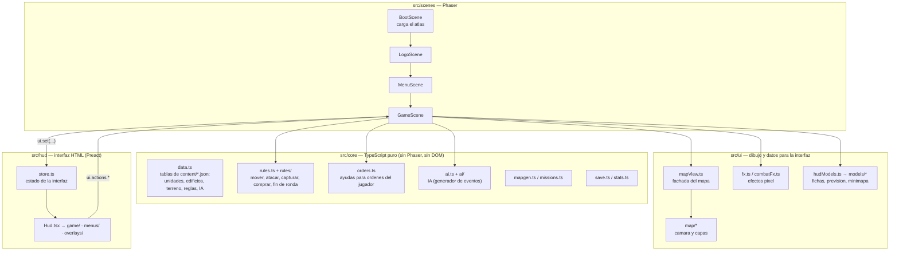
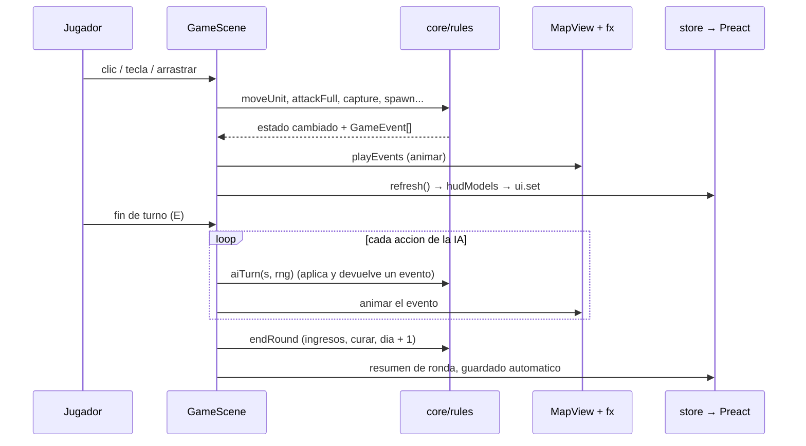

# Arquitectura

Mapa del codigo para personas y agentes de IA: que hace cada parte, como fluye un turno y por que se
tomaron las decisiones que no conviene deshacer sin pensarlo.

## Capas

- `src/core` no conoce la pantalla: se prueba con vitest, la usa la herramienta de equilibrio y la
  partida por texto (`npm run play`). ESLint prohibe que importe Phaser, Preact o el DOM.
- Las escenas orquestan: leen la entrada, llaman a las reglas, animan los eventos y publican el estado
  de la interfaz. La interfaz HTML no toca el juego: llama a `ui.actions`, que registra la escena.

### El nucleo por dentro

`rules.ts` y `ai.ts` son fachadas: reexportan lo publico de sus modulos, uno por tema, y desde
fuera de `src/core` se importa siempre de ellas (`'../core/rules'`, `'@core/ai'`). Dentro de core,
mejor del modulo concreto (`'./rules/movement'`): menos acoplamiento y sin ciclos.

`src/core/rules/` (cada modulo solo importa los de encima en la tabla; no hay ciclos):

| Modulo | Que va |
|---|---|
| `queries` | que hay en una casilla, por donde se anda, unidades de un bando, pasajeros |
| `visibility` | vision y niebla |
| `capture` | puntos de captura, capturas a medias, capturar y su evento |
| `lifecycle` | crear, quitar y limpiar unidades |
| `movement` | alcance (`moveRange`), caminos, emboscadas, distancia por tierra, mover y su evento |
| `combat` | alcance de tiro, proteccion, acierto (`HIT_MODIFIERS`), veterania, contraataque, botin, atacar |
| `forecast` | prevision de combate y zona de amenaza |
| `transport`, `supply`, `unitActions` | unir y transportes; reparar; menu de acciones y esperar |
| `economy` | ingresos, mantenimiento, limite del ejercito, comprar |
| `control`, `round` | puntos de control; fin de ronda (`ROUND_PHASES`) |
| `outcome` | victoria, derrota y objetivos de mision |

`src/core/ai/`: `context` (el `AiCtx` del turno y ayudas comunes), `scoring` (cuanto vale cada
ataque), `tactics` (retirarse, atacar, capturar, avanzar), `fire` (fuego concentrado), `unitTurn`
(prioridades de cada unidad), `production` (que fabrica), `formation` (escuadras que avanzan juntas)
y `commands` (ordenes con destino del jugador y su prevision). `ai.ts` tiene `aiTurn`, que los junta.

- **Sin estado global en la IA**: el bando que juega, el modo grupo y el plan de fuego van en un
  `AiCtx` que crea quien empieza el turno (`aiTurn`, `assistTurn`, `commandNow`) y se pasa a cada
  paso. Dos turnos, o una prevision en medio de uno, no se mezclan (lo necesitara un PvP o un
  servidor con varias partidas).
- **Puntos de extension**:
  - una regla que cambia la probabilidad de acierto es una entrada en `HIT_MODIFIERS`
    (`rules/combat.ts`); la prevision, el panel de combate y la IA la ven solas;
  - un sistema que actua cada ronda es un paso en `ROUND_PHASES` (`rules/round.ts`), en su sitio;
  - una clase de habilidad de unidad es su forma en `AbilityDef` (`content/types.ts`) y su efecto en
    `abilities.ts`, como funcion que pregunta la regla que toca (las reglas no leen `abilityOf`);
  - un comportamiento de IA nuevo (un papel de unidad) es una entrada `{ id, when, run }` en
    `UNIT_BEHAVIOURS` (`ai/unitTurn.ts`), en su sitio de la lista; `run` devuelve si ha usado la
    unidad y suele llamar a un paso de `ai/tactics.ts`;
  - una razon nueva para preferir o evitar un ataque es un termino en `ATTACK_SCORE_TERMS`
    (`ai/scoring.ts`); un tipo de orden del jugador, una entrada en `COMMAND_TURNS`
    (`ai/commands.ts`); un tipo de efecto de general, una entrada en `EFFECT_VALUES` (`aiGenerals.ts`).
- La arena (`npm run arena -- --snapshot`) copia `ai.ts` y todo `ai/`, asi que un modulo nuevo de la
  IA entra solo en la referencia.

### Herramientas

`tools/` (equilibrio, automejora, partida por texto, contenido) solo usa el nucleo, importado por su
alias: `import { UNIT } from '@core/data'` (definido en `tsconfig.json` "paths" y en
`vite.config.ts`; `tsx` lo entiende solo). ESLint prohibe que `tools/` importe nada mas de `src/`
(escenas, interfaz, ajustes) o Phaser/Preact, y que los tests importen el nucleo por ruta relativa.

Es el paso previo a un monorepo: si algun dia hace falta (un servidor para partidas online que use el
nucleo, una herramienta con dependencias propias, publicar el nucleo), `src/core` pasa a ser el paquete
`@ilogic/core` y basta con cambiar el alias. Hasta entonces, un solo paquete es mas simple.

### Interfaz HTML (src/hud)

Las escenas publican con `ui.set(...)` lo que hay que enseñar y los componentes de Preact solo lo
pintan; los botones llaman a `ui.actions.*`, que pone la escena. Cada pieza en su sitio:

| Que | Donde |
|---|---|
| El store (`ui`, `showToast`, `resetActions`...) | `store.ts` (reexporta todos los tipos: se importan de ahi) |
| Forma del estado y valor al arrancar | `state.ts` (`UIState`, `initialState`) |
| Lo que piden los botones, agrupado por pantalla | `actions.ts` (`UIActions`; su valor sin escena, en `store.ts`) |
| Tipo de lo que enseña cada panel | `vm/<panel>.ts` (`TileVM` en `vm/tile.ts`...) |
| Calculo de esos datos a partir de la partida (puro, con test) | `src/ui/models/<panel>.ts`, reexportado en `src/ui/hudModels.ts` |
| Raiz: pantalla en curso, dialogos y avisos | `Hud.tsx` |
| Paneles de la partida y donde va cada uno | `game/*.tsx`, colocados en `game/GameHud.tsx` (lista `GAME_PANELS`) |
| Pantallas del menu, pausa y final | `menus/*.tsx` |
| Dialogos (ayuda, novedades, nombre de escuadra) y avisos (carga, aviso, resumen, cartel) | `overlays/*.tsx` |
| Piezas compartidas | `common/`: `Button` (sin foco del navegador), `Btn` (menus), `Icon`, `Popover`, `Veil`, `Seg`, `useFold`/`FoldMark`, `useTipToggle`, `useUI`, formatos (`pct`, `range`...) |
| Estilos | `styles/<grupo>/<panel>.css`, juntados en orden por `hud.css` |

- **Un panel nuevo**: su tipo en `vm/`, su campo en `UIState` (null = no se ve) y en `initialState`,
  la funcion que lo calcula en `ui/models/` (con test), el componente en `game/` (o `menus/`,
  `overlays/`), su entrada en `GAME_PANELS` de `GameHud.tsx` (o `Hud.tsx`), sus acciones en `actions.ts` con su valor
  por defecto en `DEFAULT_ACTIONS`, y su hoja al final de `hud.css`.
- **Botones**: siempre `Button` (o `Btn` en los menus), que no se queda con el foco: Enter y las
  flechas son del juego (lo lleva la escena con el teclado). Solo el cuadro del nombre de escuadra
  usa botones normales, porque ahi se escribe.
- **Estilos**: cada hoja de `styles/` es un trozo seguido de la hoja de antes y `hud.css` las importa
  en ese orden, que es el de la cascada. Por eso hay alguna mezclada (`base/narrow.css`,
  `legacy.css`): mover reglas de sitio puede cambiar quien gana. Lo nuevo va al final; los colores son
  variables de `styles/base/base.css` (los mismos que `ui/palette.ts`).
- **Textos**: `t('clave')` (de `settings.ts`) busca en `src/i18n/`, un fichero por tema en `es/` y su
  traduccion con el mismo nombre en `en/` (tipada con `Translation`: si falta una clave, no
  compila). Un texto nuevo va al tema que toca en `es/` y luego en `en/`; las claves no se repiten
  entre temas (`tests/i18n.test.ts`).
- Los textos salen de `t('clave')` al pintar: por eso los componentes no se memorizan (`memo`), un
  cambio de idioma o de escala tiene que repintarlos aunque sus datos no cambien.

## Un turno, paso a paso

- Las reglas **cambian el estado y devuelven eventos**; las animaciones solo cuentan lo que ya ha
  pasado. Por eso el turno enemigo se puede repetir (semilla guardada) y acelerar sin cambiar nada.
- Todo el azar pasa por un `Rng` con semilla: la misma semilla da el mismo mapa y la misma partida
  IA contra IA (`tests/aiGolden.test.ts` lo vigila).
- `RULES`, `MAP_W` y `MAP_H` son globales del modulo `data.ts` y cambian al empezar una partida
  (`useRules`, `setMapSize`). El menu usa `keepMapSize` para no pisar el tamaño al generar miniaturas.

## Graficos

`tools/art/` (dibujos guardados de PixelLab y Retro Diffusion) → `npm run assets` →
`public/assets/img/` (cada imagen) → `public/assets/atlas/` (2 paginas) → BootScene crea la textura
`'atlas'`. El terreno nuevo se pinta una vez por partida en un lienzo (`terrainArt.ts`) con piezas
precompiladas (costas, agua, niebla); en tiempo de juego solo se colocan. Ver README, "Graficos".

## Vista del mapa

`MapView` (`src/ui/mapView.ts`) es solo la fachada que usan la escena, el menu y las pruebas: crea las
capas de `src/ui/map/`, las apila en un contenedor y les reparte `render(s, opts)` y `tick(time)`.
Cada capa hace una cosa:

| Capa (de abajo arriba) | Fichero | Que dibuja |
|---|---|---|
| terreno | `map/terrainLayer.ts` | lienzo del terreno nuevo (`terrainArt.ts`) y agua animada, o casillas de 2013 |
| quemados | `map/decals.ts` | marcas en el suelo donde cae una unidad |
| edificios | `map/buildingLayer.ts` | edificios y, ordenados por fila con ellos, montañas y bosques |
| niebla | `map/fogLayer.ts` | niebla del dibujo nuevo (lienzo, `fog.ts`) |
| resaltados | `map/overlayLayer.ts` | un Graphics que se rehace entero: lista `OVERLAYS` (abajo) |
| banderines | `map/flagLayer.ts` | banderines dibujados de puntos de control y de ordenes |
| unidades | `map/unitLayer.ts`, `map/unitMarks.ts` | un sprite por unidad, vida, primer plano, estrellas, carga, orden |
| marcas | `map/markLayer.ts` | destino y escolta de la mision, aro de las elegidas |
| efectos | contenedor `fx` | lo que ponen `fx.ts`/`combatFx.ts` (`addFx`, `ghost`) y el recuadro (`map/selectionBox.ts`) |
| cursor | `map/cursor.ts` | esquinas de la casilla señalada |

La camara (zoom entero, limites, casilla ↔ pantalla) esta en `map/camera.ts`; las cuentas de
casillas en `map/geometry.ts`; los tipos que pasa la escena (`ViewOptions`, `HighlightKind`) en
`map/viewOptions.ts` (los reexporta `mapView.ts`, igual que `Facing`, `baseFacing` y `faceFlip`).

- **Una marca nueva sobre el mapa** (zona, marco, flecha, barra): una funcion `OverlayPainter`
  (`(g, opts, ctx) => void`) en `OVERLAYS` (`map/overlayLayer.ts`), en su sitio del orden, y el
  dato que necesite en `ViewOptions`. Hoy: niebla de 2013, puntos de control, amenaza, resaltados,
  capturas, alcance, peligro, ordenes, intenciones y camino (`map/zones.ts`, `map/highlights.ts`,
  `map/orders.ts`).
- **Una capa con objetos propios**: una clase con `object` (`MapLayer`) y, si se anima por pasos,
  `tick(clock)` (`AnimatedLayer`, con `stepOf` para el paso); se apila en el constructor de `MapView`.
- **Un efecto** (animacion de un momento): una funcion en `fx.ts` o `combatFx.ts` que recibe la escena
  y un `FxHost` (la `MapView`). Las piezas comunes estan en `fxKit.ts` (`sleep`, `tween`, `fxRect`,
  `fxText`) y el dibujo de pixeles en `pixelDraw.ts` (`cornerBrackets`, `frameRect`, `fillRects`).
  Los de combate reciben un `FxTimeline` (escena + velocidad de las animaciones) y escriben sus
  esperas a velocidad normal: `timeline.wait(70)`.
- **La animacion de un `GameEvent` nuevo**: su entrada en `ANIMATORS` (`scenes/game/playback.ts`),
  una funcion `Animator<'tipo'>` que recibe el `EventStage` (escena, partida, esperas a la velocidad
  elegida). Sin ella no compila.
- Colores: `PAL` (los de `hud.css`) y `PAL_MAP` (solo del mapa) en `ui/palette.ts`.

## Decisiones (y por que)

| Decision | Por que | Que romperia deshacerla |
|---|---|---|
| Logica en `src/core` sin Phaser | Probar reglas e IA sin navegador; equilibrio con miles de partidas | Tests, `npm run balance`, `npm run play` |
| Interfaz en HTML (Preact) sobre el lienzo | Texto nitido en cualquier escala, accesible, facil de maquetar | Todo el HUD y los menus |
| Eventos en vez de animar dentro de las reglas | Repetir y acelerar turnos; la IA y el jugador comparten codigo | Repeticion del turno enemigo |
| Semillas para mapas y para la IA | Mapas compartibles por codigo; partidas reproducibles | Codigo de mapa, tests de referencia |
| Graficos compilados antes (`npm run assets`) y atlas oficial de Phaser | Carga rapida, mitad de tamaño, nada se dibuja al jugar | Rendimiento, HTML de un fichero |
| Color de bando por giro de tono desde un dibujo magenta | Una generacion por unidad (coste en RD) y bandos identicos | Arte y presupuesto de RD |
| Estado de partida reiniciado en `init()` (`resetMatch`) | Phaser reutiliza el objeto escena | Fallos al volver a jugar |
| Version en un solo fichero HTML | Jugar sin servidor (file://), compartir por correo | Releases, pruebas por file:// |
| Releases y web por GitHub Actions | La sesion de Claude no puede crear Releases; asi no hace falta | Novedades y aviso de version |

## La escena de la partida (`src/scenes/game/`)

`GameScene` es la raiz de composicion: tiene el ciclo de Phaser (`init`, `create`, `update`,
`SHUTDOWN`), el estado de la partida y la maquina de fases del turno del jugador (`accept`, `back`,
`toMap`, mover y el menu de la unidad). Lo demas son modulos de `src/scenes/game/`, cada uno con una
responsabilidad:

| Modulo | Que hace | Phaser |
|---|---|---|
| `types.ts` | `Phase`, `Intent`, constantes, `GameStartData` | no |
| `intent.ts` | que pasa al soltar la unidad elegida y por que camino (`MovePlan`) | no |
| `highlights.ts`, `menuModel.ts`, `hudParts.ts` | casillas marcadas, menu de bocadillo, prevision, panel de lo elegido, ayuda | no |
| `tutorial.ts`, `commandPreview.ts` | panel de mision y pasos del tutorial; prevision de ordenes con cache | no |
| `input.ts` | enganche del teclado y los punteros a `src/controls` (`CommandTarget`) | si |
| `pointerInput.ts` | lo que hace cada gesto en la partida (`PointerTarget`) | solo tipos |
| `groupSelection.ts` | grupo, «Elegir varias», escuadras, teclas de grupo | solo tipos |
| `carry.ts` | coger, arrastrar y soltar una unidad | si |
| `orders.ts` | acciones del registro y ordenes con destino; puntero del raton | solo tipos |
| `abilities.ts`, `labMode.ts` | habilidades del general; laboratorio de animaciones | poco |
| `playback.ts` | animar los `GameEvent` (mover, combate, captura, compra, habilidad) | si |
| `turns.ts` | fin de turno, turno de la IA, repeticion, ordenes de varios turnos | si |
| `endOfMatch.ts` | final de la partida y su pantalla | si |

- **Dependencias por interfaces pequeñas**: cada modulo declara lo que necesita de la escena en una
  interfaz `...Host` (como `PointerTarget` en `src/controls`). La escena se la da con `live()`
  (`host.ts`): los campos se leen en la escena cada vez, asi que el modulo ve siempre la partida y la
  fase del momento sin que la escena haga publicos sus privados.
- **Estado**: cada modulo es dueño del suyo (la seleccion de `GroupSelection`, `enemyPlaying` de
  `TurnFlow`...) y lo reinicia en `reset()`, que llama `resetMatch()`. La escena conserva accesores
  donde lo usan las pruebas (`group`, `multi`, `openGroupMenu`, `view`).
- **Lo que no usa Phaser se prueba** en `tests/sceneGame.test.ts`.
- Un sistema nuevo es un modulo nuevo con su `Host`; la escena solo lo crea y lo enchufa.

## Mandos

Las escenas no leen teclas, botones ni punteros: un **adaptador** de `src/controls/` (funciones
puras, sin Phaser, con tests) traduce lo que pulsa el jugador a **ordenes**, y la escena las cumple.

| Orden | Donde vale | Quien la cumple |
|---|---|---|
| `GameCommand` (`commands.ts`): cursor, aceptar, atras, deshacer, fin de turno, zoom... | el mapa y sus menus de bocadillo | `GameScene.command(cmd)` |
| `MenuCommand` (`menu.ts`): mover, aceptar, atras y atajos (opciones, notas, otro mapa) | menus de pantalla: inicio, partida nueva, campaña, opciones, notas, ayuda, fin de partida | `MenuScene.menu(cmd)`, `GameScene.menu(cmd)` (que pasan a `OptionsPanel.command`, `notesCommand`...) |
| gestos de `PointerGestures` (`pointer.ts`) | raton y dedos en la partida, incluido desplazar el mapa por el borde (`tick`, cada fotograma) | `pointerTarget()` de `scenes/game/pointerInput.ts` |

Cada escena dice donde esta el foco con `controlContext()`: `'map'` (ordenes `GameCommand`) o el menu
abierto (`'home'`, `'setup'`, `'typing'`, `'options'`, `'end'`...), que decide que teclas valen.

- **Teclado**: `keyCommand(e)` (tabla `KEY_BINDINGS`) en el mapa; `menuKeyCommand(e, ctx)` (tabla
  `MENU_BINDINGS`, una por menu) en los menus. Son las unicas tablas de teclas.
- **Raton y dedos**: la escena traduce el `Phaser.Input.Pointer` a `PointerIn` (`pointerIn`) y llama a
  `PointerGestures` (`down`, `move`, `up`, `wheel`, `leave` y `tick` en `update()`).
- **Seleccion** (`selection.ts`): como en los juegos de estrategia en tiempo real. Funciones puras que
  reciben el gesto ya decidido (clic con sus teclas y cuantas veces, recuadro) y devuelven la
  seleccion nueva (`clickSelect`, `boxSelect`); la escena solo la aplica (`applySelection`: una unidad
  que puede actuar queda elegida para moverla; varias forman el grupo, con aro a los pies). Los
  grupos con numero son escuadras con `Squad.key` (`setGroup`, `addToGroup`, `squadByKey` en
  `core/squads.ts`), y las teclas son la orden `group {n, mode}`.
- **Raton**: arrastrar con el izquierdo desde una casilla sin unidad propia es recuadro; con el
  derecho o la rueda, mueve el mapa; el derecho sin arrastrar es clic derecho (al soltar). El doble
  clic lo cuenta `PointerGestures` (`TapInfo.count`).
- **Acciones** (`actions.ts`): registro de lo que se puede hacer con lo elegido (mover, atacar,
  capturar, unirse, subir, ir alli, ordenes, escuadra). Cada accion dice cuando vale (`ok`), su texto
  y su cursor. De ahi salen el clic derecho (`smartAction`: la primera principal que vale), el menu
  completo de Alt + clic derecho, F, la pulsacion larga y la bandeja (`menuActions`) y el puntero del
  raton (`cursorFor`, dibujado en `ui/cursors.ts`). La escena le pasa lo que solo ella sabe (que
  significa soltar la unidad elegida en esa casilla) y cumple la accion (`Orders.run`, en
  `scenes/game/orders.ts`). Una accion nueva es una entrada en `ACTIONS` y un caso en `Orders.run`:
  los mandos no cambian.
- **Se quedan fuera a proposito**: el cuadro de texto del nombre de escuadra (`hud/overlays/RenameSquad.tsx`, para el
  teclado del juego mientras se escribe), `main.ts` (que Tab no mueva el foco del navegador), las
  capturas de teclas de Phaser (`addCapture`) y saltar el logo con cualquier tecla o clic (`LogoScene`;
  no es una orden, es "lo que sea").

### Añadir un mando (gamepad)

Un fichero nuevo, `src/controls/gamepad.ts`, con la misma forma que el teclado:

1. Tablas puras de botones → ordenes, p. ej. `padCommand(button): GameCommand | null` (A = aceptar,
   B = cancelar, cruceta = cursor, Start = opciones, LB/RB = zoom...) y
   `padMenuCommand(button, ctx): MenuCommand | null` (cruceta = mover, A = `ok`, B = `back`). La
   repeticion al mantener la cruceta se decide aqui (`ok` lleva `repeat`, como el teclado). Con tests.
2. En la escena, solo el enganche: leer los botones recien pulsados (`this.input.gamepad`, o la API
   `navigator.getGamepads()` en `update()`) y, segun `controlContext()`, llamar a
   `this.command(padCommand(b))` o a `this.menu(padMenuCommand(b, ctx))`. Nada mas de la escena cambia.
3. Phaser necesita `input: { gamepad: true }` en la configuracion del juego (`main.ts`).
4. La ayuda (`helpText.ts`) explica los botones.

El cursor del mapa y los menus de bocadillo ya funcionan solo con ordenes `GameCommand`, asi que un
mando puede jugar una partida entera sin raton.

## Donde mirar

| Quiero... | Fichero |
|---|---|
| Añadir o cambiar unidades y edificios (precio, daño...) | `src/core/content/*.json` (`docs/CONTENIDO.md`, skill `nueva-unidad`) |
| Cambiar terreno, reglas, pesos de la IA | `src/core/content/terrain.json`, `rules.json`, `ai.json` (+ skill `equilibrar`) |
| Cambiar una regla | su modulo en `src/core/rules/` (ver "El nucleo por dentro"; + test en `tests/`) |
| Cambiar como juega la IA | `src/core/ai/` (`unitTurn.ts` prioridades, `tactics.ts` cada paso, `production.ts` compras), pesos en `data.AI` |
| Cambiar lo que enseña una ficha | `src/ui/models/tile.ts` y `src/hud/game/Cards.tsx` (ver "Interfaz HTML") |
| Añadir un panel o una pantalla a la interfaz | `src/hud/` (ver "Interfaz HTML") |
| Cambiar el dibujo del mapa | la capa de `src/ui/map/` (ver "Vista del mapa"), `src/ui/terrainArt.ts` |
| Añadir una marca sobre el mapa o un efecto | `OVERLAYS` en `src/ui/map/overlayLayer.ts`; `src/ui/fx.ts`, `src/ui/combatFx.ts` |
| Cambiar las teclas, o añadir un mando (gamepad...) | `src/controls/` (ver "Mandos": teclas del mapa en `keyboard.ts`, de los menus en `menu.ts`) |
| Cambiar los gestos del raton o del dedo (toque, arrastrar, pellizcar, pulsacion larga, recuadro, borde de la pantalla) | `src/controls/pointer.ts` (`PointerGestures` reparte los eventos; cada gesto es una pieza pura de `src/controls/gestures/`; lo que hace en la partida esta en `src/scenes/game/pointerInput.ts`) |
| Cambiar algo de la partida en pantalla (animaciones, turno enemigo, final, seleccion...) | `src/scenes/game/` (ver "La escena de la partida") |
| Cambiar que hace un toque con el dedo | `src/ui/touch.ts` |
| Textos | `src/settings.ts` (`TEXTS.es` / `TEXTS.en`) |
| Misiones | `src/core/missions.ts` (+ skill `nueva-mision`); un tipo de objetivo nuevo, una entrada en `OBJECTIVES` (`src/core/objectives.ts`) y su frase en `OBJECTIVE_TEXT` (`src/campaign.ts`) |
