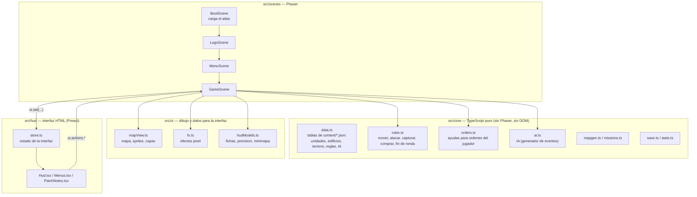
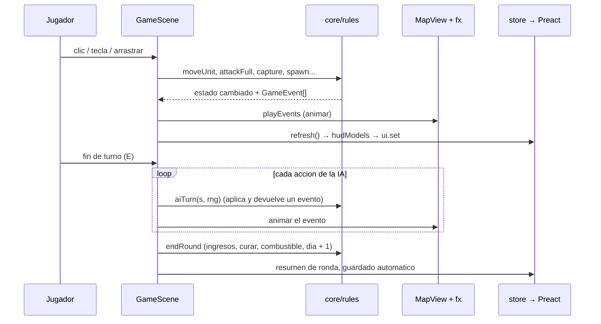

# Arquitectura

Mapa del codigo para personas y agentes de IA: que hace cada parte, como fluye un turno y por que se
tomaron las decisiones que no conviene deshacer sin pensarlo.

## Capas

- `src/core` no conoce la pantalla: se prueba con vitest, la usa la herramienta de equilibrio y la
  partida por texto (`npm run play`). ESLint prohibe que importe Phaser, Preact o el DOM.
- Las escenas orquestan: leen la entrada, llaman a las reglas, animan los eventos y publican el estado
  de la interfaz. La interfaz HTML no toca el juego: llama a `ui.actions`, que registra la escena.

### Herramientas

`tools/` (equilibrio, automejora, partida por texto, contenido) solo usa el nucleo, importado por su
alias: `import { UNIT } from '@core/data'` (definido en `tsconfig.json` "paths" y en
`vite.config.ts`; `tsx` lo entiende solo). ESLint prohibe que `tools/` importe nada mas de `src/`
(escenas, interfaz, ajustes) o Phaser/Preact, y que los tests importen el nucleo por ruta relativa.

Es el paso previo a un monorepo: si algun dia hace falta (un servidor para partidas online que use el
nucleo, una herramienta con dependencias propias, publicar el nucleo), `src/core` pasa a ser el paquete
`@ilogic/core` y basta con cambiar el alias. Hasta entonces, un solo paquete es mas simple.

## Un turno, paso a paso

- Las reglas **cambian el estado y devuelven eventos**; las animaciones solo cuentan lo que ya ha
  pasado. Por eso el turno enemigo se puede repetir (semilla guardada) y acelerar sin cambiar nada.
- Todo el azar pasa por un `Rng` con semilla: la misma semilla da el mismo mapa y la misma partida
  IA contra IA (`tests/aiGolden.test.ts` lo vigila).
- `RULES`, `MAP_W` y `MAP_H` son globales del modulo `data.ts` y cambian al empezar una partida
  (`useRules`, `setMapSize`). El menu usa `keepMapSize` para no pisar el tamaño al generar miniaturas.

## Graficos

`tools/art/` (dibujos guardados de PixelLab y Retro Diffusion) → `npm run assets` →
`public/assets/img/` (cada imagen) → `public/assets/atlas/` (2 paginas) → BootScene crea la textura
`'atlas'`. El terreno nuevo se pinta una vez por partida en un lienzo (`terrainArt.ts`) con piezas
precompiladas (costas, agua, niebla); en tiempo de juego solo se colocan. Ver README, "Graficos".

## Decisiones (y por que)

| Decision | Por que | Que romperia deshacerla |
|---|---|---|
| Logica en `src/core` sin Phaser | Probar reglas e IA sin navegador; equilibrio con miles de partidas | Tests, `npm run balance`, `npm run play` |
| Interfaz en HTML (Preact) sobre el lienzo | Texto nitido en cualquier escala, accesible, facil de maquetar | Todo el HUD y los menus |
| Eventos en vez de animar dentro de las reglas | Repetir y acelerar turnos; la IA y el jugador comparten codigo | Repeticion del turno enemigo |
| Semillas para mapas y para la IA | Mapas compartibles por codigo; partidas reproducibles | Codigo de mapa, tests de referencia |
| Graficos compilados antes (`npm run assets`) y atlas oficial de Phaser | Carga rapida, mitad de tamaño, nada se dibuja al jugar | Rendimiento, HTML de un fichero |
| Color de bando por giro de tono desde un dibujo magenta | Una generacion por unidad (coste en RD) y bandos identicos | Arte y presupuesto de RD |
| Estado de partida reiniciado en `init()` (`resetMatch`) | Phaser reutiliza el objeto escena | Fallos al volver a jugar |
| Version en un solo fichero HTML | Jugar sin servidor (file://), compartir por correo | Releases, pruebas por file:// |
| Releases y web por GitHub Actions | La sesion de Claude no puede crear Releases; asi no hace falta | Novedades y aviso de version |

## Donde mirar

| Quiero... | Fichero |
|---|---|
| Añadir o cambiar unidades y edificios (precio, daño...) | `src/core/content/*.json` (`docs/CONTENIDO.md`, skill `nueva-unidad`) |
| Cambiar terreno, reglas, pesos de la IA | `src/core/content/terrain.json`, `rules.json`, `ai.json` (+ skill `equilibrar`) |
| Cambiar una regla | `src/core/rules.ts` (+ test en `tests/`) |
| Cambiar como juega la IA | `src/core/ai.ts`, pesos en `data.AI` |
| Cambiar lo que enseña una ficha | `src/ui/hudModels.ts` y `src/hud/Hud.tsx` |
| Cambiar el dibujo del mapa | `src/ui/mapView.ts`, `src/ui/terrainArt.ts` |
| Textos | `src/settings.ts` (`TEXTS.es` / `TEXTS.en`) |
| Misiones | `src/core/missions.ts` (+ skill `nueva-mision`) |
