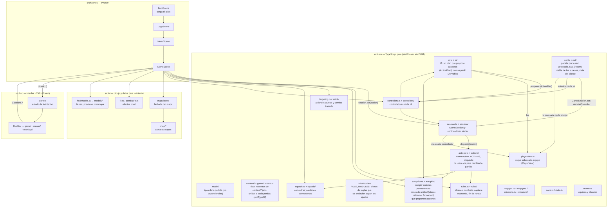
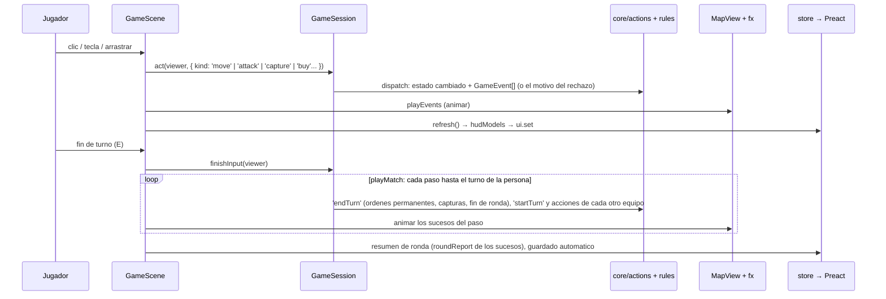

# Arquitectura

Mapa del codigo para personas y agentes de IA: que hace cada parte, como fluye un turno y por que se
tomaron las decisiones que no conviene deshacer sin pensarlo.

## Capas



- `src/core` no conoce la pantalla: se prueba con vitest, la usa la herramienta de equilibrio y la
  partida por texto (`npm run play`). ESLint prohibe que importe Phaser, Preact o el DOM.
- Las escenas orquestan: leen la entrada, mandan acciones (`dispatch`), animan los sucesos que
  devuelven y publican el estado de la interfaz. La interfaz HTML no toca el juego: llama a
  `ui.actions`, que registra la escena.

### El nucleo por dentro

`actions.ts`, `rules.ts`, `ai.ts`, `autopilot.ts`, `session.ts`, `controllers.ts`, `squads.ts` y
`net.ts` son fachadas: reexportan lo publico de sus modulos, uno por tema, y desde fuera de `src/core` se importa
siempre de ellas (`'../core/rules'`, `'@core/actions'`); ESLint no deja que la escena, la interfaz
ni las herramientas importen los modulos de dentro. Dentro de core, mejor del modulo concreto
(`'./rules/movement'`): menos acoplamiento y sin ciclos. **La IA es un jugador mas**: las reglas,
las acciones, las ordenes permanentes (autopilot/) y la sesion no importan nada de la IA (ai/,
ai.ts, controllers/); ESLint lo vigila (`NO_AI`) y `tests/layers.test.ts` comprueba
que `session.ts`, `actions.ts`, `autopilot.ts` y `rules.ts` no la cargan ni de lejos. La IA
reutiliza autopilot/. Y **quien decide solo propone**: la IA y autopilot/ no importan dispatch, las
acciones ni la sesion, no se hacen su propia vista de la partida y no tiran de los dados
(`DECIDERS_ONLY_PROPOSE`; tests/layers.test.ts comprueba que `ai.ts`, `autopilot.ts` y
`playerView.ts` no cargan dispatch ni la sesion). Los modulos de `rules/` y `squads/` tienen, ademas de sus consultas,
los pasos con los que se cambia la partida (`advanceCapture`, `mergeInto`, `earn`, `spendUnit`,
`giveStandingOrder`, `formSquad`...): solo los llaman el `apply` de las acciones, los pasos de ronda
y de turno, las `INVARIANTS` y lo que prepara una partida. La IA, autopilot/, la sesion, los
controladores, la vista y lo que apunta la escena (`targeting.ts`, `trail.ts`) no los importan
(`APPLY_STEPS`, eslint.config.js; tambien los del clima, los generales y las estadisticas:
`advanceWeather`, `appointGeneral`, `applyPower`, `recordEvents`...), y las fachadas no los dan
(tests/lintImports.test.ts, que ademas busca con los tipos de TypeScript toda funcion del nucleo que
escribe en la partida, `tests/stateWriters.ts`, y falla si no esta en la lista de su modulo). Los de
la raiz del nucleo (clima, generales, estadisticas, `changeSettings`), que no tienen fachada que los
esconda, tampoco se pueden importar desde src/ ni tools/ (`ROOT_STEPS`): las
herramientas y los tests que preparan una partida a mano ponen sus unidades con `newUnit` de
`core/measure.ts`.

### Acciones: la unica via para cambiar la partida

Quien juega un equipo (la persona en la pantalla, la IA, `npm run play`, el jugador al azar del
fuzz, la huella) cambia la partida mandando una **accion**: `dispatch(s, team, action)`
(`core/actions.ts`). Una `GameAction` (`model/actions.ts`) son datos, con uids y casillas (nunca
objetos de la partida): se puede guardar, repetir o mandar por la red.

```ts
const result = dispatch(s, viewer, { kind: 'attack', uid: tank.uid, target: enemy.uid });
if (result.ok) await play(result.events); // si no, result.reason dice por que ('notTarget', 'spent'...)
```

- Las `INVARIANTS` son de las reglas (`rules/invariants.ts`): las repasan `dispatch` despues de cada
  accion y `endRound` al acabar la ronda, asi que ninguno de los dos copia sus pasos.
- `dispatch` pasa las comprobaciones comunes (`ACTION_GUARDS`, `actions/guards.ts`, en orden: que
  tenga la forma de una accion, `isGameAction` con `ACTION_SHAPES` de `actions/shape.ts`, o
  `'badAction'`; que la mande un equipo de la partida, `'notATeam'`; que la partida no se haya
  decidido, `'matchOver'`; que sea su turno, `'notYourTurn'`, y que lo haya empezado,
  `'turnNotStarted'` (estas dos, `turnOnly`, no cuentan para las acciones con `anyTime`: rendirse
  vale en cualquier momento, como pide una partida por la red o con varias personas); que ese equipo
  no haya perdido, `'defeated'`, salvo para pasar el turno), el `validate` de la accion, su `apply`
  (con los dados de la partida, `diceOf(s)`), despues las `INVARIANTS` (`rules/invariants.ts`: fuera
  los muertos, las capturas cuya unidad se ha ido, las escuadras vacias, el dinero por encima del
  maximo, los movimientos que ya no se pueden deshacer) y apunta los sucesos en las estadisticas
  (`recordEvents`, stats.ts: de todos, se animen o no). Las invariantes no saben de acciones;
  `dispatch` tampoco: lee lo que dice la entrada del registro.
- `ACTIONS` (`actions/registry.ts`) tiene una entrada por accion (el tipo obliga), cada una en el
  modulo de su tema (`movement`, `combat`, `capture`, `transport`, `units`, `economy`,
  `standingOrders`, `squads`; la de los poderes, `POWER_ACTIONS`, vive con ellos en `generalPowers.ts`). `validate(s, team, action)` lo calcula todo desde la partida (alcance,
  vision, dinero, de quien es cada unidad): no se fia de nada que traiga la accion. `apply` usa las
  piezas de `rules/` y `squads/` y devuelve los sucesos.
- `actionProblem`/`isValidAction` preguntan lo mismo sin cambiar nada. El menu de una unidad sale de
  ahi: `UNIT_MENU` (`actions/menu.ts`) dice con que acciones se cumple cada opcion y
  `availableActions(s, team, unit)` ofrece, en ese orden, las que tienen alguna que vale (la escena
  solo añade «Atras», en el sitio que dice `BACK_GOES_BEFORE`). Lo que se manda a unas unidades
  elegidas (un grupo, la bandeja) sale igual de `SELECTION_MENU` y `canDoWithSelection`; las
  opciones que son las mismas con una sola unidad (las ordenes, quitarlas) salen de ahi tambien
  (`ORDER_OPTIONS` dice cual es cada orden), y mover un grupo es su plan (`groupMoveOrder`,
  `groupMoveStep`), que la escena cumple paso a paso. Los mandos (`controls/actions.ts`,
  `INPUT_ACTIONS`) solo preguntan ahi y añaden lo que es de la interfaz. Lo que pasaria al soltar la
  unidad en otra casilla tambien lo dice el nucleo (`targetProblem`, `canCaptureAt`).
- Un solo deshacer, en el nucleo: la accion `undoMove`. La partida apunta cada movimiento
  (`GameState.undoableMoves`, con la captura a medias que perdio la unidad al irse; `rules/undo.ts`)
  y los deja mientras lo de despues no cuente nada nuevo de la partida: las entradas con `keepsUndo`
  (mover, deshacer, esperar, viajes, escuadras, ordenes); tras cualquier otra del equipo que juega,
  dispatch los olvida (`forgetUndoableMoves`; una de otro fuera de su turno, rendirse, no). El paso
  de un viaje no se deshace (seria un movimiento gratis). La invariante 'undoWindow' olvida los de
  unidades que ya no estan como las dejo su movimiento (caen, suben a un transporte o vuelven a
  estar listas con la ronda nueva). Se deshace siempre el ultimo (`lastUndoableMove`,
  `undoMoveProblem`), uno tras otro; si al moverse descubrio enemigos (`revealed`), no
  (`'revealed'`): con niebla seria mirar gratis. «Atras» del menu de la unidad y Ctrl+Z mandan
  `undoMove` con la misma funcion (y avisan si el nucleo dice `'revealed'`). Si el movimiento acabo
  una orden de ir alli, deshacerlo la devuelve (`UndoableMove.goto`, con su suceso 'standingOrder').
- «Ir alli» (el viaje de varios turnos) es una orden permanente mas: `StandingOrder` de tipo 'goto'
  (reglas del viaje en `rules/travel.ts`). Se da con 'giveStandingOrder' como las demas, a una
  casilla que la unidad pueda pisar, a la que no llegue ya este turno —`'withinReach'`: para eso se
  mueve— y hacia la que pueda dar ya un paso (`travelProblem`, su `block` en `STANDING_ORDER_TYPES`), y se
  quita con 'cancelStandingOrder'. Es siempre de cada unidad (nunca de su escuadra: `unitOnly`) y
  manda sobre la de su escuadra mientras dura. Cada orden dice cuando se cumple
  (su `moment`, `momentOf`): la de ir alli al empezar el turno (la fase 'gotoOrders' de
  `TURN_START_PHASES`: su paso, 'gotoStep', hacia la casilla del alcance que mas acerca,
  `travelStepOf`, y despues quien juega puede seguir con ella), las de pelear al acabarlo. Si ya
  esta en el destino o llega este turno, la orden se cumple sin moverla (el ultimo trozo lo hace
  quien juega: puede seguir, atacar o capturar); un camino cortado (`interruption`, la emboscada)
  tambien la cumple: su suceso es 'standingOrderDone' con como acabo (`end`: 'arrived',
  'withinReach' o la clase del corte), y la escena avisa «llega» solo con 'withinReach'. Moverla a
  mano ('move', 'load', 'merge', y 'attack' sin haberse movido aun) la acaba (`endGotoByHand`, con
  el suceso de quitarla); capturar, esperar o atacar despues del paso, no. El paso no se deshace
  (seria un movimiento gratis); si un movimiento a mano la acabo, deshacerlo la devuelve
  (`UndoableMove.goto`). La interfaz enseña la de ir alli como una flecha hasta el destino
  (`gotoDestination`) y las de pelear con su bandera (`turnEndOrderOf`).
- **Turnos**: la partida sabe de quien es el turno (`GameState.turn`, en el orden de la ronda
  `turnOrder`, que pone el modo; `turnStarted`). 'startTurn' lo empieza (`TURN_START_PHASES`, en
  actions/turn.ts: las ordenes de ir alli dan su paso, `assistTurn` de 'turnStart') y 'endTurn' lo
  acaba (`TURN_END_PHASES`: las ordenes de pelear del equipo se cumplen, `assistTurn` de 'turnEnd', y las unidades que se han quedado sobre un
  edificio que pueden capturar siguen capturando, `autoCapturers` en rules/capture.ts) y lo pasa al
  siguiente que juega (`nextTurn`, rules/turnOrder.ts: los derrotados no); tras el ultimo del orden,
  el fin de ronda (`endRound`, con `roundPhasesOf`). Sus sucesos: 'turnStart' y 'turnEnd'. Cada paso
  de turno hace acciones del equipo (las mismas entradas de ACTIONS, con su validate). Las fases son
  acciones mandadas por el mismo camino que las demas (el `ActionDispatcher` que recibe el `apply`
  de las acciones de turno, y solo ellas: `CompositeActionDefinition`; guardas, validate,
  invariantes) y sus sucesos se cuentan una vez en las estadisticas; el modo puede añadir las suyas
  (`turnPhases`). Las ordenes permanentes son una regla para todos los equipos (la persona, la IA o
  un jugador por la red), no del controlador: las cumple core/autopilot, no la IA. 'startTurn' y
  'endTurn' solo los manda la sesion (`isTurnBoundary`; `session.act` los rechaza con
  'sessionOnly'). Rendirse es la accion 'surrender' (`TeamState.resigned`: cuenta como derrotado),
  en su turno o fuera de el (`anyTime`); el menu solo lo ofrece si la partida se puede perder
  (`canBeLost`: el laboratorio no; el nucleo tampoco lo deja, 'cannotLose'), y guardar, si su modo se
  guarda (`saves`; `gameMenuOf`).
- Lo que cambia la partida y no es de quien juega se queda fuera de `dispatch`: preparar una partida
  (`buildMatch`, `newGameState`, `newUnit`, `appointGeneral`).
- **Una accion nueva**: su forma en `GameAction` (`model/actions.ts`) y la de cada campo en
  `ACTION_SHAPES` (`actions/shape.ts`; el tipo la pide), su suceso en `GameEvent`
  (`model/events.ts`) y su entrada en el modulo de `actions/` que toque (con `keepsUndo` si no
  cuenta nada nuevo de la partida y deja deshacer lo de antes, y con `anyTime` si vale fuera del
  turno, como rendirse); si se ofrece en el menu de una unidad, su entrada en `UNIT_MENU`; si se
  puede mandar a unas unidades elegidas, en `SELECTION_MENU` (y en `INPUT_ACTIONS` y
  `ACTION_RUNNERS` de los mandos y la escena); su animacion en `ANIMATORS`
  (`scenes/game/playback.ts`). Lo comun a todas las acciones es una entrada en `ACTION_GUARDS`; lo
  que hay que limpiar despues de cualquiera (y de cada ronda), una en `INVARIANTS`, que devuelve sus
  sucesos.

### Sucesos

Cada accion y el fin de ronda devuelven sus sucesos (`GameEvent`, `model/events.ts`), completos para
contar lo que ha pasado sin mirar la partida: quien lo hizo (`actor`: el equipo que mando la accion,
o null en los del fin de ronda), a quien (uids), tipos y casillas. El ataque nombra a su objetivo
por uid (`target`) y su casilla (`at`) y lleva como estaban las dos (`combat`), el botin y la carga
que gana cada general (`charge`); la compra, el tipo y el equipo; la captura, siempre los puntos que
quedan. Lo que dejan en orden las `INVARIANTS` tambien se cuenta, detras de los de la accion y sin
actor: `cargoLost` (los pasajeros de un transporte que cae; tambien al retirarlo), `captureDropped`
(una captura a medias cuya unidad se ha ido), la escuadra que se queda vacia y `fundsCapped` (el
dinero que pasaba del maximo; botin, poderes e ingresos se cuentan enteros y lo perdido va aqui,
porque el tope se aplica al acabar la accion o la ronda, no al cobrar). Cada escuadra que desaparece
tiene un solo suceso `squad` (`SquadChange`): `change: 'disbanded'` si su equipo la deshace, o
`change: 'removed'` si se queda vacia; si la vacia una accion (salir, formar otra con sus unidades),
lleva el equipo de esa accion como actor y va antes que el `formed` o `grouped`; si la vacia la
partida (caen sus unidades), la cuenta la invariante sin actor. Los numeros de escuadra no se
reutilizan (`nextSquadId`). Con ellos
se anima (`ANIMATORS`), se cuentan las estadisticas (`recordEvents` en dispatch, por el `actor`) y se resume el
fin de ronda (`roundReport(s, events)`: lo que enseña la escena; cada parte del resumen es una
`ROUND_REPORT_PARTS` de siempre, ingresos y curas, o una `roundReportParts` de su modulo: control,
mantenimiento, clima; el resumen solo tiene la parte de un modulo si este la ha apuntado, y cada
modulo dice su forma ampliando `RoundReportParts` con `declare module`). `endRound` devuelve los suyos:
`income`, `heal`, `upkeep`, `controlPoint`, `newDay`, `weather` (cada paso del fin de ronda, `roundPhasesOf`, da los
que tiene; el ultimo, 'army', apunta el valor de cada ejercito del dia nuevo) y, al final, los de
las `INVARIANTS`, que `endRound` tambien repasa (`fundsCapped`...). Van dentro de los del 'endTurn'
que acaba la ronda.

### Las piezas del nucleo

Las piezas de abajo, que usa todo lo demas (los detalles, debajo de la tabla):

| Pieza | Que va |
|---|---|
| `model/` | los tipos de la partida; solo tipos (ESLint lo vigila) |
| `content/` | el contenido (JSON validados) resuelto en tipos con nombre y catalogos por id; ver docs/CONTENIDO.md |
| `gameContent.ts` | el contenido de cada partida (`s.content`) y sus atajos (`unitTypeOf`, `terrainAt`...); `cloneState` |
| `modes.ts` | `GAME_MODES`: lo que fija cada modo de juego (congelado; se lee con `gameModeOf`) |
| `match.ts` | empezar una partida: `MatchConfig`, `MATCH_SETUPS`, `buildMatch`, `skirmishConfig`, `rematchOf` |
| `gameState.ts` | `newGameState(...)`: el unico sitio que escribe la forma de una partida nueva |
| `dice.ts`, `turnSeeds.ts` + `util/random.ts` | el azar: los dados de la partida (`diceOf`), la semilla de las decisiones de cada turno (`turnSeedOf`; quien decide, de su vista: `decisionRngOf`, playerView.ts), el `Rng` con semilla (`seededRng`) y elegir al azar (`pick`, `weightedPick`) |
| `playerView.ts` | lo que sabe cada equipo (`PlayerView`, con lo que no sabe en `FOG`), un plan con la vista al dia (`seeing`), su azar (`decisionRngOf`) y una copia con su niebla para simular (`foggedCopy`) |
| `settingsSchema.ts` | `SETTINGS_SCHEMA`: que valores puede tener cada ajuste |
| `matchSettings.ts` | `settingsWith(contenido, cambios)`: los ajustes por defecto con cambios (`MatchSettings`, `s.settings`) |
| `ruleModules/` | los modulos de reglas (`RULE_MODULES`) y lo que aporta cada uno a las listas de las reglas (`RuleHooks`); ver "Modulos de reglas" |
| `abilities.ts` | lo que hace cada clase de habilidad de las unidades (`ABILITY_EFFECTS`; lo enchufa el modulo `abilities`) |
| `generals.ts`, `generalPowers.ts` | el general de cada equipo (ventaja fija, carga, ronda, reconocimiento) y sus poderes (`POWER_EFFECTS`: casilla, area, efecto y valor para la IA; `powerBlock`, `applyPower`) |
| `weather.ts` | el clima de la partida: cual hay, el pronostico y como cambia (lo enchufa el modulo `weather`) |
| `damage.ts` | como sale el daño (`DamageModel`: la tirada y su reparto); cada modelo por su nombre en `DAMAGE_MODELS` (el ajuste `damageModel`: `shotByShot`, `spread`), construido una vez por partida (`damageModelOf`); solo usa `model/` |
| `teams.ts` | los equipos de la partida: alianzas, enemigos, quien los juega (ver "Equipos") |
| `data.ts` | constantes que no son contenido (`MAP_SIZES`, `MAP_MIN`/`MAP_MAX`, `MAX_LIFE`) |
| `defaultGames.ts` | partidas con el contenido del juego: `createMatch`, `loadGame` |
| `save.ts` + `savedParts.ts` + `saveVersion.ts` | guardar y leer (`readSave`): solo el formato de ahora |
| `util/grid.ts`, `mapGrid.ts` | rejillas (`Grid<T>`, `GridBounds`) y el mapa de una partida como rejilla (`mapGrid(s)`) |
| `geom.ts` | `posOf`, rombos (`diamond`, `neighbors4`), cuadrados (`squareArea`), `posKey` |
| `util/validation.ts` | comprobar lo que viene de fuera: `isInt`, `isPos`, `isPosOn` (e `isEntryId`, en content/catalog.ts) |

#### Los tipos y el contenido

- `model/`: `GameState`, `Unit` y su `UnitTurnState`, `Building`, `GameAction`, `GameEvent`,
  `StandingOrder`, `Squad`, `UndoableMove`, `MatchResult`, `GameModeId`, `MatchSettings`, `Rng`,
  `Dice`... No importa nada ni exporta constantes o funciones.
- `content/`: los JSON validados se resuelven al cargar en tipos con campos con nombre (`UnitType`,
  `BuildingType`, `TerrainType`, `WeatherType`, `Theme`, generales y sus poderes), cada uno en un
  catalogo por id (`Catalog`: `list` en el orden del fichero y `byId`; `findEntry`/`entryOf`).
  `loadContent(ficheros)` da un `GameContent` congelado; `content/default.ts`, el del juego
  (`defaultContent()`, perezoso).
- `gameContent.ts`: el contenido de cada partida es un campo, `GameState.content` (en el modelo,
  `MatchContent`; content/index.ts le da la forma de `GameContent`). Lo ponen `newGameState` y
  `readSave`, no se guarda (`serialize` escribe `SavedGameState`) y se lee como `s.content` o con
  los atajos que dan el tipo resuelto: `unitTypeOf(s, unit)`, `buildingTypeOf`, `isHq`,
  `terrainAt(s, pos)`, `themeOf(s)`, `weatherTypeOf(s, id)` (los pesos de la IA, `content.ai`, los
  lee quien juega por su perfil: ver "La IA") (y
  `findUnitType`/`findBuildingType` para lo que viene de fuera). Las partidas guardan ids
  (`unit.type = 'Tank'`), nunca el puesto en el fichero; `cloneState(s)` copia la partida y comparte
  el contenido.
- `data.ts`: las tablas del generador de mapas (`mapgen.json`) y los temas (`themes.json`: letras de
  los mapas en texto, probabilidades de terreno) son contenido, y tambien los tipos de movimiento
  (`movements.json`, `content.movements`: `MoveType` es su id; el generador mide la tierra con el
  de `mapgen.json`, "landMovement", y la escena dibuja segun su `motion`, que lleva cada tipo de
  unidad: `unitType.motion`).

#### Modos y partidas nuevas

- `modes.ts`: lo que fija cada modo (`GameState.mode`: escaramuza, mision, partida para mirar): como
  se acaba (`victory`, en orden), el orden de los turnos de cada ronda (`turnOrder`: se fija al
  crear la partida y se guarda con ella), las reglas que impone (`fixedSettings`, que aplica
  `buildMatch`: la partida para mirar no tiene clima), sus pasos de turno (`turnPhases`, detras de
  los de siempre) y si la pantalla guarda sola al empezar el turno de una persona
  (`saves`). Esta congelado. Cada partida resuelve su modo al crearse o leerse, como sus modulos de
  reglas (`s.ruleset.mode`), de un registro (`GameModeRegistry`; los del juego, `GAME_MODES`), y
  todo lo lee por `gameModeOf(s)` (las reglas, la sesion, la preparacion). Asi otro modo (uno de
  prueba, uno de un servidor) se juega sin tocar nada global: su nombre en `GameModeIds`
  (model/match.ts, `declare module`, como ModuleEvents) y su definicion en el registro que se da a
  `newGameState({ modes })`, `buildMatch(config, { modes })` o `readSave(json, contenido, modes)`
  (tests/modeHooks.test.ts lo hace asi). Un modo del juego nuevo es su nombre en `GameModeIds`, su
  entrada en `GAME_MODES` y, si se empieza desde una configuracion, esta en `MatchConfig` y su
  forma de prepararse en `MATCH_SETUPS` (el compilador pide las dos).
- `match.ts`: `MatchConfig` son datos (`SkirmishConfig`, `MissionConfig`, `SandboxConfig`);
  `MATCH_SETUPS`, como se prepara cada modo; `buildMatch(config, { content, mapRng? })`, con su
  clima y la muestra del ejercito del primer dia. Todo lo de la partida va en la configuracion, nada
  se cambia despues: los generales en `MatchTeam.general`, y empezar cada equipo en el sitio del que
  va k puestos detras en `rotateStarts: k`, con cualquier numero de equipos (la herramienta de
  equilibrio; con dos y 1, se cambian). `skirmishConfig` pone lo de
  siempre en lo que no se elige (mapa de `DEFAULT_MAP_SIZE`, tema al azar, reglas por defecto);
  `rematchOf(s)` da la revancha. La usan la pantalla, `npm run play`, las herramientas y los tests:
  una misma semilla da la misma partida en todos (K4).
- `gameState.ts`: `newGameState({ map, settings, content, mode, teams, seeds, firstTeam?, theme? })`
  lo usan mapgen, misiones, laboratorio, duelos y tests. Quien la crea dice sus equipos (`teams:
  duel('human', 'ai')` o una lista de `TeamSetup`) y las semillas de su azar (`seeds`: dados y decisiones, una aparte de la otra; ver "El azar").
- `defaultGames.ts`: `createMatch(config, mapRng?)` y `loadGame(json)` (lo que usa la web). Con `content/default.ts`, el unico sitio del nucleo que conoce el contenido del
  juego (ESLint).
- `settingsSchema.ts`: cada regla es un interruptor o un numero (entero o no, en un intervalo, quiza
  null). La usan el contenido (settings.json) y el guardado; settings.schema.json dice lo mismo para los
  editores (lo comprueba un test). `settingsWith` usa `content.defaultSettings`; nunca `{ ...ajustes, ...
  }` a mano.
- `teams.ts`: `teamState`, `isHostile`/`areAllied`, `isHostileOwner`/`isAlliedOwner`,
  `enemiesOf`/`alliesOf`, `teamsControlledBy`, `isAiControlled`, `playerTeam`, `perTeam`,
  `duel`/`duelTeams`, `newTeams`.

#### El azar

Los dados de las reglas (el combate) son de la partida: `GameState.dice` es el estado de un
mulberry32 (un entero de 32 bits) y `diceOf(s)` tira de el, asi que se guarda y se repite con la
partida. Las decisiones de la IA tienen su propio azar, tambien de la partida pero aparte:
`GameState.decisionSeed` (fija; quien crea la partida la saca aparte de la de los dados: `MatchSeeds`,
`matchSeedsFrom(semilla)` para una mision o un laboratorio, dos tiradas distintas del generador en
mapgen; no es un secreto: con una, la otra sale probando las 2^32 semillas, unos 10 s) y, para cada
turno, `turnSeedOf(s, equipo)` (turnSeeds.ts: la semilla del turno, `turnSeed`, mezcla la de la
partida, el dia y el equipo). Quien decide no la saca de la partida: la vista se la da
(`PlayerView.turnSeed`) y su azar es `decisionRngOf(vista)`; en la vista la semilla de la partida es
0, asi que `turnSeedOf(vista.state, ...)` daria siempre lo mismo, y por eso ESLint no deja a la IA ni
a autopilot/ importar `dice.ts` ni `turnSeeds.ts` (`DECIDERS_ONLY_PROPOSE`). Asi el mismo turno da las mismas decisiones al cargar la partida, al
repetirla o en otra maquina (por la red), y lo que decide no cambia lo que sale en los dados. El
generador de mapas lleva su `Rng` (`seededRng`), que da quien crea la partida. `util/random.ts`: el
paso de mulberry32 (`randomStep`), `seededRng`, `seedFromDraw`, `matchSeedsFrom`, `turnSeed`, y
elegir al azar (`pick`, `weightedPick` con lo que sale si no hay a quien elegir; con la lista vacia no
tiran), un entero entre dos (`randomInt`) y barajar (`shuffleInPlace`). El clima del dia tiene su azar,
de la semilla del mapa y del dia (`weatherSeed`, weather.ts).

#### Guardar y leer

- `readSave(json, contenido)` da `{ ok, state }` o `{ ok: false, error }` con el `SaveError` de la
  parte rota (`badVersion`, `badMap`, `badUnits`, `badSettings`...); `deserialize` es su atajo que da
  null. El contenido no va en la partida: lo da quien lee.
- El JSON leido es un `SavedGame` (sus campos, `unknown`) hasta que se ha comprobado entero;
  `savedParts.ts` comprueba o limpia cada parte (lo opcional roto se quita) con lo que necesita
  (`SaveFrame`: contenido, bordes del mapa, cuantos equipos), y leer no cambia nada mas (ni
  escuadras ni teclas). Lo que la partida siempre guarda tiene que estar: no se rellena con valores
  por defecto (una regla que falta es `badSettings`).
- Cada partida guarda la version de su formato (`SAVE_VERSION` en saveVersion.ts, ahora 12, atada al
  tipo de `GameState.version`) y **solo se lee la de ahora**: no hay migraciones. Mientras el juego no
  ha salido, cambiar lo que se guarda es subir la version, y las partidas guardadas con una de antes
  se descartan (`badVersion`): el menu no ofrece Continuar y, al intentar cargarla, se borra el hueco.
- Se prueba con partidas creadas por el codigo de ahora (`tests/readSave.test.ts`), sin ficheros
  guardados.

#### Rejillas y casillas

`Grid<T>` tiene `at`, `atClamped`, `set`, `contains`, `forEach`, `cells`, `createLayer`,
`width`/`height`; `GridBounds` (tamaño y `contains`) es para lo que solo mira los bordes.
`mapGrid.ts`: `mapGrid(s)`, `terrainAt`, `isOnBoard`, `createLayer(s, fill)`. Los rombos y cuadrados
de `geom.ts` reciben los bordes y solo dan casillas de dentro; `posOf` copia la casilla de una
unidad o edificio.

**El estado es la unica fuente de la partida**: los ajustes van en `s.settings` (obligatorios; de ellos salen los modulos de reglas que lleva), el tamaño
del mapa en `s.map`, los equipos en `s.teams` y el contenido va unido a la partida (`s.content`); no hay variables de modulo
con la partida en curso, y dos partidas con otro tamaño, otras reglas u otro contenido se juegan a la
vez en el mismo proceso (tests/gameContent.test.ts, tests/mapSizes.test.ts). Las consultas no la cambian
(`statsOf`, `captureProgress`); lo que la cambia son las acciones (`dispatch`), el fin de ronda y lo
que la prepara, y lo dice en el nombre (`recordEvent`, `newUnit`...).

`src/core/squads/` (escuadras y ordenes permanentes del jugador): `queries` (unidades de una
escuadra), `naming` (nombres y teclas de grupo), las ordenes permanentes en tres piezas
(`standingOrderTypes`: que es cada tipo; `standingOrderQueries`: que orden cumple cada unidad, la de
su escuadra o la propia, y si se puede dar; `standingOrderSteps`: los pasos que las cambian, lo que
prohibe `APPLY_STEPS`), `membership` (formar, meter, sacar, deshacer; no hace sucesos) y `events` (el suceso
de una escuadra, `squadEvent`): las piezas con las que se hacen las acciones de escuadras y ordenes
(`actions/squads.ts`, `actions/standingOrders.ts`); la fachada `squads.ts` solo da las consultas.
Las cumple la partida al acabar el turno de cada equipo, sea quien sea quien lo juegue (la fase
'standingOrders' de `TURN_END_PHASES`, con `assistTurn` de `autopilot/standingOrders.ts`).
`targeting.ts` y `trail.ts`: desde donde atacar (con la regla del ataque, `attackProblem` con
`from`) y el camino trazado con el cursor, para la escena.

`src/core/rules/` (cada modulo solo importa los de encima en la tabla; no hay ciclos):

| Modulo | Que va |
|---|---|
| `queries` | que hay en una casilla, por donde se anda (`canMoveOn`, `movementOf`), unidades de un equipo, pasajeros |
| `unitTurn` | el turno de cada unidad (`Unit.turnState`) y la unica forma de cambiarlo (ver abajo) |
| `funds` | el dinero: `earn`, `pay` (paga lo que haya) y `capFunds` (lo que pase del maximo se pierde al acabar cada accion y cada ronda) |
| `visibility` | vision y niebla (la de toda la alianza), enemigos a la vista y que se le enseña a cada equipo |
| `capture` | puntos de captura, capturas a medias (`captureProgress`), capturar y su suceso, `autoCapturers` |
| `lifecycle` | crear, quitar y limpiar unidades (`removeWithCargo`, con su `cargoLost`) |
| `undo` | los movimientos que se pueden deshacer (`undoableMoves`), el ultimo, por que no y su invariante |
| `falls` | si un equipo ha caido y por que (`currentDefeat`) y cuando cayo (`recordFalls`, `fallOf`, `lastFallen`) |
| `invariants` | `INVARIANTS` y `restoreInvariants`: lo que se deja en orden tras cada accion y cada ronda, con sus sucesos |
| `movementProfile` | como se mueve cada tipo: por donde entra y lo que le cuesta (`TerrainAccess`), lo que puede gastar (`MovementProfile`), `pathCost` |
| `passage` | lo que le hacen las demas unidades a quien se mueve (las `passRules` de los modulos; si ninguna dice nada, cierra el paso: `surroundingsOf`) y donde tiene que pararse; lo mismo para medir (`passBlockers`) y si se atraviesa a los aliados (`letsAlliesThrough`: lo que dice el `allies` de las reglas, sin unidad de ejemplo) |
| `distance` | pasos por tierra sin limite (`distanceMap`: 0 en el origen, Infinity donde no se llega) y lo que corta el paso al medir (`Blockers`: `noBlockers`, `unitsBlock` o `passBlockers`) |
| `movement` | la regla de cada paso (`stepAllowed`), alcance (`moveRange`), caminos (`plannedPath`, `validPath`, `approachPath`) y el paso hacia algo (`stepToward` con un `Approach`) |
| `traverse` | recorrer de verdad un camino (`traverse`, `moveAlong`): lo corta el primer `pathInterruptions` de los modulos que llega (la emboscada); el suceso de mover lleva el corte (`interruption: { kind, at }`) |
| `travel` | la orden de ir alli (varios turnos): a donde (`travelProblem`), el paso de cada turno (`travelStepOf`) y como acaba (`finishGoto`, `endGotoByHand`) |
| `engagement` | un combate como pregunta (`Engagement`: atacante y defensor como `Fighter`, con casilla y vida): lo hipotetico sin fingir unidades |
| `weapons` | lo que dice el arma de cada tipo: `inAttackRange`, `basePower`, `canDamage` |
| `attackRecord` | un ataque recien empezado (`newAttackRecord`) y quien ha caido (`fallenIn`); la forma, `AttackRecord`, con las partes de los modulos (`AttackRecordParts`), en `model/combat.ts` |
| `combat` | desde donde y a quien se dispara, proteccion, acierto (`HIT_MODIFIERS` y los de los modulos), daño esperado, contraataque (`canCounter`), tirada |
| `forecast` | prevision de combate (`combatForecast` de un `Engagement`) y zona de amenaza |
| `transport`, `supply` | unir y transportes (`mergeProblem`, `loadProblem`, `unloadProblem` y como se hacen); reparar |
| `economy` | ingresos, mantenimiento, limite del ejercito, comprar (`buyProblem`, `buildUnit`) |
| `control`, `round` | puntos de control; fin de ronda (`ROUND_PHASES`, cada paso devuelve sus sucesos; `roundReport`, el resumen, con `ROUND_REPORT_PARTS` y las `roundReportParts` de los modulos) |
| `rank` | el rango por bajas (`RANK_KILLS`, `rank`: lo usa el modulo de veterania y la interfaz) |
| `victory` | como acaba la partida, igual para todos (`matchResult(s)`, `VICTORY_RULES`; ver abajo) |
| `turnOrder` | quien juega despues (`nextTurn`, y si con eso acaba la ronda; `takesTurn`) |

- `unitTurn`: `'ready'`, `'moved'`, `'done'`; `canStillAct`, `canStillMove`, `canStillFire` (una
  que no puede moverse y disparar, `firesAfterMove`, ya no dispara si se ha movido), `canActNow`/`canMoveNow` (lo mismo y en el mapa), y se cambia
  solo con `markMoved`, `spendUnit` y `readyUnit`.
- `visibility`: lo que ve un equipo es un `Sight` (`sightOf`); enemigos a la vista con
  `isVisibleFoe` (la pregunta de una unidad), `visibleFoes` (los de la vista) y `visibleFoeAt`; que unidades se le enseñan, `isShownTo`.
- `capture`: `captureProgress` solo consulta; `dropStaleCaptures` es una de las INVARIANTS. `undo`:
  apuntar, olvidar, `lastUndoableMove` y `undoMoveProblem`. `combat`: `attackProblem`,
  `attackTargets` y la tirada (`strike`); lo que pasa en un ataque es `COMBAT_RESOLUTION`
  (`actions/combat.ts`, ver "Modulos de reglas").
- **Movimiento** (G1-G7 de la auditoria del nucleo): `movementProfile(s, unidad)` dice por donde
  entra, lo que cuesta cada casilla y lo que puede gastar (el coste del terreno y el clima los ponen
  sus modulos); `surroundingsOf(s, unidad)` lo que encuentra en cada casilla (`'empty'`,
  `'passThrough'`, `'blocked'`) segun las reglas de paso de los modulos (pasar entre aliados, no
  saber de los enemigos escondidos; si ninguna dice nada, otra unidad cierra el paso) y donde tiene que pararse (`stopRules`: la zona de
  control); `moveRulesOf` junta las dos cosas y `stepAllowed(reglas, paso, 'walk' | 'join')` es la
  unica regla de cada paso: la usan el alcance, `validPath`, el rastro del cursor (`extendTrail`) y
  `approachPath` (unirse o subir a un transporte es un paso `'join'`, que entra en la unidad y no
  en su casilla, aunque cuesta lo mismo que entrar en ella; si aun puede moverse lo mira quien
  llama, `transport.ts`). `MoveRange` lleva esas reglas, `steps` (lo que cuesta acabar en cada casilla, o
  null) y `prev`; no mira si la unidad ya se ha movido (es hasta donde llegaria en su turno). Un
  camino ya comprobado se recorre con `traverse` (`moveAlong` al mover): lo puede cortar una
  `pathInterruptions` de un modulo (la emboscada; si hay varias, la que corta antes) y entonces la
  unidad se para antes y pierde el turno; el suceso lleva el corte (`interruption: { kind, at }`),
  la orden de ir alli acaba con su `kind` y la escena busca su animacion por `kind`; mover, unirse,
  subir y el paso de un viaje usan lo mismo. Distancias sin limite: `distanceMap(s, desde,
  movimiento, blockers)`; acercarse a algo: `stepToward(alcance, approach)` (`overGroundTo`,
  `straightTo` o el `Approach` de la IA y de la formacion). La IA mide con `stepsMap`
  (`autopilot/context.ts`) sobre la vista de su equipo, asi que los enemigos que no ve no le cortan el
  camino al planear, haya emboscadas o no: sola, todas las unidades que conoce cortan el paso; con el
  ejercito a la vez y si las reglas de paso dejan atravesar a los aliados, mide con esas reglas.
- **La rejilla**: el mapa es una rejilla de casillas con cuatro vecinas (`neighbors4`) y distancia
  en linea `manhattan` (`geom.ts`). Es la unica suposicion fija del nucleo: alcance, distancias,
  zona de control, rombos de vision y de alcance la dan por hecha. Otra forma (hexagonos) seria
  cambiar `geom.ts` y lo que usa `diamond`, no una lista de los modulos.
- **Combate como pregunta**: las reglas del combate reciben un `Engagement` (`engagement(atacante,
  defensor, { from, attackerLife, defenderLife, defenderHitToday })`; `reversed` es el del contraataque). Asi la
  prevision desde otra casilla, el valor de un ataque para la IA o el contraataque con la vida que
  le quedaria al defensor se preguntan sin copias de unidades.
- `falls`: si un equipo ha caido y por que, mirando la partida (`currentDefeat`, para un equipo:
  rendido, si no sin nada, si no sin Base; `isDefeated`), y cuando cayo: `TeamState.fell`, con su
  numero de caida, que apunta la invariante 'falls' (`recordFalls`, con el suceso 'teamDefeated') en
  la accion o la ronda en que pasa. Si caen varios a la vez, cual cuenta lo dice `DEFEAT_PRIORITY`
  (sin Base, sin nada, rendido: `mainFall`). Al cargar, `readSave` solo comprueba que lo apuntado
  cuadre con la partida en los dos sentidos (`fallsMatch`) y si no, la rechaza; `assertAllStanding`
  exige que una partida nueva empiece con todos en pie.
- `victory`: `MatchResult` con `status`, `winners` y `reason`; `isMatchOver`, `isWinner`. Las formas
  de acabar estan en `VICTORY_RULES` ('lastAllianceStanding', 'objective', 'dayLimit') y cada modo
  dice las suyas. Solo lee las caidas apuntadas: el motivo del resultado es el de la ultima
  (`decidingFall`, la misma que usa el final para decir de quien fue), la que lo decide, no una
  rendicion de antes. `outcomeFor` dice si un equipo ha ganado, perdido o empatado. Contrato: una
  partida decidida por una caida que no esta apuntada (cambiada sin pasar por las INVARIANTS) hace
  que `matchResult` lance un error; por eso `buildMatch` exige que todos empiecen en pie
  (`assertAllStanding`) y `readSave` rechaza lo que no cuadre. Si lo que pasa al acabar un turno
  decide la partida, 'endTurn' no pasa el turno (ni ronda nueva, ni otro dia). Puntos del limite de
  dias por alianza, progreso del objetivo de un equipo en la mision (`objectiveProgress(s, equipo)`).
- `turnOrder`: `nextTurn` da el siguiente del orden de la ronda que aun juega.

`src/core/autopilot/` (no es la IA: lo usan las ordenes permanentes, una regla para todos):
`profile` (con que juega: `AutopilotProfile`, pesos y razones de ataque; el de las ordenes de la
partida, `autopilotProfileOf`, en defaultProfile.ts), `context` (el `PlayCtx` del turno y ayudas
comunes), `engagement` (como pelea una unidad: `EngagementPolicy`), `scoring` (cuanto vale cada
ataque), `tactics` (retirarse, atacar, capturar lo de debajo), `formation` (escuadras que avanzan
juntas) `standingOrders` (cumplir las ordenes, `StandingOrder`) y `preview` (lo que haran, para las flechas de intencion: `previewStandingOrders`).
`src/core/ai/` los reutiliza: `profile` (`AiProfile`, `defaultAiProfile`), `general` (que poder usa su general: `choosePower`), `tactics` (ir a capturar,
avanzar, moverse al azar), `fire` (fuego concentrado), `unitTurn` (prioridades de cada unidad) y
`production` (que fabrica). `turn` tiene `aiTurn`, que los junta (es el `turn` del perfil del juego, `defaultProfile`); `ai.ts` es la fachada.

### La IA

- **Un plan que propone**: el turno de la IA, como lo que hacen las ordenes, es un `ActionPlan`
  (`Generator<GameAction, R, ActionResult>`, model/actions.ts): cada paso propone una accion
  (`act`, `doMove`, `finish` en `autopilot/context.ts`) y recibe lo que ha dicho la partida; no
  manda nada. La sesion lo cumple como lo de cualquier controlador (`proposing`, 'propose'); fuera
  de una sesion (el paso de fin de turno, la prevision, la escena al dar una orden, los tests) se
  cumple con `carryOut(plan, enviar)` (actions/plan.ts). Cuando una persona pide que la IA juegue su
  turno (`ia` en la partida por texto), se lo deja a la sesion (`GameSession.handOver(equipo,
  aiController())`), que lo juega como el de cualquier equipo de la IA, con su perfil. Asi todo lo que hace
  la IA pasa por `dispatch` con las mismas comprobaciones que lo de una persona, queda en el
  registro de la sesion y se puede repetir o mandar por la red.
- **Lo que sabe su equipo**: decide con la `PlayerView` que le da la sesion (`playerView.ts`): la
  partida sin lo que su equipo no sabe (`FOG`: los enemigos que no ve; de los que ve, sus ordenes,
  su escuadra y a quien llevan dentro; las escuadras enemigas; quien captura un edificio que no ve;
  las cuentas de los enemigos: estadisticas, dinero y carga de su general; lo que pueden deshacer los
  demas equipos; y las semillas: dados, decisiones y la del mapa, `setup`). De su azar solo sabe el de sus
  decisiones de este turno (`PlayerView.turnSeed`, que usa su controlador). Las semillas son de 32
  bits y la pantalla enseña a la persona el codigo del mapa (de el salen las de una escaramuza): una
  partida por la red que las tenga que guardar en secreto no las manda. Es la misma partida por
  debajo (un Proxy; sus unidades son las de verdad) y se pone al dia tras cada accion. Las
  caidas son publicas (la partida las anuncia): la vista las lleva como estan apuntadas
  (`TeamState.fell`), nunca las deduce de lo que ve. Las ordenes permanentes deciden igual, con la
  vista del equipo, las cumpla quien las cumpla: los pasos de turno (`followStandingOrders` en
  actions/turn.ts: `playerView` + `seeing`), la escena al darlas (scenes/game/orders.ts) y
  `autopilotController` (con la vista que le da la sesion). Su prevision simula sobre una copia de
  la partida tal como la sabe el equipo (`foggedCopy`, con toda la niebla de FOG), asi que sin
  combates ni emboscadas dice lo que despues hacen y no delata nada de lo que no ve.
  La sesion pone al dia la vista de quien juega tras cada accion; fuera de una sesion lo hace
  `seeing`. La vista es de solo lectura hasta el fondo (lo que se lee de ella tambien) y por todas
  las puertas: pedir el descriptor de una propiedad (`Object.getOwnPropertyDescriptor`) da lo mismo
  que leerla (la lista con niebla, no la de verdad), y cambiar el prototipo o cerrar un objeto lanza
  un error, como escribir. Las reglas de la partida (`s.ruleset`: modulos, listas y entradas) estan
  congeladas hasta el fondo desde que se resuelven (`resolveRuleset`), asi que tampoco se cambian por
  la vista. La guarda va siempre puesta: solo lanza errores y cuesta poco por turno de la IA.
- **Un perfil que se le da**: como juega una IA es su `AiProfile` (`weights` de ai.json,
  `scoreTerms`, `behaviours` y su turno entero, `turn`: el del juego, `aiTurn`), que recibe su controlador (`aiController(perfil?)`; sin el, el del
  contenido de la partida: `defaultAiProfile`). Nada de la IA lee pesos de un sitio comun: dos IAs
  con otros perfiles juegan a la vez (la arena). Las ordenes de la partida usan
  `autopilotProfileOf(contenido)`.
- **Su azar, de la partida**: `decisionRngOf(vista)` (ver "El azar"): el mismo turno decide igual
  al cargar, al repetir o por la red.
- **Sin estado global**: el equipo que juega, su perfil, como mide los caminos (`paths`: 'alone',
  cada unidad sola, o 'army', el ejercito a la vez: atraviesa a los aliados si las reglas lo
  dejan) y el fuego concentrado del turno (`focusFire`) van en un `PlayCtx` que no cambia; la IA
  crea uno para el general y la compra y otro para mover el ejercito. Dos turnos, o una prevision en
  medio de uno, no se mezclan.
- **Pregunta a las reglas**: lo que necesita saber de la partida es una consulta de las reglas
  (`projectedIncome`, `canRepair`, `isEnemyHq`, `hasFullArmy`, `killReward`; el daño de rematar
  a quien otro ya ha dado, `expectedDamage` de `engagement(..., { defenderHitToday: true })`),
  nunca una copia propia; los numeros con los que decide son pesos de su perfil. Los enemigos que
  conoce y lo que ve los da su vista (`knownFoes`, `sightIn`, playerView.ts): la vision se calcula una
  vez cada vez que la vista se pone al dia (y eso, la primera vez que se mira despues de una accion,
  no en cada una), no en cada unidad que decide; en otra partida (la copia de la prevision) se mira
  en ella.
- **Puntos de extension**:
  - una pieza de reglas que la partida lleva o no (con su ajuste) es un modulo de reglas (ver
    "Modulos de reglas"): un fichero en `ruleModules/` y su entrada en `RULE_MODULES`;
  - una regla que cambia la probabilidad de acierto es un `hitModifiers` de su modulo (lo de
    cualquier partida, el poder y la proteccion, esta en `HIT_MODIFIERS`, `rules/combat.ts`); la
    prevision, el panel de combate y la IA la ven solas;
  - un sistema que actua cada ronda es un `roundPhases` de su modulo, en su momento (`RoundStage`);
    lo de cualquier partida esta en `ROUND_PHASES` (`rules/round.ts`);
  - algo que pasa en cada ataque es un `combatSteps` de su modulo, en su momento (`CombatStage`);
    lo de cualquier ataque esta en `COMBAT_RESOLUTION` (`actions/combat.ts`); lo que apunta en el
    ataque (y lleva su suceso) es su campo en `AttackRecordParts` (`model/combat.ts`, con `declare
    module`, como el botin y la carga; no puede llamarse como un campo de `AttackEventBase`:
    `AttackPartsFitEvent` no compila); quien contraataca, un `counterRules`;
  - un suceso propio de un modulo (el mantenimiento, los puntos de control, el clima) es su tipo en
    `ModuleEvents` (`model/events.ts`, con `declare module` desde el modulo). `GameEvent` es lo de
    cualquier partida (`CoreGameEvent`) mas esos; la escena anima los de siempre por `ANIMATORS`
    (exhaustiva) y los de los modulos por `MODULE_ANIMATORS` o nada, y `npm run play` y las
    estadisticas tienen un caso por defecto. Los sucesos no se guardan ni se leen de fuera, asi que
    no hay validacion que necesite la lista cerrada; un ingreso nuevo del fin de ronda dice de donde
    sale con el nombre de su modulo (`income.source`, ampliando `IncomeSources`);
  - lo que cuenta un suceso en las estadisticas es una entrada en `STAT_COUNTERS` (stats.ts, por tipo
    de suceso) o, si es de un modulo, un `statCounters` suyo;
  - por donde se pasa, un `passRules` o `stopRules`; lo que corta un camino a mitad, un
    `pathInterruptions` (su nombre ampliando `InterruptionKinds`, `model/events.ts`, con `declare
    module`; si quiere animacion propia, en `INTERRUPTION_ANIMATIONS`, `scenes/game/playback.ts`, y si
    no sale un destello; en `npm run play`, su nombre o el del codigo);
  - una parte del resumen de ronda, un `roundReportParts` y su forma ampliando `RoundReportParts`;
  - otra forma de repartir el daño, una entrada en `DAMAGE_MODELS` (`damage.ts`) y su nombre
    en el ajuste `damageModel`; el coste de las casillas o lo que se puede gastar,
    un `enterCosts` o `moveBudgets`; la vision, `visionRadius`, `revealRules`, `concealment` o
    `coverSight`;
  - una clase de habilidad de unidad es su forma en `AbilityDef` (`content/types.ts`), su validacion
    en `ABILITY_SHAPES` (`content/abilities.ts`), lo que aporta a las listas en `ABILITY_HOOKS`
    y su sitio en `ABILITY_ORDER` (`abilities.ts`; el compilador exige las dos, y de ahi sale
    `ABILITY_EFFECTS`, en ese orden); el modulo de las habilidades lo enchufa todo;
  - una clase de efecto de un poder del general es su forma en `GeneralEffect`, su validacion en
    `EFFECT_SHAPES` (`content/generals.ts`) y su entrada en `POWER_EFFECTS` (`generalPowers.ts`: si
    necesita casilla, su area, como se aplica, lo que apunta en el suceso del poder —su campo en
    `PowerEventParts`, con `declare module`, como el dinero o las curas— y lo que le vale a la IA,
    `aiValue`);
  - un comportamiento de IA nuevo (un papel de unidad) es una entrada `{ id, when, run }` en
    `UNIT_BEHAVIOURS` (`ai/unitTurn.ts`, los del perfil por defecto), en su sitio de la lista; `run`
    es un plan que devuelve si ha usado la unidad y suele llamar a un paso de `ai/tactics.ts`. Para
    probarlo antes, un perfil con la lista nueva en la arena (`--candidate`);
  - una razon nueva para preferir o evitar un ataque es un termino en `ATTACK_SCORE_TERMS`
    (`autopilot/scoring.ts`, los del perfil); una forma de pelear, un preset de `EngagementPolicy`
    (`autopilot/engagement.ts`); un tipo de orden permanente, su linea en `StandingOrderKinds`
    (`model/standingOrder.ts`, con su momento: de ahi salen los tipos), su entrada en
    `STANDING_ORDER_TYPES` (`squads/standingOrderTypes.ts`: nombre, momento, si es solo de la unidad, por
    que no se puede dar, como la cumple quien no puede (`escort`), si es quedarse guardando el sitio
    (`holdsPosition`, la que se da al parar), si es tomar el edificio (`takesBuilding`, la de quien
    captura a mano), si manda en la escuadra (`leadsSquad`), cuando esta cumplida para su escuadra
    (`squadDone`), si es un viaje (`travels`) y su puesto en el menu de una casilla (`menuRank`): nada de las ordenes pregunta por
    un tipo concreto) y como se juega en `STANDING_ORDER_TURNS` (`autopilot/standingOrders.ts`); el
    compilador pide las tres. Que sean tres tablas es a proposito: el modelo (solo tipos) no puede
    tener funciones, las reglas de las ordenes (squads/) no pueden depender de quien las cumple
    (autopilot/, que usa las reglas) y cada capa tiene su entrada por tipo, sin ciclos; las une el
    compilador, no una lista que haya que acordarse de tocar;
  - algo mas que un equipo no sabe de la partida, una entrada en `FOG` (`playerView.ts`).
- La arena (`npm run arena`) enfrenta dos perfiles de IA (`AiProfile`, ver "La IA"): cada uno se le da a
  su controlador, asi que juegan a la vez sin copiar codigo ni cambiar nada global. La referencia es la
  IA del juego con los pesos guardados en `improve/ai-baseline.json` (`--snapshot` guarda los de
  ai.json). Un cambio de codigo de la IA (comportamientos, razones de ataque o el turno entero, el
  `turn` del perfil) se prueba como perfil antes de ponerlo en src/core: un fichero de
  `tools/improve/candidates/` (`--candidate`; `--rival` para enfrentarlo a otro).
  `tests/arenaSnapshot.test.ts` comprueba que los pesos guardados son justo los que lee la IA y que
  las dos juegan una partida corta.

### Modulos de reglas (`core/ruleModules/`)

Los ajustes de una partida (`s.settings`, un `MatchSettings`: numeros e interruptores; se guardan con
ella) no se preguntan dentro de cada regla. Cada pieza que la partida lleva o no es un modulo
(`RuleModule`: `id`, `isOn(ajustes)` y lo que aporta, `hooks: RuleHooks`), y las reglas miran
listas: las entradas de siempre mas las de los modulos que la partida lleva (`hooksOf(s, lista)`,
en el orden de `RULE_MODULES`; `isRuleOn(s, id)` dice si uno esta puesto). Sin el modulo, sus
entradas no estan: no hay `if (!s.settings.veterancy) return 1`.

Los modulos se resuelven **una vez por partida**: `rulesetFor(partida, ajustes)` junta los del juego
(`RULE_MODULES`) y los que trae su modo (`GameMode.ruleModules`), se queda con los que se enchufan y
deja sus listas ya juntas en `s.ruleset` (con el modelo de daño, `damageModel`). Se pone al crear la
partida, al leerla (`readSave`) y al cambiar sus ajustes (`changeSettings`, que cambia los dos a la
vez: `s.settings` es de solo lectura); no se guarda (como el contenido). `hooksOf` e `isRuleOn` solo
leen `s.ruleset` (`ruleModules/ruleset.ts`). La ayuda de una partida cuenta sus modulos (`helpRulesOfMatch`); la del menu, sin partida, los del juego que van con los ajustes (`helpRulesForSettingsOnly`, `gameModulesFor`). Las
partes del juego que no son reglas (la interfaz, la IA) tampoco miran el ajuste: preguntan al
modulo (`isRuleOn`) o a las reglas (`seesEverything`, `letsAlliesThrough`).

| Modulo | Su ajuste | Lo que aporta |
|---|---|---|
| `abilities` | `abilities` | lo de cada clase de habilidad (`ABILITY_EFFECTS`): escudo y aura al acierto, perforar, zona de control, ver en el bosque, capturar rapido |
| `veterancy` | `veterancy` | el rango al acierto (`rank`, `RANK_KILLS`; las bajas se cuentan siempre) |
| `flank` | `flankBonus` > 0 | rematar a quien ya ha recibido un ataque hoy (`flankBonusFor`, `wasHitToday`) |
| `generals` | siempre | su ventaja fija al acierto, su carga en combate, su ronda (volver a usar un poder) y su reconocimiento |
| `weather` | `weather` | acierto, lo que se puede gastar al moverse, el radio de vision, el cambio de clima con el dia y el clima del primer dia (`matchSetup`) |
| `controlPoints` | `controlPoints` > 0 | lo que pagan al acabar la ronda |
| `upkeep` | `upkeep` > 0 | pagar el mantenimiento al acabar la ronda |
| `noHealUnderFire` | `noHealUnderFire` | quien ha recibido un ataque hoy no se cura (`unhealable`) |
| `noFog` | `fog` quitado | todos ven todo el mapa |
| `forestHides` | `forestHides` | el terreno que esconde solo se ve desde al lado |
| `terrainCost` | `terrainCost` | lo que cuesta entrar en cada terreno (si no, 1) |
| `passAllies` | `passAllies` | los aliados se atraviesan (sin parar encima) |
| `ambush` | `ambush` | los enemigos que no se ven no cuentan al planear; al chocar, emboscada |
| `counterattack` | `counterattack` | `MELEE_COUNTER`: quien contraataca |
| `bounty` | `bounty` > 0 | el botin al destruir (`killRewards`: lo que se cobra, `killReward` de rules/economy.ts, que preguntan el panel de combate y la IA) |

Las listas (`RuleHooks`, en `ruleModules/hooks.ts`, solo tipos): `hitModifiers`, `coverPiercing`,
`counterRules`, `combatSteps` (con su `CombatStage`), `roundPhases` (con su `RoundStage`),
`matchSetup`, `healingBlocks`, `visionRadius`, `revealRules`, `concealment`, `coverSight`,
`enterCosts`, `moveBudgets`, `passRules`, `stopRules`, `pathInterruptions`, `roundReportParts` y
`captureFactors`. Las que van por momentos
(el fin de ronda, el ataque) se ordenan por momento y, en cada uno, primero las de siempre y luego
las de los modulos (`roundPhasesOf`, `combatResolutionOf`); en el acierto, el orden de los modulos
importa (coma flotante). La direccion es una: el registro (`ruleModules/registry.ts`) importa los
modulos, los modulos importan lo que enchufan (generales, clima, habilidades...) y las reglas solo
importan `ruleModules/ruleset.ts` (`hooksOf`, `isRuleOn`) y los tipos de `ruleModules/hooks.ts`:
ni el registro, ni un modulo concreto, ni generales, clima o habilidades (L7). Lo comprueba ESLint
(`no-restricted-imports` en `src/core/rules/**` y `src/core/actions/**`, con la ruta que sea:
relativa o por `@core/`; solo la lista de acciones, `actions/registry.ts`, junta la de los poderes
de `generalPowers.ts`). `ruleModules/ruleset.ts` y `ruleModules/hooks.ts` no importan rules/: lo
que comparten con las reglas son tipos de `model/` (`Engagement`, `AttackRecord` y sus
`AttackRecordParts`, `DamageModel`, `RoundReport` y sus `RoundReportParts`, `model/combat.ts` y
`model/roundReport.ts`) y los modelos de daño (`damage.ts`, que solo usa `model/`). Asi la direccion
es rules → ruleModules/ruleset → model, sin vuelta. Los tipos del registro de acciones tambien
estan en `model/actionRegistry.ts`, para que una pieza que trae su accion (los poderes) no importe
actions/. Lo que solo usa el arma de cada tipo esta en `rules/weapons.ts` para que las reglas de
los modulos no tengan que importar el combate.

Un modulo nuevo: su fichero en `ruleModules/` (lo que aporta a cada lista), su nombre en
`RuleModuleIds` (los del juego estan alli; el de un modo la amplia con `declare module`, y
`resolveRuleset` no deja dos con el mismo nombre),
su entrada en `RULE_MODULES` y, si tiene interruptor, su ajuste en `MatchSettings`, `SETTINGS_SCHEMA`,
settings.json y settings.schema.json. Una lista nueva que se pueda ampliar: su campo en `RuleHooks` y la
regla que la mira con `hooksOf`. Lo prueba `tests/ruleModules.test.ts` (cada interruptor quita su
modulo y solo ese).

### Equipos

Una partida tiene dos o mas equipos (`GameState.teams`, `TeamState`; una guardada, hasta 16): cada uno con su numero (`id`, su
puesto en la lista), su `alliance`, quien lo juega (`controller`: `'human'` o `'ai'`), su dinero, su
general y sus estadisticas. **Ningun numero de equipo es especial**: no hay "el 0 es el jugador".

- Enemigos son los de otra alianza (`isHostile`, `enemiesOf`); los de la misma comparten la vision,
  no se atacan ni se capturan lo suyo, y un punto de control solo lo disputan enemigos.
- Todo lo que es de un equipo lo dice: `unit.team`, `building.owner`, `squad.team`,
  `objective.owner`. Las funciones que hacen algo por un equipo lo reciben siempre
  (`dispatch(s, team, action)`, `playerView(s, team)`, `visibility(s, team)`), sin
  valor por defecto. Como acaba la partida no es de un equipo: `matchResult(s)` dice quien gana.
- Los sucesos dicen que equipo los ha hecho (`actor`); el resumen de la ronda (`RoundReport`,
  `ControlReport`) lleva una lista por equipo (`perTeam`).
- Un equipo pierde si se queda sin Base o sin nada, o si se rinde (`isDefeated`); los derrotados ya
  no juegan. A quien le toca lo dice la partida (`GameState.turn`, ver "Acciones": 'endTurn' pasa al
  siguiente que juega, `nextTurn`). Lo que le queda en el mapa a un derrotado se queda a proposito y
  el fin de ronda lo trata como el de cualquiera (cobra, se cura): nadie lo usa, y es botin para los
  demas.
- La partida termina (`isMatchOver`) cuando la primera forma de acabar de su modo lo decide
  (`VICTORY_RULES`): solo queda en pie una alianza (o ninguna: empate), un objetivo de la mision
  (cada equipo tiene el suyo o ninguno, `s.mission.objectives`, `objectiveOf(s, equipo)`; decide el
  primero, en el orden de los equipos, que se cumple o falla) o el limite de dias (gana la alianza con mas puntos; si empatan, empate). Con 3 o mas equipos, que
  caiga uno no la acaba.
- Hace falta al menos dos alianzas (`newTeams` y `readSave` no aceptan menos).
- Las reglas no miran el `controller`: solo dice quien decide (el controlador que le pone la sesion,
  ver "Partidas en juego"). Las ordenes con destino se le pueden dar a cualquier equipo.
- **La escena**: el equipo que mira es `viewer` (`viewerOf(session)`: la persona a la que le toca, o
  si no la primera; sin personas, el primer equipo, que juega la persona aunque guarde `controller:
  'ai'`, `screenControllers` de core/controllers, que usa tambien `npm run play`; en el laboratorio,
  ademas, `labControllers`), y todos los `...Host` lo tienen. La niebla, la amenaza, lo que se elige
  y lo que se ordena son del `viewer`. Si un equipo es de una persona solo lo dice
  `isPerson(session, equipo)` (session/screen.ts: el `person` de su controlador, tambien dentro de un `sequence`). La interfaz
  no sabe de numeros de equipo: pinta y escribe por **lado** (`ui/sides.ts`: `'own'`, `'ally'`,
  `'enemy'` y `'neutral'` para lo que no es de nadie; azul lo propio y aliado, rojo lo enemigo).
- **Varias personas en la misma pantalla** (por turnos): cada una tiene su `humanController`; al
  empezar el turno de otra, la escena tapa la partida con el aviso de cambio de jugador
  (`UIState.handoff`, `hud/overlays/Handoff.tsx`) y, cuando esta lista, pasa a mirar ella
  (`TurnFlow.switchPerson`). Cada una tiene su camara (la primera vez, sobre su cuartel) y su
  «repetir el turno de los demas» (lo que vio al acabar su turno); el aviso «TU TURNO» sale al
  empezar el turno de la persona, no al cargar. El final se ve desde una que gana (`endViewer`). La
  pantalla de partida nueva lo ofrece en «Rival»; `npm run play` juega la persona a la que le toca
  (`TextMatch`, tools/play/textMatch.ts, sobre la misma `GameSession`).
- El turno en la barra de arriba es el del equipo que juega, por lado (`turn: Side`): tu turno, el
  de un aliado (en azul) o el de un enemigo (en rojo).
- Los mapas al azar valen para 2 o mas equipos (`generateGame` busca una salida por equipo, cada una
  lejos de las anteriores); la pantalla de nueva partida y las misiones son de dos (`duel`). Las
  reglas, la IA, el guardado y la escena ya valen para mas (tests/teams.test.ts: 4 equipos en 2
  alianzas y 3 todos contra todos).

### Herramientas

`tools/` (equilibrio, automejora, partida por texto, contenido) solo usa el nucleo, importado por su
alias: `import { createMatch } from '@core/defaultGames'` (definido en `tsconfig.json` "paths" y en
`vite.config.ts`; `tsx` lo entiende solo). ESLint prohibe que `tools/` importe nada mas de `src/`
(escenas, interfaz, ajustes) o Phaser/Preact, y que los tests importen el nucleo por ruta relativa.
Lo que mide una regla fuera de una partida de verdad, sin comprobar nada (el combate suelto del
laboratorio de duelos y de los tests: `uncheckedAttack`), esta en `core/measure.ts` (no es el modo
'sandbox', la partida para mirar). ESLint prohibe
importar ese fichero desde cualquier fichero de `src/`, tambien del nucleo y con cualquier ruta
(`MEASURING_IS_NOT_THE_GAME`): solo lo usan `tools/` y `tests/`. Y `resolveAttack`, el combate sin
comprobar que hay debajo, solo se puede importar en `measure.ts` (su modulo, `actions/combat.ts`, lo
usa para la accion 'attack'; `UNCHECKED_ATTACK_ONLY_IN_MEASURE`).

Es el paso previo a un monorepo: si algun dia hace falta (un servidor para partidas online que use el
nucleo, una herramienta con dependencias propias, publicar el nucleo), `src/core` pasa a ser el paquete
`@ilogic/core` y basta con cambiar el alias. Hasta entonces, un solo paquete es mas simple.

### Interfaz HTML (src/hud)

Las escenas publican con `ui.set(...)` lo que hay que enseñar y los componentes de Preact solo lo
pintan; los botones llaman a `ui.actions.*`, que pone la escena. Cada pieza en su sitio:

| Que | Donde |
|---|---|
| El store (`ui`, `showToast`, `resetActions`...) | `store.ts` (reexporta todos los tipos: se importan de ahi) |
| Forma del estado y valor al arrancar | `state.ts` (`UIState`, `initialState`) |
| Lo que piden los botones, agrupado por pantalla | `actions.ts` (`UIActions`; su valor sin escena, en `store.ts`) |
| Tipo de lo que enseña cada panel | `vm/<panel>.ts` (`TileVM` en `vm/tile.ts`...) |
| Calculo de esos datos a partir de la partida (puro, con test) | `src/ui/models/<panel>.ts`, reexportado en `src/ui/hudModels.ts` |
| Raiz: pantalla en curso, dialogos y avisos | `Hud.tsx` |
| Paneles de la partida y donde va cada uno | `game/*.tsx`, colocados en `game/GameHud.tsx` (lista `GAME_PANELS`) |
| Pantallas del menu, pausa y final | `menus/*.tsx` |
| Dialogos (ayuda, novedades, nombre de escuadra) y avisos (carga, aviso, resumen, cartel) | `overlays/*.tsx` |
| Piezas compartidas | `common/`: `Button` (sin foco del navegador), `Btn` (menus), `Icon`, `Popover`, `Veil`, `Seg`, `useFold`/`FoldMark`, `useTipToggle`, `useUI`, formatos (`pct`, `range`...) |
| Estilos | `styles/<grupo>/<panel>.css`, juntados en orden por `hud.css` |

- **Un panel nuevo**: su tipo en `vm/`, su campo en `UIState` (null = no se ve) y en `initialState`,
  la funcion que lo calcula en `ui/models/` (con test), el componente en `game/` (o `menus/`,
  `overlays/`), su entrada en `GAME_PANELS` de `GameHud.tsx` (o `Hud.tsx`), sus acciones en `actions.ts` con su valor
  por defecto en `DEFAULT_ACTIONS`, y su hoja al final de `hud.css`.
- **Botones**: siempre `Button` (o `Btn` en los menus), que no se queda con el foco: Enter y las
  flechas son del juego (lo lleva la escena con el teclado). Solo el cuadro del nombre de escuadra
  usa botones normales, porque ahi se escribe.
- **Estilos**: cada hoja de `styles/` es un trozo seguido de la hoja de antes y `hud.css` las importa
  en ese orden, que es el de la cascada. Por eso hay alguna mezclada (`base/narrow.css`,
  `legacy.css`): mover reglas de sitio puede cambiar quien gana. Lo nuevo va al final; los colores son
  variables de `styles/base/base.css` (los mismos que `ui/palette.ts`).
- **Textos**: `t('clave')` (de `settings.ts`, que solo la expone) busca en `src/i18n/`, un fichero por tema en `es/` y su
  traduccion con el mismo nombre en `en/` (tipada con `Translation`: si falta una clave, no
  compila). Un texto nuevo va al tema que toca en `es/` y luego en `en/`; las claves no se repiten
  entre temas (`tests/i18n.test.ts`).
- Los textos salen de `t('clave')` al pintar: por eso los componentes no se memorizan (`memo`), un
  cambio de idioma o de escala tiene que repintarlos aunque sus datos no cambien.

## Partidas en juego (`core/session`)

Quien decide lo que hace cada equipo es un **controlador** (`Controller`, `session/controller.ts`):
la sesion le pide su turno (`playTurn`) con la vista de su equipo (`PlayerView`: nunca la partida de
verdad) y va haciendo lo que da, paso a paso (`TurnStep`): 'propose' (una accion para que la mande la
sesion; recibe el resultado) o 'awaitInput' (decide alguien de fuera: la sesion espera a
`finishInput`). Ningun controlador manda nada: la IA y las ordenes son planes que proponen
(`ActionPlan`), y `proposing(plan)` los hace pasos 'propose'. Cuando el turno del controlador acaba,
la sesion manda 'endTurn'.

| Controlador | Que hace |
|---|---|
| `aiController(perfil?)` | la IA rival, con su perfil (`AiProfile`; la arena le da otro) y el azar de la partida |
| `humanController()` | una persona en la pantalla: espera a que acabe (sus ordenes permanentes las cumple la fase de fin de turno) |
| `remoteController()` | un jugador por la red: espera las acciones que lleguen |
| `replaySession(s, log)` | (una sesion entera, no un controlador) repite el registro de otra, con un `LogCursor` |
| `autopilotController()` | cumple ya, en el turno, las ordenes de pelear (la huella; session/autopilotController.ts, sin IA) |
| `randomController(rng)` | jugadas legales al azar, de las que el juego daria por buenas (tools/improve/randomPlayer.ts, para el fuzz) |
| `passiveController()` | no hace nada |
| `scriptedController(acciones)` | manda una lista fija de acciones (la huella: las ordenes del primer dia) |
| `sequence(...)` | uno detras de otro (la huella: sus ordenes, `autopilotController` y la IA) |

Los de la IA (`aiController`, y `controllersFor`, que da el de cada equipo segun su
`TeamState.controller`) estan en `core/controllers/` (fachada `core/controllers.ts`), fuera de
session/: la sesion no importa la IA. El azar de la IA sale de la partida (`decisionRngOf` de su vista, ver "El
azar"): nadie se lo da, asi que la pantalla, el fondo del menu y las herramientas deciden igual.

- La partida en juego es una `GameSession` (`session/gameSession.ts`): la partida, sus
  controladores, el registro de lo que se ha hecho (`log`, para repetirlo) y los avisos de cada
  accion (`subscribe`). Avanza paso a paso (`step`): empieza el turno de quien le toca, hace lo
  siguiente de su controlador o acaba su turno, y para si espera a alguien de fuera o si la partida
  se ha decidido. Quien la juega decide como esperar entre pasos: `runMatch` la lleva seguida (las
  herramientas y los tests, con `until`) y `playMatch` espera a que se anime cada paso (la escena y
  el fondo del menu).
- Las acciones de una persona entran por `session.act(team, action)`, o por `session.dispatcher`
  donde hace falta un `ActionDispatcher` (la escena, la partida por texto; solo vale para la partida
  de la sesion: para simular en una copia, `dispatch`). Solo mientras se la espera, salvo rendirse,
  que vale siempre.
- 'startTurn' y 'endTurn' son solo de la sesion: la regla esta en `sessionOnlyProblem` y la usan
  `act` y lo que propone un controlador (los pasos de turno, ademas, solo mandan acciones de su
  equipo: `ownTeamOnly`).
- El registro (`log`, de `LoggedAction`) y como se lee estan en `session/log.ts`. Lo que un equipo
  manda fuera de su turno (rendirse mientras juega otro, o antes de empezar el suyo) queda en el
  registro en su sitio; si lo es lo dice una sola pregunta, `isOffTurnAction` (el turno es de otro o
  el suyo aun no ha empezado, y vale en cualquier momento). Los controladores no traen acciones de
  otros equipos: lo que llega fuera de turno lo da quien crea la sesion
  (`SessionOptions.offTurnFeed`), que la sesion mira antes de cada paso. La repeticion es una sesion
  propia (`replaySession`): su controlador (uno para todos los equipos) y su `offTurnFeed` leen el
  registro con el mismo `LogCursor` (mirar no mueve; `advance`, `skipBoundariesDoneBy`, `seekTurnOf`
  y `takeOffTurn` si), asi lo de fuera de turno entra en su sitio y la repeticion sale igual; al
  acabarse el registro se para esperando, como la partida que se apunto. Si a quien se espera ya no
  juega (se ha rendido), la sesion deja de esperarle y pasa su turno.
- Lo que mira la pantalla no es de la sesion (ella solo lleva los turnos): son preguntas puras de
  `session/screen.ts` sobre la partida y sus controladores (`SeatedMatch`, que una `GameSession` ya
  es). Si es una persona lo dice `isPerson(session, team)` (`Controller.person`): la unica pregunta, que
  usan la escena, el autoguardado y quien mira. Que un paso empieza un turno lo dice
  `startsTurn(paso)`.
- El guardado automatico es al empezar el turno de una persona, si su modo guarda
  (`isAutosaveMoment(session, paso)`): con los viajes de ese turno ya dados, al cargar nada se repite ni se pierde.
- En la escena, si la partida sigue pero ya no juega ninguna persona (se han rendido o han caido, y
  quedan otros equipos), se acaba para esta pantalla: `checkEnd`, que se mira tras cada paso, la da
  por perdida con su motivo (`screenEnd(session, viewer)`, y para la pantalla `screenEndFor`: un
  `ScreenEnd`, que solo lleva de quien fue la caida, `fallenBy`, si la decidio una), la cierra y
  borra su guardado. Una rendicion vuelve a escribir el guardado que hubiera, y la escena avisa de
  cada equipo que cae ('teamDefeated': «El equipo N queda fuera»). El final se lee desde quien mira:
  de quien fue la caida que lo decidio (`ScreenEnd.fallenBy`: suya, de un aliado o de un enemigo),
  asi «Te has rendido» solo lo lee quien se rindio («Un aliado se ha rendido», «El enemigo se ha
  rendido»). Rendirse con `act` no anima sus sucesos: el aviso de su caida lo da la escena
  (`showFallNotice`), salvo si con eso se acaba (lo cuenta el final). Con varias personas, cada una
  apunta hasta que caida ha visto (`TurnFlow.seenFalls`: al dejar de mirar y tras ver el aviso de
  una), y al volver a mirar se le avisa de las que no vio (`tellFallsSince`, con `fallsNoticeFor`:
  «El equipo N queda fuera» o, si son varias, `teamsOut`). Se acaba para la pantalla lo dice la
  pantalla (`screenEnd`, que da un `PersonEnd`; `people`, `personStillPlays`, session/screen.ts), asi la
  partida por texto acaba igual (K4): despues ya no deja jugar, solo mirar. Mientras juegan los
  demas no hay menu, pero Esc o el boton del menu (que sigue a `UIState.watching`, lo que dice la
  escena) dejan salir al menu principal (`quitWhileWatching`, dos pulsaciones).



- Las acciones **cambian el estado y devuelven sucesos**; las animaciones solo cuentan lo que ya ha
  pasado. Por eso los turnos ajenos se pueden repetir («Repetir turno enemigo»: el registro de la
  sesion sobre una copia de la partida de antes, `replaySession`) y acelerar sin cambiar nada.
- El azar: los dados de los combates van en la partida (`GameState.dice`, `diceOf(s)`) y las
  decisiones llevan su propio `Rng` con semilla. La misma semilla da el mismo mapa y la misma partida
  IA contra IA (`tests/aiGolden.test.ts` y `npm run huella` lo vigilan); cargar una partida no cambia
  lo que saldra en sus combates: el resultado de un ataque ya esta fijado por la partida, y volver a
  cargar para atacar otra vez da el mismo.
- [CAMBIO] La semilla de las decisiones de la IA es de la partida (`GameState.decisionSeed`, se
  guarda con ella) y la de cada turno sale de ella, del dia y del equipo (`turnSeedOf`; quien decide, `decisionRngOf(vista)`): cargar y
  pasar turno da las mismas decisiones, y una partida por la red o una repeticion decide igual en
  cada maquina. Va aparte de los dados: lo que decide la IA no cambia lo que sale en los combates.
- **Nada de estado global de partida**: los ajustes van en `s.settings` (obligatorios; los de siempre,
  `content.defaultSettings`, estan congelados y cada partida lleva su copia, con los cambios de su modo,
  mision o laboratorio; que modulos de reglas lleva sale de ahi, sin guardar nada mas) y el tamaño
  del mapa sale de `s.map` (`mapGrid(s)`, `createLayer(s, fill)`, `isOnBoard(s, pos)` en `core/mapGrid.ts`).
  Asi dos partidas a la vez (la de la pantalla y la miniatura del menu, una prevision, un servidor) no se pisan.

## Red (`core/net`)

Una partida por la red, en el nucleo y sin red: el servidor (PR 2: un Durable Object en Cloudflare
Workers) y la pantalla (PR 3) solo tienen que mover mensajes. Las decisiones que no conviene deshacer:

- **El servidor manda.** La partida de verdad vive en el servidor, en una `GameSession` como la de la
  pantalla: cada persona es un `remoteController` (la sesion espera sus acciones), cada equipo de la IA
  juega alli con `aiController` y los dados son los de la partida. Todo lo que manda un cliente pasa
  por `session.act` con las mismas comprobaciones que lo de cualquiera (`dispatch`: su turno, su
  unidad, su alcance): un cliente trucado no puede hacer nada que la partida no deje.
- **Lo que no se ve no ha llegado.** Un cliente solo recibe la vista de su equipo (`PlayerView`, con
  toda la niebla de `FOG`: `viewSnapshotOf`, en la forma de una partida guardada) y, de cada paso, los
  sucesos que su equipo ve (`eventsSeenBy`). Asi mirar a traves de la niebla no es posible ni leyendo
  la memoria del navegador ni escuchando la red. Lo que la sala le contesta tampoco cuenta nada: antes
  de mandar una accion a la partida, la sala se la pregunta a la partida tal como la sabe el equipo
  (`actionProblem` sobre su vista con niebla) y, si ahi no vale, contesta eso sin preguntar a la de
  verdad (que diria lo que el equipo no ve: 'notTarget' o 'notYours' de una unidad escondida, o
  'unreachable' de una casilla ocupada por alguien que no se ve; probando uids o casillas se contaria
  el ejercito escondido). Un edificio que cambia de dueño si se ve: los dueños son publicos, como en
  la pantalla compartida. El resultado de
  su propia accion lleva los sucesos tal como el los ve (un ataque aereo no nombra a quien no ve); y
  los pasos de los demas van juntos en un solo `events` (courier.ts), que no sale si no trae nada
  (ni sucesos ni cambio en su vista): asi no se cuenta cuantas cosas han hecho los enemigos donde no
  ve. Las semillas (dados, decisiones, la del mapa) tampoco salen del servidor.
- **Amigos por enlace.** Una sala (`Room`) da una ficha (`token`) por asiento de persona, que no se
  puede adivinar (192 bits de azar que pone el servidor: `RoomContext.newToken`; el nucleo no tira de
  ningun azar; comparar fichas en tiempo constante, `sameToken`, tambien lo da el servidor). El enlace
  de invitacion lleva la ficha; con ella se entra y se vuelve a entrar.

| Modulo | Que va |
|---|---|
| `net/protocol` | los mensajes como datos: `ClientMessage` (hello, act, endTurn, surrender, resync) y `ServerMessage` (welcome, view, events, result, turn, ended, error); `PROTOCOL_VERSION` (la forma de los mensajes) con `SAVE_VERSION` (la de la vista) en el saludo: otra version no entra; `isValidMessage` comprueba lo que llega campo a campo (`CLIENT_MESSAGE_SHAPES`, como `ACTION_SHAPES`) y con topes de tamaño (`isWithinBounds`: listas de hasta `MAX_LIST`, textos de hasta `MAX_TEXT`, nada hondo); lo que cambia de una vista (`viewChangeOf`, `mergeView`) |
| `net/room` | `Room`: `create(config, context)` prepara la partida (`buildMatch`) y sus asientos; `join(hello)` y `handle(asiento, mensaje)` devuelven los mensajes que salen y para quien (`Outgoing`); `snapshot()`/`restore()` la guardan y la recuperan como JSON; `leave`, `abandon` (abandonar es rendirse), `replaceWithAi` (el asiento pasa a la IA), `endTurnOf` (se le acabo el tiempo); estados 'waiting' → 'playing' → 'ended' (se decide la partida, o ya no juega ninguna persona: `ended.abandoned`); la partida avanza de `ADVANCE_STEP_BUDGET` pasos en pasos (`pending()`, `continueMatch()`: el servidor sigue desde una alarma, su tiempo esta contado); `rejectionsOf` (cuantos mensajes se le han rechazado a cada asiento, para que el servidor frene a quien insiste). Sin relojes: los tiempos los lleva el servidor |
| `net/seats` | los asientos (`Seat`): una persona con su ficha, su conexion, su ultimo numero de orden y su ultimo mensaje (`PersonSeat`), o la IA con su perfil (`AiSeat`); cada asiento tiene su numero (`SeatId`) y su equipo (hoy uno por equipo; manana, espectadores o dos personas por equipo) |
| `net/courier` | `Courier`: lo que se lleva a cada persona (su vista entera, los lotes de sucesos, el turno), con lo que sabia tras lo ultimo que se le mando y el numero de cada mensaje; `Outbox`, lo que sale en lo que va de mensaje |
| `net/eventFog` | la niebla de los sucesos: `eventsSeenBy(sucesos, { before, after })`, con lo que sabe el equipo antes y despues del paso (`Knowledge` = `knowledgeOf(s, equipo)`: su `foggedCopy` y lo que ve) |
| `net/clientState` | `viewSnapshotOf(s, equipo)` (lo que se manda) y `loadView(vista, contenido)` (la partida del cliente, comprobada con `readSaved` como una guardada) |

**La niebla de los sucesos.** La regla: un suceso se ve si el equipo conoce lo que nombra **antes o
despues del paso**. Hace falta el antes porque el paso puede dejar sin rastro a quien lo protagoniza
(la unidad que cae, la que se mete en la niebla, la que sube a un transporte) y el despues porque
puede dejar algo nuevo a la vista (la que sale de la niebla, la que se fabrica). Lo que un equipo sabe
de una unidad lo decide `FOG` (playerView.ts): eventFog no calcula la vision, pregunta a las dos
vistas (`Knowledge.state`, una `foggedCopy`). Lo que es de cada tipo de suceso es una entrada de
`EVENT_FOG`, una por tipo (el compilador la exige, tambien para los de los modulos; un suceso que no
esta en la tabla no sale):

| Se ve... | Sucesos |
|---|---|
| siempre (la partida lo anuncia a todos) | `turnStart`, `turnEnd`, `newDay`, `weather`, `surrender`, `teamDefeated`; `controlPoint` (de quien es cada punto esta en el estado; que lo disputa alguien, solo si ve a quien lo disputa); `power` (que un general usa su poder es publico: su `used` esta en el estado de cada equipo), recortado a las unidades que conoce y a la casilla si la ve |
| si conoce a la unidad (antes o despues) | `capture`, `spawn`, `wait`, `remove`, `heal`, `captureDropped`; `supply` (sus reparaciones, solo las de unidades que conoce); `undoMove` (y ve adonde vuelve) |
| si conoce a las dos | `merge`, `load`, `unload` |
| si conoce a la unidad; del camino, solo las casillas que ve | `move` (y el corte, si ve donde esta lo que corto); una unidad que cruza la vision sin pararse en ella no esta en ninguna vista: no se cuenta |
| si ve donde cae el disparo | `attack`: entero si conoce a quien dispara; si no, sin su uid (`attacker: null`) ni si se le pudo contestar (`counterHit: null`, diria si estaba al alcance), pero con su tipo, su vida y su rango (lo que enseña el panel de combate, como en la pantalla de hoy) |
| si conocia el transporte | `cargoLost`, con solo los pasajeros que conocia (quien iba dentro de un transporte enemigo nunca se supo) |
| solo su alianza | `standingOrder`, `standingOrderDone`, `squad`, `income`, `upkeep`, `fundsCapped` |

Lo que hace la propia alianza se sabe entero (el camino de una unidad propia pasa por donde no ve).
Sin niebla todo lo del mapa pasa tal cual; lo privado de cada alianza, no. Y lo que la vista no
cuenta de los enemigos tampoco lo cuenta un cambio de la vista: de los demas equipos no se ve el
dinero ni la carga de su general (`FOG`, 'foreignBooks': dirian lo que compran y lo que pelean donde
no se ve), un edificio sin captura a la vista va siempre sin el campo `capture` (si apareciera,
delataria la captura escondida) y la lista de movimientos que se pueden deshacer solo esta si hay
alguno propio. Lo prueba `tests/eventFog.test.ts` en partidas enteras de 2 a 4 equipos (con alianzas,
generales, clima, puntos de control, emboscadas y bosques): cada uid y cada casilla que nombra un
suceso recortado se conocen antes o despues del paso (`tests/sim/eventReferences.ts` dice lo que
nombra cada tipo), y `tests/room.test.ts` prueba por mensajes que ningun cliente recibe una unidad
escondida y que, para cada tipo de accion, una unidad o escuadra escondida se rechaza igual que una
que no existe.

**La sala, paso a paso.** Al entrar todas las personas (o rendirse las que abandonan antes), la sala
lleva la sesion con `runMatch` hasta que hay que esperar a una persona (y anuncia `turn`) o la
partida se decide (`ended`). Cada vez que para, cada persona que esta dentro recibe en un solo
`events` lo que ve de los pasos desde lo ultimo que se le mando y lo que cambia de su vista
(`ViewChange`: lo fijo —mapa, reglas— llego con su vista entera, `view`, y el cliente lo junta con
`mergeView`); lo de su propia alianza le llega al momento, con su `result` delante (que lleva sus
sucesos tal como los ve). Fuera de turno solo vale rendirse (`error: 'notYourTurn'`); antes de empezar
o despues de acabar, nada (`'notPlaying'`); una ficha que no es de la sala, `'badToken'`; lo que no
tiene forma de mensaje, `'badMessage'`; un asiento que no es de una persona, `'noSeat'`.

- **Orden y repeticiones.** Lo que tiene efecto (`act`, `endTurn`, `surrender`) lleva un numero de
  orden del cliente (`seq`, creciente por asiento; `welcome` dice el ultimo atendido, para seguir
  contando tras un corte): la sala contesta con el en `result` y no repite uno ya atendido
  (`'stale'`), asi un mensaje reenviado tras un corte no compra dos veces ni acaba el turno
  siguiente. Cada `view`, `events` y `turn` que se manda a un asiento lleva su `step` (creciente por
  asiento): si al cliente le falta uno, pide su vista (`resync`), que es el punto de partida nuevo.
- **Conexiones.** `join` da una conexion nueva (`connection`); un segundo saludo con la misma ficha
  (otra pestaña) sustituye a la conexion de antes, y `leave(asiento, conexion)` con una conexion que
  ya no es la suya no hace nada.
- **La sala guardada** (`snapshot`, con su propia version `ROOM_SNAPSHOT_VERSION`) es la partida, sus
  asientos (con sus numeros de orden y de mensaje) y su estado; el registro de la sesion no hace
  falta: la partida decide igual al recuperarla (los dados y la semilla de las decisiones van en ella;
  `tests/room.test.ts` lo comprueba jugando la misma partida seguida y a trozos). Al recuperarla nadie
  esta dentro: cada cliente vuelve a saludar y recibe su vista entera.
- La vista de un cliente se lee con `loadView` (`readSaved` con origen 'view': las caidas son las
  apuntadas, nunca se deducen de lo que se ve) y `cloneState`, `serialize` y la pantalla la tratan
  como cualquier partida. Para la PR 3: un `events` no trae la accion (el suceso de rendirse ya lo
  cuenta), trae un lote (varios pasos y la vista del final: una unidad que se metio en la niebla por
  el camino se anima contra la vista de antes, no contra la del final), el `attacker` de un ataque
  puede ser null (la escena ya dibuja un combate sin atacante a la vista), y el dinero y la carga
  del general de los demas equipos llegan a 0 (la barra del general enemigo tiene que enseñar «?»).
- El servidor tiene que acotar los bytes de cada mensaje antes de convertirlo de JSON (los topes de
  `isValidMessage` miran lo que ya es un objeto) y puede frenar a quien insiste (`rejectionsOf`).

ESLint pone la red encima de todo (`NO_NET`, eslint.config.js): ni la IA, ni las ordenes, ni la
sesion, ni las reglas, ni la vista la importan (una partida se juega igual con red que sin ella), y la
red no cambia la partida a mano (`APPLY_STEPS`) ni manda con `dispatch` (`NO_DIRECT_DISPATCH`): pasa
por la sesion. `tests/layers.test.ts` y `tests/lintImports.test.ts` lo comprueban.

### Servidor (`server/`)

Un Worker de Cloudflare con un Durable Object por sala (PR 2; el como se publica, `server/README.md`).
Es un adaptador fino sobre `Room`: no sabe de la partida, solo mueve lo que la sala devuelve para
cada asiento (`Outgoing`), la guarda y lleva los relojes. Es un paquete aparte (`server/package.json`,
workspace de npm) que importa el nucleo tal cual (`@core/...` → `src/core`): el mismo codigo que la
pantalla, sin compilar nada aparte; `npm run check` de la raiz acaba con sus tipos y sus tests.

- **Rutas** (`index.ts`, una lista `ROUTES`). `POST /rooms` crea una sala con una escaramuza
  (`RoomRequest`: `SkirmishChoices` mas un reloj por turno y una espera a los que faltan, si se
  quieren; se comprueba campo a campo como un mensaje, `roomRequest.ts`, con los ids contra el
  contenido) y devuelve su codigo (6 signos sin letras que se confundan, `codes.ts`) y, por asiento
  de persona, su ficha y su enlace `#/sala/CODIGO/FICHA`. `GET /rooms/:code` es el vestibulo: estado,
  version y quien esta, nada de la partida. `GET /rooms/:code/ws` sube a WebSocket; el saludo va como
  primer mensaje, asi la ficha no viaja en la URL (ni en registros de acceso ni en el historial).
- **El objeto de una sala** (`roomObject.ts`, `idFromName(codigo)`) tiene la sala en memoria por
  `RoomAdapter` (`roomAdapter.ts`, el unico que toca `Room`) y la guarda entera en su almacen tras
  cada mensaje atendido (`snapshot`; con los relojes aparte, `meta`). Al despertar la recupera
  (`restore`) y, como la sala recuperada no conoce a nadie, vuelve a meter a cada conexion que sigue
  abierta con la ficha que lleva pegada (`Attachment`: asiento, conexion y ficha van en el socket,
  WebSocket Hibernation API, y sobreviven a que el objeto duerma); esos clientes reciben su vista
  entera otra vez, que es su punto de partida nuevo. Un cierre de socket es `leave(asiento, conexion)`;
  otra pestaña con la misma ficha cierra la de antes (4409). Lo que no entra se despide con un codigo
  de cierre propio (`CLOSE_CODES`), y los bytes se acotan antes de leer el JSON (`MAX_MESSAGE_BYTES`,
  tambien el cuerpo de `POST /rooms`); a quien la sala le rechaza mas de `MAX_REJECTIONS_PER_WINDOW`
  mensajes en un minuto (`rejectionsOf`, `rateLimit.ts`) se le corta.
- **Una alarma, varios relojes** (`timers.ts`, datos puros; el objeto pone la alarma del primero que
  vence, `nextAlarm`): caducar a los 30 dias sin actividad (`expire`: se borra todo y se cierran las
  conexiones), el turno de quien se espera (`endTurnOf`; otro dia u otro asiento es otro reloj),
  la espera a los que no llegan (`replaceWithAi` a cada asiento vacio y la partida empieza) y seguir
  una partida a medias (`pending()` tras cada paso → alarma ya → `continueMatch()` desde ella: cada
  llamada tiene su tiempo de CPU, y un turno largo de la IA se reparte en varias). Lo que una alarma
  hace llega a los que estan dentro como lo de cualquier paso.
- **CORS** (`cors.ts`): la web del juego y lo que diga `ALLOWED_ORIGINS` (wrangler.toml), mas
  `localhost`, `127.0.0.1` y `null` (el HTML abierto desde un fichero). Sin origen (otro servidor)
  pasa: no es un navegador.
- **Lo que hay que configurar** (una vez, `server/README.md`): una cuenta de Cloudflare (vale el plan
  gratuito: las salas son Durable Objects con SQLite, `new_sqlite_classes`; los clasicos piden el de
  pago), los secretos `CLOUDFLARE_API_TOKEN` y `CLOUDFLARE_ACCOUNT_ID` en GitHub (con ellos,
  `.github/workflows/server.yml` publica con cada push a `main` que toque el servidor o el nucleo;
  sin ellos no hace nada) y la variable `VITE_SERVER_URL` con la URL del Worker (los workflows de
  la web y de las previews la pasan al `vite build`; en local, `.env` a partir de `.env.example`).
- **Tests**: `server/test/unit` (las piezas puras con la sala de verdad) y `server/test/workers`
  (`@cloudflare/vitest-plugin`: el Worker y el objeto de verdad dentro de workerd; dos personas por
  WebSocket y la IA juegan varios dias con el cliente simulado de `tests/sim/netClient.ts`, que
  comprueba cada mensaje; volver a entrar, despertar el objeto (`evictDurableObject`), un `seq`
  repetido, el tope de bytes, y las alarmas adelantando los relojes guardados y sonando con
  `runDurableObjectAlarm`).

La pantalla (PR 3) solo necesita `VITE_SERVER_URL`: ver "Cliente". `POST /rooms/:code/ai` deja a
quien creo la sala (la ficha del primer asiento) dar a la IA un asiento de persona que no ha
entrado, mientras la sala espera (`RoomAdapter.handToAi`).

### Cliente (`src/net/`, el menu y la escena)

La pantalla de una partida por la red (PR 3). Lo de fuera del nucleo que habla con el servidor esta
en `src/net/` (sin Phaser: se prueba con un socket falso, `tests/onlineClient.test.ts`); el menu y
la escena solo lo enchufan.

| Modulo | Que va |
|---|---|
| `net/serverUrl` | donde esta el servidor: `VITE_SERVER_URL` al compilar o, por encima, `ilogic.server` en localStorage (el propio servidor de quien juega, o uno local en los tests); sin ninguna, el juego no ofrece «Jugar en línea» |
| `net/serverLink` | `ServerLink`: el WebSocket con los mensajes de `net/protocol` encima. Saluda (`hello`) al abrirse; numera lo que tiene efecto (`seq`, guardado en localStorage por sala y asiento: otra pestaña o una recarga siguen contando, y el `welcome` dice hasta donde atendio el servidor); si se corta, vuelve sola con esperas crecientes (`RECONNECT_MS`), saluda otra vez (el servidor manda la vista entera: punto de partida nuevo) y reenvia lo mandado sin contestar que el servidor no atendio (el `seq` evita repetir); si falta un `step`, pide la vista (`resync`) y no entrega el mensaje con hueco; un cierre sin arreglo (ficha mala, otra version, otra pestaña con la misma ficha, la sala ya no existe) no se reintenta |
| `net/roomClient` | `RoomClient`: los `ServerMessage` como lo que entiende la pantalla. Su partida es la vista del equipo (`loadView` de la entera; `mergeView` con cada `events`). Lo que pasa mientras juegan los demas sale en una cola de jugadas (`RoomPlay`: un lote `events` con la vista de antes y la de despues, una `view` entera, a quien se espera `turn`, o `ended`; `next()` espera si no hay). Una accion propia (`act`) devuelve una promesa con el `result` del servidor, y el `events` que viene detras es su eco: pone la vista al dia (`nextEcho`) y no se anima otra vez |
| `net/roomApi` | las rutas que no son la partida: crear una sala, el vestibulo, dar un asiento vacio a la IA |
| `net/onlineRooms` | «Mis partidas en línea» en localStorage (codigo, ficha, asiento, lo ultimo que se supo; quien creo la sala guarda tambien los enlaces de los demas) y `parseInvite` (un enlace, su parte tras el `#` o `CODIGO/FICHA`) |
| `net/onlineMatch` | `OnlineMatch`: enlace y cliente juntos, con quien escucha ahora (primero la pantalla de la sala, luego la escena) |
| `menu/onlineScreen` | la pantalla «Jugar en línea»: crear sala (las opciones de una partida nueva, quien juega cada asiento y con que general, reloj por turno y espera a los que faltan), entrar con un enlace, la lista de salas y el vestibulo (quien esta, por `GET /rooms/:code` cada pocos segundos; los enlaces para repartir, con copiar y compartir; «Sustituir por IA» de quien creo la sala). Un enlace `#/sala/CODIGO/FICHA` al cargar entra directo (`MenuScene.openInviteFromHash`). Cuando la sala juega (o acabo), la escena sigue con la conexion (`GameStartData` 'online') |

**Como juega la escena.** La partida de la pantalla es la vista que manda el servidor, en una
sesion espejo (`mirrorSession`, matchSetup.ts): la persona juega su equipo (`humanController`) y los
demas son remotos (`remoteController`: la sesion los espera y no juega nada por ellos). Asi todo lo
de la escena funciona igual que en una partida de esta pantalla:

- **El turno propio** se juega como en la hotseat: cada accion pasa por la sesion espejo (`act`, que
  la comprueba con lo que el equipo sabe, igual que la sala antes de preguntar a la partida de
  verdad) y, si vale, se manda a la sala (`sendToRoom`). Si la sala la rechaza (algo escondido lo
  impedia), se avisa y se pide la vista (`resync`), que vuelve a ser la partida. Lo que se anima
  (`perform`: atacar, capturar, comprar, unirse, subir, poderes) lo decide el servidor —los dados y lo
  escondido estan alli—: se espera su `result` y su eco (la vista al dia), la vista pasa a ser la
  partida (`adoptView`: sesion espejo nueva) y sus sucesos, tal como los ve el equipo, se animan como
  siempre (con `attacker: null` si no se ve al que dispara). Las ordenes que empiezan ya
  (`dispatcher`) se mandan igual.
- **Los demas** llegan por lotes (`TurnFlow.playRemote`): cada lote se anima por turnos (el aviso de
  cada uno, `splitByTurn` por los `turnStart`) contra `animationView(antes, despues)`: la vista de
  despues (las unidades que siguen estan donde acaban, como en la pantalla de siempre) mas las que
  solo estan en la de antes (cayeron o se metieron en la niebla por el camino: sin ellas no habria
  dibujo que animar). Al acabar el lote, la de despues es la partida. Un `turn` de otro equipo pone
  «Esperando al equipo N…» (la linea de la conexion, `UIState.net`); el propio devuelve el mando (y
  si no se mira la pestaña, el titulo y un toque lo avisan: `turnNotice.ts`). Un `ended` deja la
  ultima vista y el final lo decide la pantalla como siempre (`checkEnd`). Lo que llega en el turno
  propio sin ser eco (una `view` tras un corte, el servidor que acaba el turno por tiempo) lo
  atiende `remotePlayDuringOwnTurn`.
- **Lo que no vale por la red**: guardar y repetir el turno enemigo no estan en el menu de pausa
  (`gameMenuOf(s, isOnline)`; la partida sigue desde el servidor: «Mis partidas en línea» o el
  enlace), el final solo ofrece volver al menu (la revancha seria otra sala), la barra del general
  enemigo enseña «?» (su carga no llega: `GeneralVM.chargeKnown`) y no hay autoguardado.
- **Limites de esta PR**: el general de cada asiento lo elige quien crea la sala; los enemigos que
  se rinden en el turno propio no se anuncian hasta que llega su lote; el reloj por turno corre en el
  servidor sin cuenta atras en la pantalla.

`tests/visual/online.mjs` (`npm run online`) lo prueba de punta a punta: arranca `wrangler dev` en
un puerto libre, dos navegadores por `file://` con el servidor en `ilogic.server`, A crea la sala, B
entra por el enlace, juegan dos turnos cada uno, B pierde la conexion y vuelve sola, recarga por el
enlace, y los dos ven lo mismo. Esta en el workflow de capturas (informativo).

## Graficos

`tools/art/` (dibujos guardados de PixelLab y Retro Diffusion) → `npm run assets` →
`public/assets/img/` (cada imagen) → `public/assets/atlas/` (2 paginas) → BootScene crea la textura
`'atlas'`. El terreno nuevo se pinta una vez por partida en un lienzo (`terrainArt.ts`) con piezas
precompiladas (costas, agua, niebla); en tiempo de juego solo se colocan. Ver README, "Graficos".

## Vista del mapa

`MapView` (`src/ui/mapView.ts`) es solo la fachada que usan la escena, el menu y las pruebas: crea las
capas de `src/ui/map/`, las apila en un contenedor y les reparte `render(s, options)` y `tick(time)`.
Cada capa hace una cosa:

| Capa (de abajo arriba) | Fichero | Que dibuja |
|---|---|---|
| terreno | `map/terrainLayer.ts` | lienzo del terreno nuevo (`terrainArt.ts`) y agua animada, o casillas de 2013 |
| quemados | `map/decals.ts` | marcas en el suelo donde cae una unidad |
| edificios | `map/buildingLayer.ts` | edificios y, ordenados por fila con ellos, montañas y bosques |
| niebla | `map/fogLayer.ts` | niebla del dibujo nuevo (lienzo, `fog.ts`) |
| resaltados | `map/overlayLayer.ts` | un Graphics que se rehace entero: lista `OVERLAYS` (abajo) |
| banderines | `map/flagLayer.ts` | banderines dibujados de puntos de control y de ordenes |
| unidades | `map/unitLayer.ts`, `map/unitMarks.ts` | un sprite por unidad, vida, primer plano, estrellas, carga, orden |
| marcas | `map/markLayer.ts` | destino y escolta de la mision, aro de las elegidas |
| efectos | contenedor `fx` | lo que ponen `fx.ts`/`combatFx.ts` (`addFx`, `ghost`) y el recuadro (`map/selectionBox.ts`) |
| cursor | `map/cursor.ts` | esquinas de la casilla señalada |

La camara (zoom entero, limites, casilla ↔ pantalla) esta en `map/camera.ts`; las cuentas de
casillas en `map/geometry.ts`; los tipos que pasa la escena (`ViewOptions`, `HighlightKind`) en
`map/viewOptions.ts` (los reexporta `mapView.ts`, igual que `Facing`, `baseFacing` y `faceFlip`).

- **Una marca nueva sobre el mapa** (zona, marco, flecha, barra): una funcion `OverlayPainter`
  (`(graphics, options, context) => void`) en `OVERLAYS` (`map/overlayLayer.ts`), en su sitio del orden, y el
  dato que necesite en `ViewOptions`. Hoy: niebla de 2013, puntos de control, amenaza, resaltados,
  capturas, alcance, peligro, ordenes, intenciones y camino (`map/zones.ts`, `map/highlights.ts`,
  `map/orders.ts`).
- **Una capa con objetos propios**: una clase con `object` (`MapLayer`) y, si se anima por pasos,
  `tick(clock)` (`AnimatedLayer`, con `stepOf` para el paso); se apila en el constructor de `MapView`.
- **Un efecto** (animacion de un momento): una funcion en `fx.ts` o `combatFx.ts` que recibe la escena
  y un `FxHost` (la `MapView`). Las piezas comunes estan en `fxKit.ts` (`sleep`, `tween`, `fxRect`,
  `fxText`) y el dibujo de pixeles en `pixelDraw.ts` (`cornerBrackets`, `frameRect`, `fillRects`).
  Los de combate reciben un `FxTimeline` (escena + velocidad de las animaciones) y escriben sus
  esperas a velocidad normal: `timeline.wait(70)`.
- **La animacion de un `GameEvent` nuevo**: su entrada en `ANIMATORS` (`scenes/game/playback.ts`),
  una funcion `Animator<'tipo'>` que recibe el `EventStage` (escena, partida, esperas a la velocidad
  elegida); los que no se animan (esperar, ordenes, escuadras, el fin de ronda) llevan
  `noAnimation`. Sin ella no compila.
- Colores: `PAL` (los de `hud.css`) y `PAL_MAP` (solo del mapa) en `ui/palette.ts`.

## Decisiones (y por que)

| Decision | Por que | Que romperia deshacerla |
|---|---|---|
| Logica en `src/core` sin Phaser | Probar reglas e IA sin navegador; equilibrio con miles de partidas | Tests, `npm run balance`, `npm run play` |
| Interfaz en HTML (Preact) sobre el lienzo | Texto nitido en cualquier escala, accesible, facil de maquetar | Todo el HUD y los menus |
| Eventos en vez de animar dentro de las reglas | Repetir y acelerar turnos; la IA y el jugador comparten codigo | Repeticion del turno enemigo |
| Toda accion es un dato y pasa por `dispatch` | Una sola regla de lo que vale (menu, IA, partida por texto); acciones que se pueden guardar, repetir o mandar por la red | Validacion, sucesos completos, INVARIANTS |
| Dados en la partida, aparte de las decisiones | Cargar no cambia la suerte; la IA decide con su azar sin mover los dados | Formato 4, huella, partidas de referencia |
| Semillas para mapas y para la IA | Mapas compartibles por codigo; partidas reproducibles | Codigo de mapa, tests de referencia |
| Graficos compilados antes (`npm run assets`) y atlas oficial de Phaser | Carga rapida, mitad de tamaño, nada se dibuja al jugar | Rendimiento, HTML de un fichero |
| Color de bando por giro de tono desde un dibujo magenta | Una generacion por unidad (coste en RD) y bandos identicos | Arte y presupuesto de RD |
| Estado de partida reiniciado en `init()` (`resetMatch`) | Phaser reutiliza el objeto escena | Fallos al volver a jugar |
| Version en un solo fichero HTML | Jugar sin servidor (file://), compartir por correo | Releases, pruebas por file:// |
| Releases y web por GitHub Actions | La sesion de Claude no puede crear Releases; asi no hace falta | Novedades y aviso de version |
| Contenido resuelto al cargar en tipos con nombre, y guardado por id | `unitType.cost` se lee y se comprueba; añadir o reordenar una unidad no rompe partidas ni reglas | Formato 3 de las partidas, CONTENIDO.md |
| El turno es de la partida; cada equipo, un controlador | Todos juegan igual (K4); persona, IA o red son controladores | Formato 6 |
| Equipos con alianza y controlador; ningun numero especial | Partidas de 3 o 4 equipos, con aliados, o IA contra IA, sin tocar las reglas | `isHostile`, la vision compartida, la interfaz por lado |
| Por la red manda el servidor y cada cliente solo recibe su vista y los sucesos que ve; lo que la sala contesta tampoco cuenta nada | Sin trampas: ni acciones que la partida no deje, ni mirar a traves de la niebla, ni contar lo que pasa donde no se ve | `Room`, `Courier`, `eventsSeenBy`, `actionProblem` sobre la vista, la IA en el servidor |

## La escena de la partida (`src/scenes/game/`)

`GameScene` es la raiz de composicion: tiene el ciclo de Phaser (`init`, `create`, `update`,
`SHUTDOWN`), el estado de la partida y la entrada de los mandos (`command`, `menu`), y lo reparte a
los modulos de `src/scenes/game/`, cada uno con una responsabilidad:

| Modulo | Que hace | Phaser |
|---|---|---|
| `types.ts` | `Phase`, `Intent`, constantes, `GameStartData` (partida nueva con su `MatchConfig`, guardada, preparada o laboratorio) | no |
| `matchSetup.ts` | la partida con que se empieza, ya en juego (`startMatch`), y quien mira (`viewerOf`) | no |
| `phases/` | que hace cada fase del turno del jugador: una entrada de `PHASES` por fase (ver abajo) | solo tipos |
| `moveSession.ts`, `unitMoves.ts` | la unidad elegida y moverla (en grupo, viajes), Atras y Ctrl+Z (`undoMove`) | solo tipos |
| `mapOverlays.ts` | lo que se dibuja encima del mapa: capturas, ordenes, intenciones, puntos de control, escolta | no |
| `intent.ts` | que pasa al soltar la unidad elegida y por que camino (`MovePlan`) | no |
| `highlights.ts`, `menuModel.ts`, `hudParts.ts` | casillas marcadas, menu de bocadillo, prevision, panel de lo elegido, ayuda | no |
| `tutorial.ts`, `standingOrderPreview.ts` | panel de mision y pasos del tutorial; prevision de ordenes con cache | no |
| `input.ts` | enganche del teclado y los punteros a `src/controls` (`InputTarget`) | si |
| `pointerInput.ts` | lo que hace cada gesto en la partida (`PointerTarget`) | solo tipos |
| `groupSelection.ts` | grupo, «Elegir varias», escuadras, teclas de grupo | solo tipos |
| `carry.ts` | coger, arrastrar y soltar una unidad | si |
| `orders.ts`, `actionRunners.ts` | elegir y cumplir las acciones del registro (`ACTION_RUNNERS`: una entrada por accion) y las ordenes con destino; puntero del raton | solo tipos |
| `powers.ts`, `labMode.ts` | poderes del general (apuntar y usar); laboratorio de animaciones | poco |
| `playback.ts` | animar los `GameEvent` (mover, combate, captura, compra, poder del general) | si |
| `turns.ts` | fin de turno y lo que juega la sesion hasta la persona (`playMatch`), cambio de persona, repetir los turnos ajenos | si |
| `endOfMatch.ts` | final de la partida y su pantalla | si |

- **La partida cambia con acciones**: los modulos que hacen algo en ella piden `ActionHost`
  (`types.ts`): `act(action)` la manda por la sesion (`GameSession.act`) con el equipo que mira y da
  sus sucesos (o null si no vale), `perform(action)` ademas los anima y `dispatcher` es por donde se
  cumple el plan de una orden que empieza ya (orders.ts, `playPlan`). Ninguno cambia la partida a mano; lo que se apunta de
  cada accion (tutorial, ultima casilla) llega por los avisos de la sesion. La escena no juega a los
  demas equipos ni hace el fin de ronda: lo hace la sesion.
- **Dependencias por interfaces pequeñas**: cada modulo declara lo que necesita de la escena en una
  interfaz `...Host` (como `PointerTarget` en `src/controls`). La escena se la da con `live()`
  (`host.ts`): los campos se leen en la escena cada vez, asi que el modulo ve siempre la partida y la
  fase del momento sin que la escena haga publicos sus privados.
- **Estado**: cada modulo es dueño del suyo (la seleccion de `GroupSelection`, `othersPlaying` de
  `TurnFlow`...) y lo reinicia en `reset()`, que llama `resetMatch()`. La escena conserva accesores
  donde lo usan las pruebas (`group`, `multi`, `openGroupMenu`, `view`).
- **Lo que no usa Phaser se prueba** en `tests/sceneGame.test.ts`.
- Un sistema nuevo es un modulo nuevo con su `Host`; la escena solo lo crea y lo enchufa. Un campo
  que el modulo lee y cambia se da con `rw(get, set)` (`host.ts`).
- **Fases** (`phases/`): cada fase es un `PhaseHandler { enter?, accept, back, menu?, highlights? }`
  en `PHASES`, cuyo tipo pide una entrada por `Phase`. `accept` y `back` reciben un `PhaseHost`; `menu`
  (bocadillo) y `highlights` (casillas marcadas) son puros y los usan `menuModel` y `computeHighlights`.
  Las opciones del menu de la unidad (`UNIT_MENU_ACTIONS`: que hace cada una; cuales se ofrecen lo
  dice el nucleo, `availableActions`, y «Atras» siempre esta) y del de pausa (`GameMenuChoices`) son
  tablas por opcion. Una fase nueva es una entrada nueva; la escena no cambia.

## Mandos

Las escenas no leen teclas, botones ni punteros: un **adaptador** de `src/controls/` (funciones
puras, sin Phaser, con tests) traduce lo que pulsa el jugador a **ordenes**, y la escena las cumple.

| Orden | Donde vale | Quien la cumple |
|---|---|---|
| `InputCommand` (`inputCommands.ts`): cursor, aceptar, atras, deshacer, fin de turno, zoom... | el mapa y sus menus de bocadillo | `GameScene.command(cmd)` |
| `MenuCommand` (`menu.ts`): mover, aceptar, atras y atajos (opciones, notas, otro mapa) | menus de pantalla: inicio, partida nueva, campaña, opciones, notas, ayuda, fin de partida | `MenuScene.menu(cmd)`, `GameScene.menu(cmd)` (que pasan a `OptionsPanel.command`, `notesCommand`...) |
| gestos de `PointerGestures` (`pointer.ts`) | raton y dedos en la partida, incluido desplazar el mapa por el borde (`tick`, cada fotograma) | `pointerTarget()` de `scenes/game/pointerInput.ts` |

Cada escena dice donde esta el foco con `controlContext()`: `'map'` (ordenes `InputCommand`) o el menu
abierto (`'home'`, `'setup'`, `'typing'`, `'options'`, `'end'`...), que decide que teclas valen.

- **Teclado**: `keyCommand(key, settings.keys)` en el mapa, con las tablas `FIXED_KEYS` (cursor, aceptar,
  deshacer, grupos) y `REBINDABLE_KEYS` (una entrada por `KeyBindingId` con su tecla de serie; el
  jugador la cambia en Opciones → Controles y `Settings.keys` guarda solo los cambios, que `keyBindings`
  pone encima); `menuKeyCommand(key, context)` (tabla `MENU_BINDINGS`, una por menu) en los menus; el
  contexto `keyCapture` (Opciones esperando una tecla) da cualquier tecla como orden `key`. Son las
  unicas tablas de teclas: la ayuda, los botones y la linea de abajo enseñan la tecla de cada orden
  con `hud/keyLabels.ts` (`keyLabelOf`, `withKeyLabels`; nombres por idioma en `i18n/<idioma>/keyNames.ts`),
  nunca una letra escrita a mano. Las escenas escuchan
  con `onceEachKey` (`browserKeys.ts`): Phaser reparte varias veces las teclas de un mismo fotograma.
- **Raton y dedos**: la escena traduce el `Phaser.Input.Pointer` a `PointerIn` (`pointerIn`) y llama a
  `PointerGestures` (`down`, `move`, `up`, `wheel`, `leave` y `tick` en `update()`).
- **Seleccion** (`selection.ts`): como en los juegos de estrategia en tiempo real. Funciones puras que
  reciben el gesto ya decidido (clic con sus teclas y cuantas veces, recuadro) y devuelven la
  seleccion nueva (`clickSelect`, `boxSelect`); la escena solo la aplica (`GroupSelection.apply`,
  scenes/game/groupSelection.ts: una unidad que puede actuar queda elegida para moverla; varias forman
  el grupo, con aro a los pies). Los
  grupos con numero son escuadras con `Squad.key` (`setGroup`, `addToGroup`, `squadByKey` en
  `core/squads/`), y las teclas son la orden `group {n, mode}`.
- **Raton**: arrastrar con el izquierdo desde una casilla sin unidad propia es recuadro; con el
  derecho o la rueda, mueve el mapa; el derecho sin arrastrar es clic derecho (al soltar). El doble
  clic lo cuenta `PointerGestures` (`TapInfo.count`).
- **Acciones** (`actions.ts`, `INPUT_ACTIONS`): registro de lo que se puede hacer con lo elegido (mover, atacar,
  capturar, unirse, subir, ir alli, ordenes, escuadra). Cada accion dice cuando vale (`ok`: si se
  puede lo dice siempre el nucleo, `canDoWithSelection` con su `SELECTION_MENU` o, con la unidad que
  se mueve, lo que pasaria al soltarla; aqui solo se añade lo de la interfaz, como si hay un enemigo
  a la vista), su texto y su
  cursor. De ahi salen el clic derecho (`smartAction`: la primera principal que vale), el menu
  completo de Alt + clic derecho, F, la pulsacion larga y la bandeja (`menuActions`) y el puntero del
  raton (`cursorFor`, dibujado en `ui/cursors.ts`). La escena le pasa lo que solo ella sabe (que
  significa soltar la unidad elegida en esa casilla) y cumple la accion (`Orders.run`, en
  `scenes/game/orders.ts`, con lo que hace cada una en `ACTION_RUNNERS` de `scenes/game/actionRunners.ts`).
  Una accion nueva es una entrada en `INPUT_ACTIONS` y otra en `ACTION_RUNNERS` (el tipo la pide),
  y su opcion en `SELECTION_MENU` si es algo nuevo que mandar: los mandos no cambian.
- **Se quedan fuera a proposito**: el cuadro de texto del nombre de escuadra (`hud/overlays/RenameSquad.tsx`, para el
  teclado del juego mientras se escribe), `main.ts` (que Tab no mueva el foco del navegador), las
  capturas de teclas de Phaser (`addCapture`) y saltar el logo con cualquier tecla o clic (`LogoScene`;
  no es una orden, es "lo que sea").

### Añadir un mando (gamepad)

Un fichero nuevo, `src/controls/gamepad.ts`, con la misma forma que el teclado:

1. Tablas puras de botones → ordenes, p. ej. `padCommand(button): InputCommand | null` (A = aceptar,
   B = cancelar, cruceta = cursor, Start = opciones, LB/RB = zoom...) y
   `padMenuCommand(button, context): MenuCommand | null` (cruceta = mover, A = `ok`, B = `back`). La
   repeticion al mantener la cruceta se decide aqui (`ok` lleva `repeat`, como el teclado). Con tests.
2. En la escena, solo el enganche: leer los botones recien pulsados (`this.input.gamepad`, o la API
   `navigator.getGamepads()` en `update()`) y, segun `controlContext()`, llamar a
   `this.command(padCommand(button))` o a `this.menu(padMenuCommand(button, context))`. Nada mas de la escena cambia.
3. Phaser necesita `input: { gamepad: true }` en la configuracion del juego (`main.ts`).
4. La ayuda (`helpText.ts`) explica los botones.

El cursor del mapa y los menus de bocadillo ya funcionan solo con ordenes `InputCommand`, asi que un
mando puede jugar una partida entera sin raton.

## Donde mirar

| Quiero... | Fichero |
|---|---|
| Añadir o cambiar unidades y edificios (precio, daño...) | `src/core/content/*.json` (`docs/CONTENIDO.md`, skill `nueva-unidad`) |
| Cambiar terreno, reglas, pesos de la IA | `src/core/content/terrain.json`, `settings.json`, `ai.json` (+ skill `equilibrar`) |
| Cambiar una regla | su modulo en `src/core/rules/` (ver "El nucleo por dentro"; + test en `tests/`) |
| Cambiar cuando vale una accion o lo que hace, o añadir una | su entrada en `src/core/actions/` (ver "Acciones"; + test en `tests/dispatch.test.ts`) |
| Cambiar como juega la IA | `src/core/ai/` (`unitTurn.ts` prioridades, `tactics.ts` cada paso, `production.ts` compras), pesos en `data.AI` |
| Cambiar lo que enseña una ficha | `src/ui/models/tile.ts` y `src/hud/game/Cards.tsx` (ver "Interfaz HTML") |
| Añadir un panel o una pantalla a la interfaz | `src/hud/` (ver "Interfaz HTML") |
| Cambiar el dibujo del mapa | la capa de `src/ui/map/` (ver "Vista del mapa"), `src/ui/terrainArt.ts` |
| Añadir una marca sobre el mapa o un efecto | `OVERLAYS` en `src/ui/map/overlayLayer.ts`; `src/ui/fx.ts`, `src/ui/combatFx.ts` |
| Cambiar las teclas, o añadir un mando (gamepad...) | `src/controls/` (ver "Mandos": teclas del mapa en `keyboard.ts`, de los menus en `menu.ts`) |
| Cambiar los gestos del raton o del dedo (toque, arrastrar, pellizcar, pulsacion larga, recuadro, borde de la pantalla) | `src/controls/pointer.ts` (`PointerGestures` reparte los eventos; cada gesto es una pieza pura de `src/controls/gestures/`; lo que hace en la partida esta en `src/scenes/game/pointerInput.ts`) |
| Cambiar algo de la partida en pantalla (animaciones, turno enemigo, final, seleccion...) | `src/scenes/game/` (ver "La escena de la partida") |
| Cambiar que hace un toque con el dedo | `src/ui/touch.ts` |
| Textos | `src/i18n/es/*.ts` (un fichero por tema) y su traduccion en `src/i18n/en/` (ver "Interfaz HTML", "Textos"); `t('clave')` y `nameOf` en `src/settings.ts` |
| Generar mapas | `src/core/mapgen/` (un modulo por paso: terreno, salidas, edificios, puntos de control; los pasos en orden en `steps.ts`, fachada `mapgen.ts`), sus numeros en `mapgen.json` y `themes.json` |
| Añadir un tipo de movimiento (a pie, rueda, vuelo...) | `src/core/content/movements.json` (y su coste en cada terreno, `terrain.json`) |
| Medir el combate sin partida (laboratorio, duelos) | `src/core/measure.ts` (`uncheckedAttack`, `newUnit`: solo para medir) |
| Cuando acaba la partida para una pantalla, quien es persona, el autoguardado | `src/core/session/screen.ts` |
| Las flechas de lo que haran las ordenes permanentes | `src/core/autopilot/preview.ts` (`previewStandingOrders`) |
| El azar de cada turno de quien decide | `src/core/turnSeeds.ts` (`turnSeedOf`) y `decisionRngOf` en `src/core/playerView.ts` |
| Las opciones de una herramienta (`npm run fuzz -- --games 50`) | `tools/cliArgs.ts` (`commandLine`) |
| La partida por la red (mensajes, sala, lo que ve cada equipo de un paso) | `src/core/net/` (ver "Red"): `protocol.ts`, `room.ts`, `seats.ts`, `courier.ts`, `eventFog.ts`, `clientState.ts` |
| Misiones | `src/core/content/missions.json` (contenido, con su esquema); la partida de una, `src/core/missions/build.ts`, y lo que se mira de su mapa, `missions/check.ts` (+ skill `nueva-mision`); un tipo de objetivo nuevo, una entrada en `OBJECTIVES` (`src/core/objectives.ts`, con su `isValid` para las partidas guardadas) y su frase en `OBJECTIVE_TEXT` (`src/campaign.ts`) |
