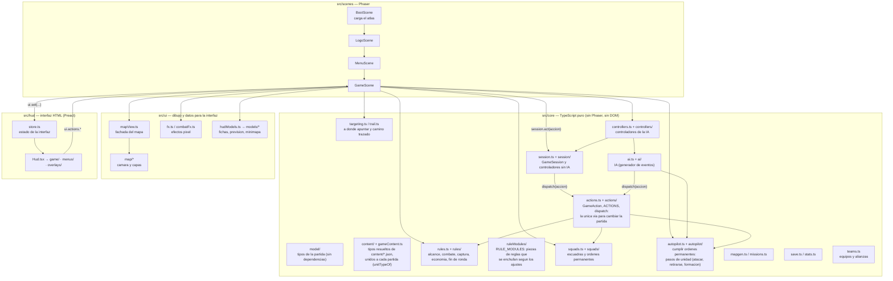
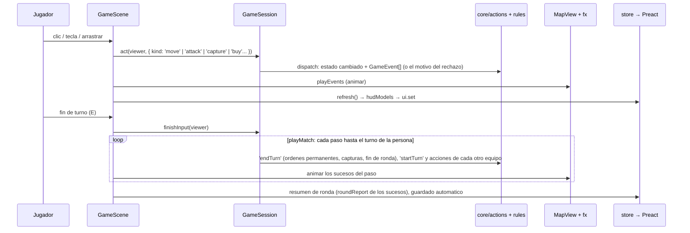

# Arquitectura

Mapa del codigo para personas y agentes de IA: que hace cada parte, como fluye un turno y por que se
tomaron las decisiones que no conviene deshacer sin pensarlo.

## Capas



- `src/core` no conoce la pantalla: se prueba con vitest, la usa la herramienta de equilibrio y la
  partida por texto (`npm run play`). ESLint prohibe que importe Phaser, Preact o el DOM.
- Las escenas orquestan: leen la entrada, mandan acciones (`dispatch`), animan los sucesos que
  devuelven y publican el estado de la interfaz. La interfaz HTML no toca el juego: llama a
  `ui.actions`, que registra la escena.

### El nucleo por dentro

`actions.ts`, `rules.ts`, `ai.ts`, `autopilot.ts`, `session.ts`, `controllers.ts` y `squads.ts` son
fachadas: reexportan lo publico de sus modulos, uno por tema, y desde fuera de `src/core` se importa
siempre de ellas (`'../core/rules'`, `'@core/actions'`); ESLint no deja que la escena, la interfaz
ni las herramientas importen los modulos de dentro. Dentro de core, mejor del modulo concreto
(`'./rules/movement'`): menos acoplamiento y sin ciclos. **La IA es un jugador mas**: las reglas,
las acciones, las ordenes permanentes (autopilot/) y la sesion no importan nada de la IA (ai/,
ai.ts, aiGenerals.ts, controllers/); ESLint lo vigila (`NO_AI`) y `tests/layers.test.ts` comprueba
que `session.ts`, `actions.ts`, `autopilot.ts` y `rules.ts` no la cargan ni de lejos. La IA
reutiliza autopilot/.

### Acciones: la unica via para cambiar la partida

Quien juega un equipo (la persona en la pantalla, la IA, `npm run play`, el jugador al azar del
fuzz, la huella) cambia la partida mandando una **accion**: `dispatch(s, team, action)`
(`core/actions.ts`). Una `GameAction` (`model/actions.ts`) son datos, con uids y casillas (nunca
objetos de la partida): se puede guardar, repetir o mandar por la red.

```ts
const result = dispatch(s, viewer, { kind: 'attack', uid: tank.uid, target: enemy.uid });
if (result.ok) await play(result.events); // si no, result.reason dice por que ('notTarget', 'spent'...)
```

- Las `INVARIANTS` son de las reglas (`rules/invariants.ts`): las repasan `dispatch` despues de cada
  accion y `endRound` al acabar la ronda, asi que ninguno de los dos copia sus pasos.
- `dispatch` pasa las comprobaciones comunes (`ACTION_GUARDS`, `actions/guards.ts`, en orden: que
  tenga la forma de una accion, `isGameAction` con `ACTION_SHAPES` de `actions/shape.ts`, o
  `'badAction'`; que la mande un equipo de la partida, `'notATeam'`; que la partida no se haya
  decidido, `'matchOver'`; que sea su turno, `'notYourTurn'`, y que lo haya empezado,
  `'turnNotStarted'` (estas dos, `turnOnly`, no cuentan para las acciones con `anyTime`: rendirse
  vale en cualquier momento, como pide una partida por la red o con varias personas); que ese equipo
  no haya perdido, `'defeated'`, salvo para pasar el turno), el `validate` de la accion, su `apply`
  (con los dados de la partida, `diceOf(s)`), despues las `INVARIANTS` (`rules/invariants.ts`: fuera
  los muertos, las capturas cuya unidad se ha ido, las escuadras vacias, el dinero por encima del
  maximo, los movimientos que ya no se pueden deshacer) y apunta los sucesos en las estadisticas
  (`recordEvents`, stats.ts: de todos, se animen o no). Las invariantes no saben de acciones;
  `dispatch` tampoco: lee lo que dice la entrada del registro.
- `ACTIONS` (`actions/registry.ts`) tiene una entrada por accion (el tipo obliga), cada una en el
  modulo de su tema (`movement`, `combat`, `capture`, `transport`, `units`, `economy`, `powers`,
  `standingOrders`, `squads`). `validate(s, team, action)` lo calcula todo desde la partida (alcance,
  vision, dinero, de quien es cada unidad): no se fia de nada que traiga la accion. `apply` usa las
  piezas de `rules/` y `squads/` y devuelve los sucesos.
- `actionProblem`/`isValidAction` preguntan lo mismo sin cambiar nada. El menu de una unidad sale de
  ahi: `UNIT_MENU` (`actions/menu.ts`) dice con que acciones se cumple cada opcion y
  `availableActions(s, team, unit)` ofrece, en ese orden, las que tienen alguna que vale (la escena
  solo añade «Atras», en el sitio que dice `BACK_GOES_BEFORE`). Lo que se manda a unas unidades
  elegidas (un grupo, la bandeja) sale igual de `SELECTION_MENU` y `canDoWithSelection`; las
  opciones que son las mismas con una sola unidad (las ordenes, quitarlas) salen de ahi tambien
  (`ORDER_OPTIONS` dice cual es cada orden), y mover un grupo es su plan (`groupMoveOrder`,
  `groupMoveStep`), que la escena cumple paso a paso. Los mandos (`controls/actions.ts`,
  `INPUT_ACTIONS`) solo preguntan ahi y añaden lo que es de la interfaz. Lo que pasaria al soltar la
  unidad en otra casilla tambien lo dice el nucleo (`targetProblem`, `canCaptureAt`).
- Un solo deshacer, en el nucleo: la accion `undoMove`. La partida apunta cada movimiento
  (`GameState.undoableMoves`, con la captura a medias que perdio la unidad al irse; `rules/undo.ts`)
  y los deja mientras lo de despues no cuente nada nuevo de la partida: las entradas con `keepsUndo`
  (mover, deshacer, esperar, viajes, escuadras, ordenes); tras cualquier otra del equipo que juega,
  dispatch los olvida (`forgetUndoableMoves`; una de otro fuera de su turno, rendirse, no). El paso
  de un viaje no se deshace (seria un movimiento gratis). La invariante 'undoWindow' olvida los de
  unidades que ya no estan como las dejo su movimiento (caen, suben a un transporte o vuelven a
  estar listas con la ronda nueva). Se deshace siempre el ultimo (`lastUndoableMove`,
  `undoMoveProblem`), uno tras otro; si al moverse descubrio enemigos (`revealed`), no
  (`'revealed'`): con niebla seria mirar gratis. «Atras» del menu de la unidad y Ctrl+Z mandan
  `undoMove` con la misma funcion (y avisan si el nucleo dice `'revealed'`). Si el movimiento corto
  un viaje, deshacerlo lo devuelve (`UndoableMove.travelTo`, con su suceso 'travel').
- Los viajes de varios turnos (`Unit.travelTo`, «Ir alli»; reglas en `rules/travel.ts`): 'travel'
  pone el destino (una casilla que la unidad pueda pisar, a la que no llegue ya este turno
  —`'withinReach'`: para eso se mueve— y hacia la que pueda dar ya un paso: `travelProblem`) o lo
  quita (`'noTravel'` si no viajaba), y 'travelStep' da el paso de cada turno, hacia la casilla del
  alcance que mas acerca (`travelStepOf`). Si ya esta en el destino o llega este turno, el viaje
  acaba sin moverla (el ultimo trozo lo hace quien juega: puede seguir, atacar o capturar); una
  emboscada por el camino tambien lo acaba. Moverla a mano ('move', 'load', 'merge', y 'attack' sin
  haberse movido aun) lo acaba con `endTravel`; capturar, esperar o atacar despues del paso del
  viaje, no. Un viaje y una orden permanente se quitan el uno al otro, y cada uno lo cuenta (el
  viaje que acaba con `end: 'ordered'`; la orden, con `order: null`). Cada fin tiene su suceso
  'travel' con `to: null` y por que (`end`: 'cancelled', 'ordered', 'arrived', 'withinReach' o
  'ambush'), y la escena avisa «llega» solo con 'withinReach'. El paso de cada turno lo da la
  partida al empezar el turno de su equipo (`TURN_START_PHASES`); la escena manda 'travel' y, al
  dar la orden, el primer 'travelStep'.
- **Turnos**: la partida sabe de quien es el turno (`GameState.turn`, en el orden de la ronda
  `turnOrder`, que pone el modo; `turnStarted`). 'startTurn' lo empieza (`TURN_START_PHASES`, en
  actions/turn.ts: los viajes avanzan) y 'endTurn' lo acaba (`TURN_END_PHASES`: las ordenes
  permanentes del equipo se cumplen, `assistTurn`, y las unidades que se han quedado sobre un
  edificio que pueden capturar siguen capturando, `autoCapturers` en rules/capture.ts) y lo pasa al
  siguiente que juega (`nextTurn`, rules/turnOrder.ts: los derrotados no); tras el ultimo del orden,
  el fin de ronda (`endRound`, con `roundPhasesOf`). Sus sucesos: 'turnStart' y 'turnEnd'. Cada paso
  de turno hace acciones del equipo (las mismas entradas de ACTIONS, con su validate). Las fases son
  acciones mandadas por el mismo camino que las demas (el `ActionDispatcher` que recibe el `apply`
  de las acciones de turno, y solo ellas: `CompositeActionDefinition`; guardas, validate,
  invariantes) y sus sucesos se cuentan una vez en las estadisticas; el modo puede añadir las suyas
  (`turnPhases`). Las ordenes permanentes son una regla para todos los equipos (la persona, la IA o
  un jugador por la red), no del controlador: las cumple core/autopilot, no la IA. 'startTurn' y
  'endTurn' solo los manda la sesion (`isTurnBoundary`; `session.act` los rechaza con
  'sessionOnly'). Rendirse es la accion 'surrender' (`TeamState.resigned`: cuenta como derrotado),
  en su turno o fuera de el (`anyTime`); el menu solo lo ofrece si la partida se puede perder
  (`canBeLost`: el laboratorio no; el nucleo tampoco lo deja, 'cannotLose'), y guardar, si su modo se
  guarda (`saves`; `gameMenuOf`).
- Lo que cambia la partida y no es de quien juega se queda fuera de `dispatch`: preparar una partida
  (`buildMatch`, `newGameState`, `newUnit`, `appointGeneral`).
- **Una accion nueva**: su forma en `GameAction` (`model/actions.ts`) y la de cada campo en
  `ACTION_SHAPES` (`actions/shape.ts`; el tipo la pide), su suceso en `GameEvent`
  (`model/events.ts`) y su entrada en el modulo de `actions/` que toque (con `keepsUndo` si no
  cuenta nada nuevo de la partida y deja deshacer lo de antes, y con `anyTime` si vale fuera del
  turno, como rendirse); si se ofrece en el menu de una unidad, su entrada en `UNIT_MENU`; si se
  puede mandar a unas unidades elegidas, en `SELECTION_MENU` (y en `INPUT_ACTIONS` y
  `ACTION_RUNNERS` de los mandos y la escena); su animacion en `ANIMATORS`
  (`scenes/game/playback.ts`). Lo comun a todas las acciones es una entrada en `ACTION_GUARDS`; lo
  que hay que limpiar despues de cualquiera (y de cada ronda), una en `INVARIANTS`, que devuelve sus
  sucesos.

### Sucesos

Cada accion y el fin de ronda devuelven sus sucesos (`GameEvent`, `model/events.ts`), completos para
contar lo que ha pasado sin mirar la partida: quien lo hizo (`actor`: el equipo que mando la accion,
o null en los del fin de ronda), a quien (uids), tipos y casillas. El ataque nombra a su objetivo
por uid (`target`) y su casilla (`at`) y lleva como estaban las dos (`combat`), el botin y la carga
que gana cada general (`charge`); la compra, el tipo y el equipo; la captura, siempre los puntos que
quedan. Lo que dejan en orden las `INVARIANTS` tambien se cuenta, detras de los de la accion y sin
actor: `cargoLost` (los pasajeros de un transporte que cae; tambien al retirarlo), `captureDropped`
(una captura a medias cuya unidad se ha ido), la escuadra que se queda vacia y `fundsCapped` (el
dinero que pasaba del maximo; botin, poderes e ingresos se cuentan enteros y lo perdido va aqui,
porque el tope se aplica al acabar la accion o la ronda, no al cobrar). Cada escuadra que desaparece
tiene un solo suceso `squad` (`SquadChange`): `change: 'disbanded'` si su equipo la deshace, o
`change: 'removed'` si se queda vacia; si la vacia una accion (salir, formar otra con sus unidades),
lleva el equipo de esa accion como actor y va antes que el `formed` o `grouped`; si la vacia la
partida (caen sus unidades), la cuenta la invariante sin actor. Los numeros de escuadra no se
reutilizan (`nextSquadId`). Con ellos
se anima (`ANIMATORS`), se cuentan las estadisticas (`recordEvents` en dispatch, por el `actor`) y se resume el
fin de ronda (`roundReport(s, events)`: lo que enseña la escena). `endRound` devuelve los suyos:
`income`, `heal`, `upkeep`, `controlPoint`, `newDay`, `weather` (cada paso del fin de ronda, `roundPhasesOf`, da los
que tiene; el ultimo, 'army', apunta el valor de cada ejercito del dia nuevo) y, al final, los de
las `INVARIANTS`, que `endRound` tambien repasa (`fundsCapped`...). Van dentro de los del 'endTurn'
que acaba la ronda.

### Las piezas del nucleo

Las piezas de abajo, que usa todo lo demas (los detalles, debajo de la tabla):

| Pieza | Que va |
|---|---|
| `model/` | los tipos de la partida; solo tipos (ESLint lo vigila) |
| `content/` | el contenido (JSON validados) resuelto en tipos con nombre y catalogos por id; ver docs/CONTENIDO.md |
| `gameContent.ts` | el contenido de cada partida (`s.content`) y sus atajos (`unitTypeOf`, `terrainAt`...); `cloneState` |
| `modes.ts` | `GAME_MODES`: lo que fija cada modo de juego (congelado; se lee con `gameModeOf`) |
| `match.ts` | empezar una partida: `MatchConfig`, `MATCH_SETUPS`, `buildMatch`, `skirmishConfig`, `rematchOf` |
| `gameState.ts` | `newGameState(...)`: el unico sitio que escribe la forma de una partida nueva |
| `dice.ts` + `util/random.ts` | el azar: los dados de la partida (`diceOf`) y el `Rng` de quien decide (`seededRng`) |
| `settingsSchema.ts` | `SETTINGS_SCHEMA`: que valores puede tener cada ajuste |
| `matchSettings.ts` | `settingsWith(contenido, cambios)`: los ajustes por defecto con cambios (`MatchSettings`, `s.settings`) |
| `ruleModules/` | los modulos de reglas (`RULE_MODULES`) y lo que aporta cada uno a las listas de las reglas (`RuleHooks`); ver "Modulos de reglas" |
| `abilities.ts` | lo que hace cada clase de habilidad de las unidades (`ABILITY_EFFECTS`; lo enchufa el modulo `abilities`) |
| `generals.ts`, `generalPowers.ts` | el general de cada equipo (ventaja fija, carga, ronda, reconocimiento) y sus poderes (`POWER_EFFECTS`: casilla, area, efecto y valor para la IA; `powerBlock`, `applyPower`) |
| `weather.ts` | el clima de la partida: cual hay, el pronostico y como cambia (lo enchufa el modulo `weather`) |
| `teams.ts` | los equipos de la partida: alianzas, enemigos, quien los juega (ver "Equipos") |
| `data.ts` | constantes que no son contenido (`MAP_SIZES`, `MAP_MIN`/`MAP_MAX`, `MAX_LIFE`) |
| `defaultGames.ts` | partidas con el contenido del juego: `createMatch`, `loadGame` |
| `save.ts` + `savedParts.ts` + `saveVersion.ts` | guardar y leer (`readSave`): solo el formato de ahora |
| `util/grid.ts`, `mapGrid.ts` | rejillas (`Grid<T>`, `GridBounds`) y el mapa de una partida como rejilla (`mapGrid(s)`) |
| `geom.ts` | `posOf`, rombos (`diamond`, `neighbors4`), cuadrados (`squareArea`), `posKey` |
| `util/validation.ts` | comprobar lo que viene de fuera: `isInt`, `isPos`, `isPosOn` (e `isEntryId`, en content/catalog.ts) |

#### Los tipos y el contenido

- `model/`: `GameState`, `Unit` y su `UnitTurnState`, `Building`, `GameAction`, `GameEvent`,
  `StandingOrder`, `Squad`, `UndoableMove`, `MatchResult`, `GameModeId`, `MatchSettings`, `Rng`,
  `Dice`... No importa nada ni exporta constantes o funciones.
- `content/`: los JSON validados se resuelven al cargar en tipos con campos con nombre (`UnitType`,
  `BuildingType`, `TerrainType`, `WeatherType`, `Theme`, generales y sus poderes), cada uno en un
  catalogo por id (`Catalog`: `list` en el orden del fichero y `byId`; `findEntry`/`entryOf`).
  `loadContent(ficheros)` da un `GameContent` congelado; `content/default.ts`, el del juego
  (`defaultContent()`, perezoso).
- `gameContent.ts`: el contenido de cada partida es un campo, `GameState.content` (en el modelo,
  `MatchContent`; content/index.ts le da la forma de `GameContent`). Lo ponen `newGameState` y
  `readSave`, no se guarda (`serialize` escribe `SavedGameState`) y se lee como `s.content` o con
  los atajos que dan el tipo resuelto: `unitTypeOf(s, unit)`, `buildingTypeOf`, `isHq`,
  `terrainAt(s, pos)`, `themeOf(s)`, `weatherTypeOf(s, id)`, `weightsOf(s)` (y
  `findUnitType`/`findBuildingType` para lo que viene de fuera). Las partidas guardan ids
  (`unit.type = 'Tank'`), nunca el puesto en el fichero; `cloneState(s)` copia la partida y comparte
  el contenido.
- `data.ts`: las tablas del generador de mapas (`mapgen.json`) y los temas (`themes.json`: letras de
  los mapas en texto, probabilidades de terreno) son contenido; `MoveType` (`'foot'`,
  `'vehicle'`...) esta en `content/types.ts`.

#### Modos y partidas nuevas

- `modes.ts`: lo que fija cada modo (`GameState.mode`: escaramuza, mision, partida para mirar): como
  se acaba (`victory`, en orden), el orden de los turnos de cada ronda (`turnOrder`: se fija al
  crear la partida y se guarda con ella), las reglas que impone (`fixedSettings`, que aplica
  `buildMatch`: la partida para mirar no tiene clima), sus pasos de turno (`turnPhases`, detras de
  los de siempre) y si la pantalla guarda sola al empezar el turno de una persona
  (`saves`). Esta congelado y todo lo lee por `gameModeOf` (las reglas, la sesion,
  `newGameState`); los tests que prueban otro modo lo dan con `vi.mock` de `gameModeOf`
  (tests/modeHooks.test.ts). Un modo nuevo es su entrada aqui, su configuracion en `MatchConfig` y
  su forma de prepararse en `MATCH_SETUPS`.
- `match.ts`: `MatchConfig` son datos (`SkirmishConfig`, `MissionConfig`, `SandboxConfig`);
  `MATCH_SETUPS`, como se prepara cada modo; `buildMatch(config, { content, mapRng? })`, con su
  clima y la muestra del ejercito del primer dia. Todo lo de la partida va en la configuracion, nada
  se cambia despues: los generales en `MatchTeam.general`, y empezar cada uno de los dos equipos en
  el sitio del otro en `swapStarts` (la herramienta de equilibrio). `skirmishConfig` pone lo de
  siempre en lo que no se elige (mapa de `DEFAULT_MAP_SIZE`, tema al azar, reglas por defecto);
  `rematchOf(s)` da la revancha. La usan la pantalla, `npm run play`, las herramientas y los tests:
  una misma semilla da la misma partida en todos (K4).
- `gameState.ts`: `newGameState({ map, rules, content, mode, teams, diceSeed, firstTeam?, theme? })`
  lo usan mapgen, misiones, laboratorio, duelos y tests. Quien la crea dice sus equipos (`teams:
  duel('human', 'ai')` o una lista de `TeamSetup`) y la semilla de sus dados.
- `defaultGames.ts`: `createMatch(config, mapRng?)` y `loadGame(json)` (lo que usa la web). Con `content/default.ts`, el unico sitio del nucleo que conoce el contenido del
  juego (ESLint).
- `settingsSchema.ts`: cada regla es un interruptor o un numero (entero o no, en un intervalo, quiza
  null). La usan el contenido (settings.json) y el guardado; settings.schema.json dice lo mismo para los
  editores (lo comprueba un test). `settingsWith` usa `content.defaultSettings`; nunca `{ ...reglas, ...
  }` a mano.
- `teams.ts`: `teamState`, `isHostile`/`areAllied`, `isHostileOwner`/`isAlliedOwner`,
  `enemiesOf`/`alliesOf`, `teamsControlledBy`, `isAiControlled`, `playerTeam`, `perTeam`,
  `duel`/`duelTeams`, `newTeams`.

#### El azar

Los dados de las reglas (el combate) son de la partida: `GameState.dice` es el estado de un
mulberry32 (un entero de 32 bits) y `diceOf(s)` tira de el, asi que se guarda y se repite con la
partida. Las decisiones de quien juega (la IA, el generador de mapas) llevan su propio `Rng`
(`seededRng`): lo que decide no cambia lo que sale en los dados. `util/random.ts`: el paso de
mulberry32 (`randomStep`), `seededRng`, `seedFromDraw`, `aiSeedFor`.

#### Guardar y leer

- `readSave(json, contenido)` da `{ ok, state }` o `{ ok: false, error }` con el `SaveError` de la
  parte rota (`badVersion`, `badMap`, `badUnits`, `badSettings`...); `deserialize` es su atajo que da
  null. El contenido no va en la partida: lo da quien lee.
- El JSON leido es un `SavedGame` (sus campos, `unknown`) hasta que se ha comprobado entero;
  `savedParts.ts` comprueba o limpia cada parte (lo opcional roto se quita) con lo que necesita
  (`SaveFrame`: contenido, bordes del mapa, cuantos equipos), y leer no cambia nada mas (ni
  escuadras ni teclas). Lo que la partida siempre guarda tiene que estar: no se rellena con valores
  por defecto (una regla que falta es `badSettings`).
- Cada partida guarda la version de su formato (`SAVE_VERSION` en saveVersion.ts, ahora 8, atada al
  tipo de `GameState.version`) y **solo se lee la de ahora**: no hay migraciones. Mientras el juego no
  ha salido, cambiar lo que se guarda es subir la version, y las partidas guardadas con una de antes
  se descartan (`badVersion`): el menu no ofrece Continuar y, al intentar cargarla, se borra el hueco.
- Se prueba con partidas creadas por el codigo de ahora (`tests/readSave.test.ts`), sin ficheros
  guardados.

#### Rejillas y casillas

`Grid<T>` tiene `at`, `atClamped`, `set`, `contains`, `forEach`, `cells`, `createLayer`,
`width`/`height`; `GridBounds` (tamaño y `contains`) es para lo que solo mira los bordes.
`mapGrid.ts`: `mapGrid(s)`, `terrainAt`, `isOnBoard`, `createLayer(s, fill)`. Los rombos y cuadrados
de `geom.ts` reciben los bordes y solo dan casillas de dentro; `posOf` copia la casilla de una
unidad o edificio.

**El estado es la unica fuente de la partida**: los ajustes van en `s.settings` (obligatorios; de ellos salen los modulos de reglas que lleva), el tamaño
del mapa en `s.map`, los equipos en `s.teams` y el contenido va unido a la partida (`s.content`); no hay variables de modulo
con la partida en curso, y dos partidas con otro tamaño, otras reglas u otro contenido se juegan a la
vez en el mismo proceso (tests/gameContent.test.ts, tests/mapSizes.test.ts). Las consultas no la cambian
(`statsOf`, `captureProgress`); lo que la cambia son las acciones (`dispatch`), el fin de ronda y lo
que la prepara, y lo dice en el nombre (`recordEvent`, `newUnit`...).

`src/core/squads/` (escuadras y ordenes permanentes del jugador): `queries` (unidades de una
escuadra), `naming` (nombres y teclas de grupo), `standingOrders` (la orden de la escuadra y la propia
de cada unidad), `membership` (formar, meter, sacar, deshacer; no hace sucesos) y `events` (el suceso
de una escuadra, `squadEvent`): las piezas con las que se hacen las acciones de escuadras y ordenes
(`actions/squads.ts`, `actions/standingOrders.ts`); la fachada `squads.ts` solo da las consultas.
Las cumple la partida al acabar el turno de cada equipo, sea quien sea quien lo juegue (la fase
'standingOrders' de `TURN_END_PHASES`, con `assistTurn` de `autopilot/standingOrders.ts`).
`targeting.ts` y `trail.ts`: desde donde atacar (con la regla del ataque, `attackProblem` con
`from`) y el camino trazado con el cursor, para la escena.

`src/core/rules/` (cada modulo solo importa los de encima en la tabla; no hay ciclos):

| Modulo | Que va |
|---|---|
| `queries` | que hay en una casilla, por donde se anda (`canMoveOn`, `movementOf`), unidades de un equipo, pasajeros |
| `unitTurn` | el turno de cada unidad (`Unit.turnState`) y la unica forma de cambiarlo (ver abajo) |
| `funds` | el dinero: `earn`, `pay` (paga lo que haya) y `capFunds` (lo que pase del maximo se pierde al acabar cada accion y cada ronda) |
| `visibility` | vision y niebla (la de toda la alianza), enemigos a la vista y que se le enseña a cada equipo |
| `capture` | puntos de captura, capturas a medias (`captureProgress`), capturar y su suceso, `autoCapturers` |
| `lifecycle` | crear, quitar y limpiar unidades (`removeWithCargo`, con su `cargoLost`) |
| `undo` | los movimientos que se pueden deshacer (`undoableMoves`), el ultimo, por que no y su invariante |
| `falls` | si un equipo ha caido y por que (`currentDefeat`) y cuando cayo (`recordFalls`, `fallOf`, `lastFallen`) |
| `invariants` | `INVARIANTS` y `restoreInvariants`: lo que se deja en orden tras cada accion y cada ronda, con sus sucesos |
| `movementProfile` | como se mueve cada tipo: por donde entra y lo que le cuesta (`TerrainAccess`), lo que puede gastar (`MovementProfile`), `pathCost` |
| `passage` | lo que le hacen las demas unidades a quien se mueve (`PASS_RULES`, `surroundingsOf`: cierra el paso, se atraviesa, no se sabe que esta) y donde tiene que pararse |
| `distance` | pasos por tierra sin limite (`distanceMap`: 0 en el origen, Infinity donde no se llega) y lo que corta el paso al medir (`Blockers`) |
| `movement` | la regla de cada paso (`stepAllowed`), alcance (`moveRange`), caminos (`plannedPath`, `validPath`, `approachPath`) y el paso hacia algo (`stepToward` con un `Approach`) |
| `traverse` | recorrer de verdad un camino (`traverse`, `moveAlong`): lo que lo corta a mitad (`PATH_INTERRUPTIONS`: la emboscada) y el suceso de mover |
| `travel` | viajes de varios turnos: a donde (`travelProblem`), el paso de cada turno (`travelStepOf`) y como acaban (`endTravel`) |
| `engagement` | un combate como pregunta (`Engagement`: atacante y defensor como `Fighter`, con casilla y vida): lo hipotetico sin fingir unidades |
| `weapons` | lo que dice el arma de cada tipo: `inAttackRange`, `basePower`, `canDamage` |
| `damage` | como sale el daño (`DamageModel`: la tirada y su reparto; `SHOT_BY_SHOT`, `spreadAround`, `damageModelOf`) |
| `attackRecord` | lo que se apunta de un ataque mientras se resuelve (`AttackRecord`, `fallenIn`) |
| `combat` | desde donde y a quien se dispara, proteccion, acierto (`HIT_MODIFIERS` y los de los modulos), daño esperado, contraataque (`canCounter`), tirada |
| `forecast` | prevision de combate (`combatForecast` de un `Engagement`) y zona de amenaza |
| `transport`, `supply` | unir y transportes (`mergeProblem`, `loadProblem`, `unloadProblem` y como se hacen); reparar |
| `economy` | ingresos, mantenimiento, limite del ejercito, comprar (`buyProblem`, `buildUnit`) |
| `control`, `round` | puntos de control; fin de ronda (`ROUND_PHASES`, cada paso devuelve sus sucesos; `roundReport`, el resumen) |
| `victory` | como acaba la partida, igual para todos (`matchResult(s)`, `VICTORY_RULES`; ver abajo) |
| `turnOrder` | quien juega despues (`nextTurn`, y si con eso acaba la ronda; `takesTurn`) |

- `unitTurn`: `'ready'`, `'moved'`, `'done'`; `canStillAct`, `canStillMove`, `canStillFire` (una
  que no puede moverse y disparar, `firesAfterMove`, ya no dispara si se ha movido), `canActNow`/`canMoveNow` (lo mismo y en el mapa), y se cambia
  solo con `markMoved`, `spendUnit` y `readyUnit`.
- `visibility`: lo que ve un equipo es un `Sight` (`sightOf`); enemigos a la vista con
  `isVisibleFoe`, `visibleEnemies` y `visibleFoeAt`; que unidades se le enseñan, `isShownTo`.
- `capture`: `captureProgress` solo consulta; `dropStaleCaptures` es una de las INVARIANTS. `undo`:
  apuntar, olvidar, `lastUndoableMove` y `undoMoveProblem`. `combat`: `attackProblem`,
  `attackTargets` y la tirada (`strike`); lo que pasa en un ataque es `COMBAT_RESOLUTION`
  (`actions/combat.ts`, ver "Modulos de reglas").
- **Movimiento** (G1-G7 de la auditoria del nucleo): `movementProfile(s, unidad)` dice por donde
  entra, lo que cuesta cada casilla y lo que puede gastar (el coste del terreno y el clima los ponen
  sus modulos); `surroundingsOf(s, unidad)` lo que encuentra en cada casilla (`'empty'`,
  `'passThrough'`, `'blocked'`) segun `PASS_RULES` y las reglas de paso de los modulos (pasar entre
  aliados, no saber de los enemigos escondidos) y donde tiene que pararse (`stopRules`: la zona de
  control); `moveRulesOf` junta las dos cosas y `stepAllowed(reglas, paso, 'walk' | 'join')` es la
  unica regla de cada paso: la usan el alcance, `validPath`, el rastro del cursor (`extendTrail`) y
  `approachPath` (unirse o subir a un transporte es un paso `'join'`, que entra en la unidad y no
  en su casilla). `MoveRange` lleva esas reglas, `steps` (lo que cuesta acabar en cada casilla, o
  null) y `prev`; no mira si la unidad ya se ha movido (es hasta donde llegaria en su turno). Un
  camino ya comprobado se recorre con `traverse` (`moveAlong` al mover): `PATH_INTERRUPTIONS` lo
  puede cortar (la emboscada) y entonces la unidad se para antes y pierde el turno; mover, unirse,
  subir y el paso de un viaje usan lo mismo. Distancias sin limite: `distanceMap(s, desde,
  movimiento, blockers)`; acercarse a algo: `stepToward(alcance, approach)` (`overGroundTo`,
  `straightTo` o el `Approach` de la IA y de la formacion).
- **Combate como pregunta**: las reglas del combate reciben un `Engagement` (`engagement(atacante,
  defensor, { from, attackerLife, defenderLife })`; `reversed` es el del contraataque). Asi la
  prevision desde otra casilla, el valor de un ataque para la IA o el contraataque con la vida que
  le quedaria al defensor se preguntan sin copias de unidades.
- `falls`: si un equipo ha caido y por que, mirando la partida (`currentDefeat`, para un equipo:
  rendido, si no sin nada, si no sin Base; `isDefeated`), y cuando cayo: `TeamState.fell`, con su
  numero de caida, que apunta la invariante 'falls' (`recordFalls`, con el suceso 'teamDefeated') en
  la accion o la ronda en que pasa. Si caen varios a la vez, cual cuenta lo dice `DEFEAT_PRIORITY`
  (sin Base, sin nada, rendido: `mainFall`). Al cargar, `readSave` solo comprueba que lo apuntado
  cuadre con la partida en los dos sentidos (`fallsMatch`) y si no, la rechaza; `assertAllStanding`
  exige que una partida nueva empiece con todos en pie.
- `victory`: `MatchResult` con `status`, `winners` y `reason`; `isMatchOver`, `isWinner`. Las formas
  de acabar estan en `VICTORY_RULES` ('lastAllianceStanding', 'objective', 'dayLimit') y cada modo
  dice las suyas. Solo lee las caidas apuntadas: el motivo del resultado es el de la ultima
  (`decidingFall`, la misma que usa el final para decir de quien fue), la que lo decide, no una
  rendicion de antes. `outcomeFor` dice si un equipo ha ganado, perdido o empatado. Contrato: una
  partida decidida por una caida que no esta apuntada (cambiada sin pasar por las INVARIANTS) hace
  que `matchResult` lance un error; por eso `buildMatch` exige que todos empiecen en pie
  (`assertAllStanding`) y `readSave` rechaza lo que no cuadre. Si lo que pasa al acabar un turno
  decide la partida, 'endTurn' no pasa el turno (ni ronda nueva, ni otro dia). Puntos del limite de
  dias por alianza, progreso del objetivo de mision.
- `turnOrder`: `nextTurn` da el siguiente del orden de la ronda que aun juega.

`src/core/autopilot/` (no es la IA: lo usan las ordenes permanentes, una regla para todos):
`context` (el `PlayCtx` del turno y ayudas comunes), `scoring` (cuanto vale cada ataque), `tactics`
(retirarse, atacar, capturar lo de debajo), `formation` (escuadras que avanzan juntas) y
`standingOrders` (cumplir las ordenes del jugador, `StandingOrder`, y su prevision).
`src/core/ai/` los reutiliza: `tactics` (ir a capturar, avanzar, moverse al azar), `fire` (fuego
concentrado), `unitTurn` (prioridades de cada unidad) y `production` (que fabrica). `ai.ts` tiene
`aiTurn`, que los junta.

- **Sin estado global en la IA**: el equipo que juega, el modo grupo y el plan de fuego van en un
  `PlayCtx` que crea quien empieza el turno (`aiTurn`, `assistTurn`, `startStandingOrder`, con el
  `ActionDispatcher` por el que manda sus acciones: el de la sesion, que las apunta) y se pasa a cada
  paso. Dos turnos, o una prevision en medio de uno, no se mezclan (lo necesitara un PvP o un
  servidor con varias partidas).
- **La IA juega por la misma via**: cada cosa que hace con una unidad es una accion (`act`,
  `doMove`, `finish` en `autopilot/context.ts`, que llaman a `dispatch` con su equipo); los sucesos
  que da son los que devuelve `dispatch`. Decide con su `Rng`; los combates tiran de los dados de la
  partida.
- **Puntos de extension**:
  - una pieza de reglas que la partida lleva o no (con su ajuste) es un modulo de reglas (ver
    "Modulos de reglas"): un fichero en `ruleModules/` y su entrada en `RULE_MODULES`;
  - una regla que cambia la probabilidad de acierto es un `hitModifiers` de su modulo (lo de
    cualquier partida, el poder y la proteccion, esta en `HIT_MODIFIERS`, `rules/combat.ts`); la
    prevision, el panel de combate y la IA la ven solas;
  - un sistema que actua cada ronda es un `roundPhases` de su modulo, en su momento (`RoundStage`);
    lo de cualquier partida esta en `ROUND_PHASES` (`rules/round.ts`);
  - algo que pasa en cada ataque es un `combatSteps` de su modulo, en su momento (`CombatStage`);
    lo de cualquier ataque esta en `COMBAT_RESOLUTION` (`actions/combat.ts`); quien contraataca, un
    `counterRules`;
  - por donde se pasa, un `passRules` o `stopRules`; lo que corta un camino a mitad, una entrada en
    `PATH_INTERRUPTIONS` (`rules/traverse.ts`); el coste de las casillas o lo que se puede gastar,
    un `enterCosts` o `moveBudgets`; la vision, `visionRadius`, `revealRules`, `concealment` o
    `coverSight`;
  - una clase de habilidad de unidad es su forma en `AbilityDef` (`content/types.ts`), su validacion
    en `ABILITY_SHAPES` (`content/abilities.ts`) y lo que aporta a las listas en `ABILITY_EFFECTS`
    (`abilities.ts`); el modulo de las habilidades lo enchufa todo;
  - una clase de efecto de un poder del general es su forma en `GeneralEffect`, su validacion en
    `EFFECT_SHAPES` (`content/generals.ts`) y su entrada en `POWER_EFFECTS` (`generalPowers.ts`: si
    necesita casilla, su area, como se aplica y lo que le vale a la IA, `aiValue`);
  - un comportamiento de IA nuevo (un papel de unidad) es una entrada `{ id, when, run }` en
    `UNIT_BEHAVIOURS` (`ai/unitTurn.ts`), en su sitio de la lista; `run` devuelve si ha usado la
    unidad y suele llamar a un paso de `ai/tactics.ts`;
  - una razon nueva para preferir o evitar un ataque es un termino en `ATTACK_SCORE_TERMS`
    (`autopilot/scoring.ts`); un tipo de orden permanente del jugador, una entrada en
    `STANDING_ORDER_TURNS` (`autopilot/standingOrders.ts`).
- La arena (`npm run arena -- --snapshot`) copia `ai.ts` y todo `ai/` y `autopilot/`, asi que un
  modulo nuevo de la IA entra solo en la referencia. La referencia (`improve/ai-baseline/`) usa el
  nucleo de ahora por `@core/...`: `tsc` la comprueba y `tests/arenaSnapshot.test.ts` le hace jugar
  una partida corta, asi que un cambio del nucleo que la rompa se ve en `npm run check` (se arregla
  con otro `--snapshot` si la IA actual ya se ha aceptado, o adaptando la copia a ese cambio: lo
  unico que se edita en ella, como dice su cabecera; sus decisiones no se tocan).

### Modulos de reglas (`core/ruleModules/`)

Los ajustes de una partida (`s.settings`, un `MatchSettings`: numeros e interruptores; se guardan con
ella) no se preguntan dentro de cada regla. Cada pieza que la partida lleva o no es un modulo
(`RuleModule`: `id`, `isOn(ajustes)` y lo que aporta, `hooks: RuleHooks`), y las reglas miran
listas: las entradas de siempre mas las de los modulos que la partida lleva (`hooksOf(s, lista)`,
en el orden de `RULE_MODULES`; `isRuleOn(s, id)` dice si uno esta puesto). Sin el modulo, sus
entradas no estan: no hay `if (!s.settings.veterancy) return 1`.

| Modulo | Su ajuste | Lo que aporta |
|---|---|---|
| `abilities` | `abilities` | lo de cada clase de habilidad (`ABILITY_EFFECTS`): escudo y aura al acierto, perforar, zona de control, ver en el bosque, capturar rapido |
| `veterancy` | `veterancy` | el rango al acierto (`rank`, `RANK_KILLS`; las bajas se cuentan siempre) |
| `flank` | `flankBonus` > 0 | rematar a quien ya ha recibido un ataque hoy (`flanked`) |
| `generals` | siempre | su ventaja fija al acierto, su carga en combate, su ronda (volver a usar un poder) y su reconocimiento |
| `weather` | `weather` | acierto, lo que se puede gastar al moverse, el radio de vision, el cambio de clima con el dia y el clima del primer dia (`matchSetup`) |
| `controlPoints` | `controlPoints` > 0 | lo que pagan al acabar la ronda |
| `upkeep` | `upkeep` > 0 | pagar el mantenimiento al acabar la ronda |
| `noHealUnderFire` | `noHealUnderFire` | quien ha recibido un ataque hoy no se cura (`unhealable`) |
| `noFog` | `fog` quitado | todos ven todo el mapa |
| `forestHides` | `forestHides` | el terreno que esconde solo se ve desde al lado |
| `terrainCost` | `terrainCost` | lo que cuesta entrar en cada terreno (si no, 1) |
| `passAllies` | `passAllies` | los aliados se atraviesan (sin parar encima) |
| `ambush` | `ambush` | los enemigos que no se ven no cuentan al planear; al chocar, emboscada |
| `counterattack` | `counterattack` | `MELEE_COUNTER`: quien contraataca |
| `bounty` | `bounty` > 0 | el botin al destruir (`bountyFor`) |

Las listas (`RuleHooks`, en `ruleModules/hooks.ts`, solo tipos): `hitModifiers`, `coverPiercing`,
`counterRules`, `combatSteps` (con su `CombatStage`), `roundPhases` (con su `RoundStage`),
`matchSetup`, `healingBlocks`, `visionRadius`, `revealRules`, `concealment`, `coverSight`,
`enterCosts`, `moveBudgets`, `passRules`, `stopRules` y `captureFactors`. Las que van por momentos
(el fin de ronda, el ataque) se ordenan por momento y, en cada uno, primero las de siempre y luego
las de los modulos (`roundPhasesOf`, `combatResolutionOf`); en el acierto, el orden de los modulos
importa (coma flotante). Las reglas importan `ruleModules/registry.ts` y los modulos importan lo que
enchufan (generales, clima, habilidades...), nunca al reves: las reglas ya no importan generales,
clima ni habilidades (L7). Lo que solo usa el arma de cada tipo esta en `rules/weapons.ts` para que
las reglas de los modulos no tengan que importar el combate.

Un modulo nuevo: su fichero en `ruleModules/` (lo que aporta a cada lista), su id en `RuleModuleId`,
su entrada en `RULE_MODULES` y, si tiene interruptor, su ajuste en `MatchSettings`, `SETTINGS_SCHEMA`,
settings.json y settings.schema.json. Una lista nueva que se pueda ampliar: su campo en `RuleHooks` y la
regla que la mira con `hooksOf`. Lo prueba `tests/ruleModules.test.ts` (cada interruptor quita su
modulo y solo ese).

### Equipos

Una partida tiene dos o mas equipos (`GameState.teams`, `TeamState`; una guardada, hasta 16): cada uno con su numero (`id`, su
puesto en la lista), su `alliance`, quien lo juega (`controller`: `'human'` o `'ai'`), su dinero, su
general y sus estadisticas. **Ningun numero de equipo es especial**: no hay "el 0 es el jugador".

- Enemigos son los de otra alianza (`isHostile`, `enemiesOf`); los de la misma comparten la vision,
  no se atacan ni se capturan lo suyo, y un punto de control solo lo disputan enemigos.
- Todo lo que es de un equipo lo dice: `unit.team`, `building.owner`, `squad.team`,
  `objective.owner`. Las funciones que hacen algo por un equipo lo reciben siempre
  (`dispatch(s, team, action)`, `aiTurn(s, rng, team, dispatcher)`, `visibility(s, team)`), sin
  valor por defecto. Como acaba la partida no es de un equipo: `matchResult(s)` dice quien gana.
- Los sucesos dicen que equipo los ha hecho (`actor`); el resumen de la ronda (`RoundReport`,
  `ControlReport`) lleva una lista por equipo (`perTeam`).
- Un equipo pierde si se queda sin Base o sin nada, o si se rinde (`isDefeated`); los derrotados ya
  no juegan. A quien le toca lo dice la partida (`GameState.turn`, ver "Acciones": 'endTurn' pasa al
  siguiente que juega, `nextTurn`). Lo que le queda en el mapa a un derrotado se queda a proposito y
  el fin de ronda lo trata como el de cualquiera (cobra, se cura): nadie lo usa, y es botin para los
  demas.
- La partida termina (`isMatchOver`) cuando la primera forma de acabar de su modo lo decide
  (`VICTORY_RULES`): solo queda en pie una alianza (o ninguna: empate), el objetivo de la mision o
  el limite de dias (gana la alianza con mas puntos; si empatan, empate). Con 3 o mas equipos, que
  caiga uno no la acaba.
- Hace falta al menos dos alianzas (`newTeams` y `readSave` no aceptan menos).
- Las reglas no miran el `controller`: solo dice quien decide (el controlador que le pone la sesion,
  ver "Partidas en juego"). Las ordenes con destino se le pueden dar a cualquier equipo.
- **La escena**: el equipo que mira es `viewer` (`viewerOf(session)`: la persona a la que le toca, o
  si no la primera; sin personas, el primer equipo, que juega la persona aunque guarde `controller:
  'ai'`, `screenControllers` de core/controllers, que usa tambien `npm run play`; en el laboratorio,
  ademas, `labControllers`), y todos los `...Host` lo tienen. La niebla, la amenaza, lo que se elige
  y lo que se ordena son del `viewer`. Si un equipo es de una persona solo lo dice
  `session.isPerson` (el `person` de su controlador, tambien dentro de un `sequence`). La interfaz
  no sabe de numeros de equipo: pinta y escribe por **lado** (`ui/sides.ts`: `'own'`, `'ally'`,
  `'enemy'` y `'neutral'` para lo que no es de nadie; azul lo propio y aliado, rojo lo enemigo).
- **Varias personas en la misma pantalla** (por turnos): cada una tiene su `humanController`; al
  empezar el turno de otra, la escena tapa la partida con el aviso de cambio de jugador
  (`UIState.handoff`, `hud/overlays/Handoff.tsx`) y, cuando esta lista, pasa a mirar ella
  (`TurnFlow.switchPerson`). Cada una tiene su camara (la primera vez, sobre su cuartel) y su
  «repetir el turno de los demas» (lo que vio al acabar su turno); el aviso «TU TURNO» sale al
  empezar el turno de la persona, no al cargar. El final se ve desde una que gana (`endViewer`). La
  pantalla de partida nueva lo ofrece en «Rival»; `npm run play` juega la persona a la que le toca
  (`TextMatch`, tools/play/textMatch.ts, sobre la misma `GameSession`).
- El turno en la barra de arriba es el del equipo que juega, por lado (`turn: Side`): tu turno, el
  de un aliado (en azul) o el de un enemigo (en rojo).
- Los mapas al azar valen para 2 o mas equipos (`generateGame` busca una salida por equipo, cada una
  lejos de las anteriores); la pantalla de nueva partida y las misiones son de dos (`duel`). Las
  reglas, la IA, el guardado y la escena ya valen para mas (tests/teams.test.ts: 4 equipos en 2
  alianzas y 3 todos contra todos).

### Herramientas

`tools/` (equilibrio, automejora, partida por texto, contenido) solo usa el nucleo, importado por su
alias: `import { createMatch } from '@core/defaultGames'` (definido en `tsconfig.json` "paths" y en
`vite.config.ts`; `tsx` lo entiende solo). ESLint prohibe que `tools/` importe nada mas de `src/`
(escenas, interfaz, ajustes) o Phaser/Preact, y que los tests importen el nucleo por ruta relativa.
Lo que mide una regla fuera de una partida de verdad, sin comprobar nada (el combate suelto del
laboratorio de duelos y de los tests: `uncheckedAttack`), esta en `core/sandbox.ts`. ESLint prohibe
importar ese fichero desde cualquier fichero de `src/`, tambien del nucleo y con cualquier ruta
(`SANDBOX_IS_NOT_THE_GAME`): solo lo usan `tools/` y `tests/`. Y `resolveAttack`, el combate sin
comprobar que hay debajo, solo se puede importar en `sandbox.ts` (su modulo, `actions/combat.ts`, lo
usa para la accion 'attack'; `UNCHECKED_ATTACK_ONLY_IN_SANDBOX`).

Es el paso previo a un monorepo: si algun dia hace falta (un servidor para partidas online que use el
nucleo, una herramienta con dependencias propias, publicar el nucleo), `src/core` pasa a ser el paquete
`@ilogic/core` y basta con cambiar el alias. Hasta entonces, un solo paquete es mas simple.

### Interfaz HTML (src/hud)

Las escenas publican con `ui.set(...)` lo que hay que enseñar y los componentes de Preact solo lo
pintan; los botones llaman a `ui.actions.*`, que pone la escena. Cada pieza en su sitio:

| Que | Donde |
|---|---|
| El store (`ui`, `showToast`, `resetActions`...) | `store.ts` (reexporta todos los tipos: se importan de ahi) |
| Forma del estado y valor al arrancar | `state.ts` (`UIState`, `initialState`) |
| Lo que piden los botones, agrupado por pantalla | `actions.ts` (`UIActions`; su valor sin escena, en `store.ts`) |
| Tipo de lo que enseña cada panel | `vm/<panel>.ts` (`TileVM` en `vm/tile.ts`...) |
| Calculo de esos datos a partir de la partida (puro, con test) | `src/ui/models/<panel>.ts`, reexportado en `src/ui/hudModels.ts` |
| Raiz: pantalla en curso, dialogos y avisos | `Hud.tsx` |
| Paneles de la partida y donde va cada uno | `game/*.tsx`, colocados en `game/GameHud.tsx` (lista `GAME_PANELS`) |
| Pantallas del menu, pausa y final | `menus/*.tsx` |
| Dialogos (ayuda, novedades, nombre de escuadra) y avisos (carga, aviso, resumen, cartel) | `overlays/*.tsx` |
| Piezas compartidas | `common/`: `Button` (sin foco del navegador), `Btn` (menus), `Icon`, `Popover`, `Veil`, `Seg`, `useFold`/`FoldMark`, `useTipToggle`, `useUI`, formatos (`pct`, `range`...) |
| Estilos | `styles/<grupo>/<panel>.css`, juntados en orden por `hud.css` |

- **Un panel nuevo**: su tipo en `vm/`, su campo en `UIState` (null = no se ve) y en `initialState`,
  la funcion que lo calcula en `ui/models/` (con test), el componente en `game/` (o `menus/`,
  `overlays/`), su entrada en `GAME_PANELS` de `GameHud.tsx` (o `Hud.tsx`), sus acciones en `actions.ts` con su valor
  por defecto en `DEFAULT_ACTIONS`, y su hoja al final de `hud.css`.
- **Botones**: siempre `Button` (o `Btn` en los menus), que no se queda con el foco: Enter y las
  flechas son del juego (lo lleva la escena con el teclado). Solo el cuadro del nombre de escuadra
  usa botones normales, porque ahi se escribe.
- **Estilos**: cada hoja de `styles/` es un trozo seguido de la hoja de antes y `hud.css` las importa
  en ese orden, que es el de la cascada. Por eso hay alguna mezclada (`base/narrow.css`,
  `legacy.css`): mover reglas de sitio puede cambiar quien gana. Lo nuevo va al final; los colores son
  variables de `styles/base/base.css` (los mismos que `ui/palette.ts`).
- **Textos**: `t('clave')` (de `settings.ts`) busca en `src/i18n/`, un fichero por tema en `es/` y su
  traduccion con el mismo nombre en `en/` (tipada con `Translation`: si falta una clave, no
  compila). Un texto nuevo va al tema que toca en `es/` y luego en `en/`; las claves no se repiten
  entre temas (`tests/i18n.test.ts`).
- Los textos salen de `t('clave')` al pintar: por eso los componentes no se memorizan (`memo`), un
  cambio de idioma o de escala tiene que repintarlos aunque sus datos no cambien.

## Partidas en juego (`core/session`)

Quien decide lo que hace cada equipo es un **controlador** (`Controller`, `session/controller.ts`):
la sesion le pide su turno (`playTurn`) y va haciendo lo que da, paso a paso (`TurnStep`): 'propose'
(una accion para que la mande la sesion; recibe el resultado), 'applied' (una que ya ha hecho el: la
IA y `autopilotController`, hasta que en la fase 6 solo propongan, mandan las suyas por el
`ActionDispatcher` de `selfDispatched`, que solo da las hechas y les pone la marca de `AppliedStep`:
ningun otro controlador puede colar una) o 'awaitInput' (decide alguien de fuera: la sesion espera a
`finishInput`). Cuando el turno del controlador acaba, la sesion manda 'endTurn'.

| Controlador | Que hace |
|---|---|
| `aiController(rng, brain?)` | la IA rival (o la de referencia de la arena), con su azar |
| `humanController()` | una persona en la pantalla: espera a que acabe (sus ordenes permanentes las cumple la fase de fin de turno) |
| `remoteController()` | un jugador por la red: espera las acciones que lleguen |
| `replaySession(s, log)` | (una sesion entera, no un controlador) repite el registro de otra, con un `LogCursor` |
| `autopilotController()` | cumple ya, en el turno, las ordenes permanentes (la huella; session/selfDispatched.ts, sin IA) |
| `randomController(rng)` | jugadas legales al azar (tools/improve/randomPlayer.ts, para el fuzz) |
| `passiveController()` | no hace nada |
| `scriptedController(acciones)` | manda una lista fija de acciones (la huella: las ordenes del primer dia) |
| `sequence(...)` | uno detras de otro (la huella: sus ordenes, `autopilotController` y la IA) |

Los de la IA (`aiController`, y `controllersFor`, que da el de cada equipo segun su
`TeamState.controller`) estan en `core/controllers/` (fachada `core/controllers.ts`), fuera de
session/: la sesion no importa la IA. La semilla del azar de la IA la elige quien empieza la sesion:
el fondo del menu y las herramientas, `aiSeedFor(semilla)` (util/random.ts); la escena, una al azar
(`seededRng(randomSeed())`; igualarlas, y llevar el azar de la IA en la partida, es de la fase 6).

- La partida en juego es una `GameSession` (`session/gameSession.ts`): la partida, sus
  controladores, el registro de lo que se ha hecho (`log`, para repetirlo) y los avisos de cada
  accion (`subscribe`). Avanza paso a paso (`step`): empieza el turno de quien le toca, hace lo
  siguiente de su controlador o acaba su turno, y para si espera a alguien de fuera o si la partida
  se ha decidido. Quien la juega decide como esperar entre pasos: `runMatch` la lleva seguida (las
  herramientas y los tests, con `until`) y `playMatch` espera a que se anime cada paso (la escena y
  el fondo del menu).
- Las acciones de una persona entran por `session.act(team, action)`, o por `session.dispatcher`
  donde hace falta un `ActionDispatcher` (la escena, la partida por texto; solo vale para la partida
  de la sesion: para simular en una copia, `dispatch`). Solo mientras se la espera, salvo rendirse,
  que vale siempre.
- 'startTurn' y 'endTurn' son solo de la sesion: la regla esta en `sessionOnlyProblem` y la usan
  `act`, lo que propone un controlador y lo que mandan los que mandan ellos mismos
  (`selfDispatched`: la IA y `autopilotController`, que ademas solo pueden mandar acciones de su
  equipo; lo mismo los pasos de turno).
- El registro (`log`, de `LoggedAction`) y como se lee estan en `session/log.ts`. Lo que un equipo
  manda fuera de su turno (rendirse mientras juega otro, o antes de empezar el suyo) queda en el
  registro en su sitio; si lo es lo dice una sola pregunta, `isOffTurnAction` (el turno es de otro o
  el suyo aun no ha empezado, y vale en cualquier momento). Los controladores no traen acciones de
  otros equipos: lo que llega fuera de turno lo da quien crea la sesion
  (`SessionOptions.offTurnFeed`), que la sesion mira antes de cada paso. La repeticion es una sesion
  propia (`replaySession`): su controlador (uno para todos los equipos) y su `offTurnFeed` leen el
  registro con el mismo `LogCursor` (mirar no mueve; `advance`, `skipBoundariesDoneBy`, `seekTurnOf`
  y `takeOffTurn` si), asi lo de fuera de turno entra en su sitio y la repeticion sale igual; al
  acabarse el registro se para esperando, como la partida que se apunto. Si a quien se espera ya no
  juega (se ha rendido), la sesion deja de esperarle y pasa su turno.
- Si es una persona lo dice `session.isPerson(team)` (`Controller.person`): la unica pregunta, que
  usan la escena, el autoguardado y quien mira. Que un paso empieza un turno lo dice
  `startsTurn(paso)`.
- El guardado automatico es al empezar el turno de una persona, si su modo guarda
  (`isAutosaveMoment`): con los viajes de ese turno ya dados, al cargar nada se repite ni se pierde.
- En la escena, si la partida sigue pero ya no juega ninguna persona (se han rendido o han caido, y
  quedan otros equipos), se acaba para esta pantalla: `checkEnd`, que se mira tras cada paso, la da
  por perdida con su motivo (`GameSession.screenEnd`, y para la pantalla `screenEndFor`: un
  `ScreenEnd`, que solo lleva de quien fue la caida, `fallenBy`, si la decidio una), la cierra y
  borra su guardado. Una rendicion vuelve a escribir el guardado que hubiera, y la escena avisa de
  cada equipo que cae ('teamDefeated': «El equipo N queda fuera»). El final se lee desde quien mira:
  de quien fue la caida que lo decidio (`ScreenEnd.fallenBy`: suya, de un aliado o de un enemigo),
  asi «Te has rendido» solo lo lee quien se rindio («Un aliado se ha rendido», «El enemigo se ha
  rendido»). Rendirse con `act` no anima sus sucesos: el aviso de su caida lo da la escena
  (`showFallNotice`), salvo si con eso se acaba (lo cuenta el final). Con varias personas, cada una
  apunta hasta que caida ha visto (`TurnFlow.seenFalls`: al dejar de mirar y tras ver el aviso de
  una), y al volver a mirar se le avisa de las que no vio (`tellFallsSince`, con `fallsNoticeFor`:
  «El equipo N queda fuera» o, si son varias, `teamsOut`). Se acaba para la pantalla lo dice la
  sesion (`GameSession.screenEnd`, que da un `PersonEnd`; `people`, `personStillPlays`), asi la
  partida por texto acaba igual (K4): despues ya no deja jugar, solo mirar. Mientras juegan los
  demas no hay menu, pero Esc o el boton del menu (que sigue a `UIState.watching`, lo que dice la
  escena) dejan salir al menu principal (`quitWhileWatching`, dos pulsaciones).



- Las acciones **cambian el estado y devuelven sucesos**; las animaciones solo cuentan lo que ya ha
  pasado. Por eso los turnos ajenos se pueden repetir («Repetir turno enemigo»: el registro de la
  sesion sobre una copia de la partida de antes, `replaySession`) y acelerar sin cambiar nada.
- El azar: los dados de los combates van en la partida (`GameState.dice`, `diceOf(s)`) y las
  decisiones llevan su propio `Rng` con semilla. La misma semilla da el mismo mapa y la misma partida
  IA contra IA (`tests/aiGolden.test.ts` y `npm run huella` lo vigilan); cargar una partida no cambia
  lo que saldra en sus combates: el resultado de un ataque ya esta fijado por la partida, y volver a
  cargar para atacar otra vez da el mismo.
- La semilla de las decisiones de la IA no es de la partida sino de su controlador
  (`aiController(rng)`): en la pantalla, una al empezar la partida; en las herramientas, la de su
  `--seed`. Va aparte de `GameState` a proposito: es estado del que controla a ese equipo, no de las
  reglas, y no se guarda (cargar y pasar turno puede dar otras decisiones, nunca otros dados).
- **Nada de estado global de partida**: los ajustes van en `s.settings` (obligatorios; los de siempre,
  `content.defaultSettings`, estan congelados y cada partida lleva su copia, con los cambios de su modo,
  mision o laboratorio; que modulos de reglas lleva sale de ahi, sin guardar nada mas) y el tamaño
  del mapa sale de `s.map` (`mapGrid(s)`, `createLayer(s, fill)`, `isOnBoard(s, pos)` en `core/mapGrid.ts`).
  Asi dos partidas a la vez (la de la pantalla y la miniatura del menu, una prevision, un servidor) no se pisan.

## Graficos

`tools/art/` (dibujos guardados de PixelLab y Retro Diffusion) → `npm run assets` →
`public/assets/img/` (cada imagen) → `public/assets/atlas/` (2 paginas) → BootScene crea la textura
`'atlas'`. El terreno nuevo se pinta una vez por partida en un lienzo (`terrainArt.ts`) con piezas
precompiladas (costas, agua, niebla); en tiempo de juego solo se colocan. Ver README, "Graficos".

## Vista del mapa

`MapView` (`src/ui/mapView.ts`) es solo la fachada que usan la escena, el menu y las pruebas: crea las
capas de `src/ui/map/`, las apila en un contenedor y les reparte `render(s, options)` y `tick(time)`.
Cada capa hace una cosa:

| Capa (de abajo arriba) | Fichero | Que dibuja |
|---|---|---|
| terreno | `map/terrainLayer.ts` | lienzo del terreno nuevo (`terrainArt.ts`) y agua animada, o casillas de 2013 |
| quemados | `map/decals.ts` | marcas en el suelo donde cae una unidad |
| edificios | `map/buildingLayer.ts` | edificios y, ordenados por fila con ellos, montañas y bosques |
| niebla | `map/fogLayer.ts` | niebla del dibujo nuevo (lienzo, `fog.ts`) |
| resaltados | `map/overlayLayer.ts` | un Graphics que se rehace entero: lista `OVERLAYS` (abajo) |
| banderines | `map/flagLayer.ts` | banderines dibujados de puntos de control y de ordenes |
| unidades | `map/unitLayer.ts`, `map/unitMarks.ts` | un sprite por unidad, vida, primer plano, estrellas, carga, orden |
| marcas | `map/markLayer.ts` | destino y escolta de la mision, aro de las elegidas |
| efectos | contenedor `fx` | lo que ponen `fx.ts`/`combatFx.ts` (`addFx`, `ghost`) y el recuadro (`map/selectionBox.ts`) |
| cursor | `map/cursor.ts` | esquinas de la casilla señalada |

La camara (zoom entero, limites, casilla ↔ pantalla) esta en `map/camera.ts`; las cuentas de
casillas en `map/geometry.ts`; los tipos que pasa la escena (`ViewOptions`, `HighlightKind`) en
`map/viewOptions.ts` (los reexporta `mapView.ts`, igual que `Facing`, `baseFacing` y `faceFlip`).

- **Una marca nueva sobre el mapa** (zona, marco, flecha, barra): una funcion `OverlayPainter`
  (`(graphics, options, context) => void`) en `OVERLAYS` (`map/overlayLayer.ts`), en su sitio del orden, y el
  dato que necesite en `ViewOptions`. Hoy: niebla de 2013, puntos de control, amenaza, resaltados,
  capturas, alcance, peligro, ordenes, intenciones y camino (`map/zones.ts`, `map/highlights.ts`,
  `map/orders.ts`).
- **Una capa con objetos propios**: una clase con `object` (`MapLayer`) y, si se anima por pasos,
  `tick(clock)` (`AnimatedLayer`, con `stepOf` para el paso); se apila en el constructor de `MapView`.
- **Un efecto** (animacion de un momento): una funcion en `fx.ts` o `combatFx.ts` que recibe la escena
  y un `FxHost` (la `MapView`). Las piezas comunes estan en `fxKit.ts` (`sleep`, `tween`, `fxRect`,
  `fxText`) y el dibujo de pixeles en `pixelDraw.ts` (`cornerBrackets`, `frameRect`, `fillRects`).
  Los de combate reciben un `FxTimeline` (escena + velocidad de las animaciones) y escriben sus
  esperas a velocidad normal: `timeline.wait(70)`.
- **La animacion de un `GameEvent` nuevo**: su entrada en `ANIMATORS` (`scenes/game/playback.ts`),
  una funcion `Animator<'tipo'>` que recibe el `EventStage` (escena, partida, esperas a la velocidad
  elegida); los que no se animan (esperar, ordenes, escuadras, el fin de ronda) llevan
  `noAnimation`. Sin ella no compila.
- Colores: `PAL` (los de `hud.css`) y `PAL_MAP` (solo del mapa) en `ui/palette.ts`.

## Decisiones (y por que)

| Decision | Por que | Que romperia deshacerla |
|---|---|---|
| Logica en `src/core` sin Phaser | Probar reglas e IA sin navegador; equilibrio con miles de partidas | Tests, `npm run balance`, `npm run play` |
| Interfaz en HTML (Preact) sobre el lienzo | Texto nitido en cualquier escala, accesible, facil de maquetar | Todo el HUD y los menus |
| Eventos en vez de animar dentro de las reglas | Repetir y acelerar turnos; la IA y el jugador comparten codigo | Repeticion del turno enemigo |
| Toda accion es un dato y pasa por `dispatch` | Una sola regla de lo que vale (menu, IA, partida por texto); acciones que se pueden guardar, repetir o mandar por la red | Validacion, sucesos completos, INVARIANTS |
| Dados en la partida, aparte de las decisiones | Cargar no cambia la suerte; la IA decide con su azar sin mover los dados | Formato 4, huella, partidas de referencia |
| Semillas para mapas y para la IA | Mapas compartibles por codigo; partidas reproducibles | Codigo de mapa, tests de referencia |
| Graficos compilados antes (`npm run assets`) y atlas oficial de Phaser | Carga rapida, mitad de tamaño, nada se dibuja al jugar | Rendimiento, HTML de un fichero |
| Color de bando por giro de tono desde un dibujo magenta | Una generacion por unidad (coste en RD) y bandos identicos | Arte y presupuesto de RD |
| Estado de partida reiniciado en `init()` (`resetMatch`) | Phaser reutiliza el objeto escena | Fallos al volver a jugar |
| Version en un solo fichero HTML | Jugar sin servidor (file://), compartir por correo | Releases, pruebas por file:// |
| Releases y web por GitHub Actions | La sesion de Claude no puede crear Releases; asi no hace falta | Novedades y aviso de version |
| Contenido resuelto al cargar en tipos con nombre, y guardado por id | `unitType.cost` se lee y se comprueba; añadir o reordenar una unidad no rompe partidas ni reglas | Formato 3 de las partidas, CONTENIDO.md |
| El turno es de la partida; cada equipo, un controlador | Todos juegan igual (K4); persona, IA o red son controladores | Formato 6 |
| Equipos con alianza y controlador; ningun numero especial | Partidas de 3 o 4 equipos, con aliados, o IA contra IA, sin tocar las reglas | `isHostile`, la vision compartida, la interfaz por lado |

## La escena de la partida (`src/scenes/game/`)

`GameScene` es la raiz de composicion: tiene el ciclo de Phaser (`init`, `create`, `update`,
`SHUTDOWN`), el estado de la partida y la entrada de los mandos (`command`, `menu`), y lo reparte a
los modulos de `src/scenes/game/`, cada uno con una responsabilidad:

| Modulo | Que hace | Phaser |
|---|---|---|
| `types.ts` | `Phase`, `Intent`, constantes, `GameStartData` (partida nueva con su `MatchConfig`, guardada, preparada o laboratorio) | no |
| `matchSetup.ts` | la partida con que se empieza, ya en juego (`startMatch`), y quien mira (`viewerOf`) | no |
| `phases/` | que hace cada fase del turno del jugador: una entrada de `PHASES` por fase (ver abajo) | solo tipos |
| `moveSession.ts`, `unitMoves.ts` | la unidad elegida y moverla (en grupo, viajes), Atras y Ctrl+Z (`undoMove`) | solo tipos |
| `mapOverlays.ts` | lo que se dibuja encima del mapa: capturas, ordenes, intenciones, puntos de control, escolta | no |
| `intent.ts` | que pasa al soltar la unidad elegida y por que camino (`MovePlan`) | no |
| `highlights.ts`, `menuModel.ts`, `hudParts.ts` | casillas marcadas, menu de bocadillo, prevision, panel de lo elegido, ayuda | no |
| `tutorial.ts`, `standingOrderPreview.ts` | panel de mision y pasos del tutorial; prevision de ordenes con cache | no |
| `input.ts` | enganche del teclado y los punteros a `src/controls` (`InputTarget`) | si |
| `pointerInput.ts` | lo que hace cada gesto en la partida (`PointerTarget`) | solo tipos |
| `groupSelection.ts` | grupo, «Elegir varias», escuadras, teclas de grupo | solo tipos |
| `carry.ts` | coger, arrastrar y soltar una unidad | si |
| `orders.ts`, `actionRunners.ts` | elegir y cumplir las acciones del registro (`ACTION_RUNNERS`: una entrada por accion) y las ordenes con destino; puntero del raton | solo tipos |
| `powers.ts`, `labMode.ts` | poderes del general (apuntar y usar); laboratorio de animaciones | poco |
| `playback.ts` | animar los `GameEvent` (mover, combate, captura, compra, poder del general) | si |
| `turns.ts` | fin de turno y lo que juega la sesion hasta la persona (`playMatch`), cambio de persona, repetir los turnos ajenos | si |
| `endOfMatch.ts` | final de la partida y su pantalla | si |

- **La partida cambia con acciones**: los modulos que hacen algo en ella piden `ActionHost`
  (`types.ts`): `act(action)` la manda por la sesion (`GameSession.act`) con el equipo que mira y da
  sus sucesos (o null si no vale), `perform(action)` ademas los anima y `dispatcher` es lo que se le
  da a la IA para las ordenes que empiezan ya. Ninguno cambia la partida a mano; lo que se apunta de
  cada accion (tutorial, ultima casilla) llega por los avisos de la sesion. La escena no juega a los
  demas equipos ni hace el fin de ronda: lo hace la sesion.
- **Dependencias por interfaces pequeñas**: cada modulo declara lo que necesita de la escena en una
  interfaz `...Host` (como `PointerTarget` en `src/controls`). La escena se la da con `live()`
  (`host.ts`): los campos se leen en la escena cada vez, asi que el modulo ve siempre la partida y la
  fase del momento sin que la escena haga publicos sus privados.
- **Estado**: cada modulo es dueño del suyo (la seleccion de `GroupSelection`, `othersPlaying` de
  `TurnFlow`...) y lo reinicia en `reset()`, que llama `resetMatch()`. La escena conserva accesores
  donde lo usan las pruebas (`group`, `multi`, `openGroupMenu`, `view`).
- **Lo que no usa Phaser se prueba** en `tests/sceneGame.test.ts`.
- Un sistema nuevo es un modulo nuevo con su `Host`; la escena solo lo crea y lo enchufa. Un campo
  que el modulo lee y cambia se da con `rw(get, set)` (`host.ts`).
- **Fases** (`phases/`): cada fase es un `PhaseHandler { enter?, accept, back, menu?, highlights? }`
  en `PHASES`, cuyo tipo pide una entrada por `Phase`. `accept` y `back` reciben un `PhaseHost`; `menu`
  (bocadillo) y `highlights` (casillas marcadas) son puros y los usan `menuModel` y `computeHighlights`.
  Las opciones del menu de la unidad (`UNIT_MENU_ACTIONS`: que hace cada una; cuales se ofrecen lo
  dice el nucleo, `availableActions`, y «Atras» siempre esta) y del de pausa (`GameMenuChoices`) son
  tablas por opcion. Una fase nueva es una entrada nueva; la escena no cambia.

## Mandos

Las escenas no leen teclas, botones ni punteros: un **adaptador** de `src/controls/` (funciones
puras, sin Phaser, con tests) traduce lo que pulsa el jugador a **ordenes**, y la escena las cumple.

| Orden | Donde vale | Quien la cumple |
|---|---|---|
| `InputCommand` (`inputCommands.ts`): cursor, aceptar, atras, deshacer, fin de turno, zoom... | el mapa y sus menus de bocadillo | `GameScene.command(cmd)` |
| `MenuCommand` (`menu.ts`): mover, aceptar, atras y atajos (opciones, notas, otro mapa) | menus de pantalla: inicio, partida nueva, campaña, opciones, notas, ayuda, fin de partida | `MenuScene.menu(cmd)`, `GameScene.menu(cmd)` (que pasan a `OptionsPanel.command`, `notesCommand`...) |
| gestos de `PointerGestures` (`pointer.ts`) | raton y dedos en la partida, incluido desplazar el mapa por el borde (`tick`, cada fotograma) | `pointerTarget()` de `scenes/game/pointerInput.ts` |

Cada escena dice donde esta el foco con `controlContext()`: `'map'` (ordenes `InputCommand`) o el menu
abierto (`'home'`, `'setup'`, `'typing'`, `'options'`, `'end'`...), que decide que teclas valen.

- **Teclado**: `keyCommand(key)` (tabla `KEY_BINDINGS`) en el mapa; `menuKeyCommand(key, context)` (tabla
  `MENU_BINDINGS`, una por menu) en los menus. Son las unicas tablas de teclas.
- **Raton y dedos**: la escena traduce el `Phaser.Input.Pointer` a `PointerIn` (`pointerIn`) y llama a
  `PointerGestures` (`down`, `move`, `up`, `wheel`, `leave` y `tick` en `update()`).
- **Seleccion** (`selection.ts`): como en los juegos de estrategia en tiempo real. Funciones puras que
  reciben el gesto ya decidido (clic con sus teclas y cuantas veces, recuadro) y devuelven la
  seleccion nueva (`clickSelect`, `boxSelect`); la escena solo la aplica (`applySelection`: una unidad
  que puede actuar queda elegida para moverla; varias forman el grupo, con aro a los pies). Los
  grupos con numero son escuadras con `Squad.key` (`setGroup`, `addToGroup`, `squadByKey` en
  `core/squads/`), y las teclas son la orden `group {n, mode}`.
- **Raton**: arrastrar con el izquierdo desde una casilla sin unidad propia es recuadro; con el
  derecho o la rueda, mueve el mapa; el derecho sin arrastrar es clic derecho (al soltar). El doble
  clic lo cuenta `PointerGestures` (`TapInfo.count`).
- **Acciones** (`actions.ts`, `INPUT_ACTIONS`): registro de lo que se puede hacer con lo elegido (mover, atacar,
  capturar, unirse, subir, ir alli, ordenes, escuadra). Cada accion dice cuando vale (`ok`: si se
  puede lo dice siempre el nucleo, `canDoWithSelection` con su `SELECTION_MENU` o, con la unidad que
  se mueve, lo que pasaria al soltarla; aqui solo se añade lo de la interfaz, como si hay un enemigo
  a la vista), su texto y su
  cursor. De ahi salen el clic derecho (`smartAction`: la primera principal que vale), el menu
  completo de Alt + clic derecho, F, la pulsacion larga y la bandeja (`menuActions`) y el puntero del
  raton (`cursorFor`, dibujado en `ui/cursors.ts`). La escena le pasa lo que solo ella sabe (que
  significa soltar la unidad elegida en esa casilla) y cumple la accion (`Orders.run`, en
  `scenes/game/orders.ts`, con lo que hace cada una en `ACTION_RUNNERS` de `scenes/game/actionRunners.ts`).
  Una accion nueva es una entrada en `INPUT_ACTIONS` y otra en `ACTION_RUNNERS` (el tipo la pide),
  y su opcion en `SELECTION_MENU` si es algo nuevo que mandar: los mandos no cambian.
- **Se quedan fuera a proposito**: el cuadro de texto del nombre de escuadra (`hud/overlays/RenameSquad.tsx`, para el
  teclado del juego mientras se escribe), `main.ts` (que Tab no mueva el foco del navegador), las
  capturas de teclas de Phaser (`addCapture`) y saltar el logo con cualquier tecla o clic (`LogoScene`;
  no es una orden, es "lo que sea").

### Añadir un mando (gamepad)

Un fichero nuevo, `src/controls/gamepad.ts`, con la misma forma que el teclado:

1. Tablas puras de botones → ordenes, p. ej. `padCommand(button): InputCommand | null` (A = aceptar,
   B = cancelar, cruceta = cursor, Start = opciones, LB/RB = zoom...) y
   `padMenuCommand(button, context): MenuCommand | null` (cruceta = mover, A = `ok`, B = `back`). La
   repeticion al mantener la cruceta se decide aqui (`ok` lleva `repeat`, como el teclado). Con tests.
2. En la escena, solo el enganche: leer los botones recien pulsados (`this.input.gamepad`, o la API
   `navigator.getGamepads()` en `update()`) y, segun `controlContext()`, llamar a
   `this.command(padCommand(button))` o a `this.menu(padMenuCommand(button, context))`. Nada mas de la escena cambia.
3. Phaser necesita `input: { gamepad: true }` en la configuracion del juego (`main.ts`).
4. La ayuda (`helpText.ts`) explica los botones.

El cursor del mapa y los menus de bocadillo ya funcionan solo con ordenes `InputCommand`, asi que un
mando puede jugar una partida entera sin raton.

## Donde mirar

| Quiero... | Fichero |
|---|---|
| Añadir o cambiar unidades y edificios (precio, daño...) | `src/core/content/*.json` (`docs/CONTENIDO.md`, skill `nueva-unidad`) |
| Cambiar terreno, reglas, pesos de la IA | `src/core/content/terrain.json`, `settings.json`, `ai.json` (+ skill `equilibrar`) |
| Cambiar una regla | su modulo en `src/core/rules/` (ver "El nucleo por dentro"; + test en `tests/`) |
| Cambiar cuando vale una accion o lo que hace, o añadir una | su entrada en `src/core/actions/` (ver "Acciones"; + test en `tests/dispatch.test.ts`) |
| Cambiar como juega la IA | `src/core/ai/` (`unitTurn.ts` prioridades, `tactics.ts` cada paso, `production.ts` compras), pesos en `data.AI` |
| Cambiar lo que enseña una ficha | `src/ui/models/tile.ts` y `src/hud/game/Cards.tsx` (ver "Interfaz HTML") |
| Añadir un panel o una pantalla a la interfaz | `src/hud/` (ver "Interfaz HTML") |
| Cambiar el dibujo del mapa | la capa de `src/ui/map/` (ver "Vista del mapa"), `src/ui/terrainArt.ts` |
| Añadir una marca sobre el mapa o un efecto | `OVERLAYS` en `src/ui/map/overlayLayer.ts`; `src/ui/fx.ts`, `src/ui/combatFx.ts` |
| Cambiar las teclas, o añadir un mando (gamepad...) | `src/controls/` (ver "Mandos": teclas del mapa en `keyboard.ts`, de los menus en `menu.ts`) |
| Cambiar los gestos del raton o del dedo (toque, arrastrar, pellizcar, pulsacion larga, recuadro, borde de la pantalla) | `src/controls/pointer.ts` (`PointerGestures` reparte los eventos; cada gesto es una pieza pura de `src/controls/gestures/`; lo que hace en la partida esta en `src/scenes/game/pointerInput.ts`) |
| Cambiar algo de la partida en pantalla (animaciones, turno enemigo, final, seleccion...) | `src/scenes/game/` (ver "La escena de la partida") |
| Cambiar que hace un toque con el dedo | `src/ui/touch.ts` |
| Textos | `src/settings.ts` (`TEXTS.es` / `TEXTS.en`) |
| Misiones | `src/core/missions.ts` (+ skill `nueva-mision`); un tipo de objetivo nuevo, una entrada en `OBJECTIVES` (`src/core/objectives.ts`, con su `isValid` para las partidas guardadas) y su frase en `OBJECTIVE_TEXT` (`src/campaign.ts`) |
