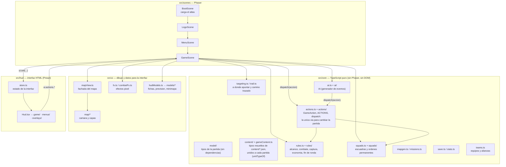

# Arquitectura

Mapa del codigo para personas y agentes de IA: que hace cada parte, como fluye un turno y por que se
tomaron las decisiones que no conviene deshacer sin pensarlo.

## Capas



- `src/core` no conoce la pantalla: se prueba con vitest, la usa la herramienta de equilibrio y la
  partida por texto (`npm run play`). ESLint prohibe que importe Phaser, Preact o el DOM.
- Las escenas orquestan: leen la entrada, mandan acciones (`dispatch`), animan los sucesos que
  devuelven y publican el estado de la interfaz. La interfaz HTML no toca el juego: llama a
  `ui.actions`, que registra la escena.

### El nucleo por dentro

`actions.ts`, `rules.ts`, `ai.ts` y `squads.ts` son fachadas: reexportan lo publico de sus modulos,
uno por tema, y desde fuera de `src/core` se importa siempre de ellas (`'../core/rules'`,
`'@core/actions'`); ESLint no deja que la escena, la interfaz ni las herramientas importen los
modulos de dentro. Dentro de core, mejor del modulo concreto (`'./rules/movement'`): menos
acoplamiento y sin ciclos.

### Acciones: la unica via para cambiar la partida

Quien juega un equipo (la persona en la pantalla, la IA, `npm run play`, el jugador al azar del
fuzz, la huella) cambia la partida mandando una **accion**: `dispatch(s, team, action)`
(`core/actions.ts`). Una `GameAction` (`model/actions.ts`) son datos, con uids y casillas (nunca
objetos de la partida): se puede guardar, repetir o mandar por la red.

```ts
const result = dispatch(s, viewer, { kind: 'attack', uid: tank.uid, target: enemy.uid });
if (result.ok) await play(result.events); // si no, result.reason dice por que ('notTarget', 'spent'...)
```

- Las `INVARIANTS` son de las reglas (`rules/invariants.ts`): las repasan `dispatch` despues de cada
  accion y `endRound` al acabar la ronda, asi que ninguno de los dos copia sus pasos.
- `dispatch` pasa las comprobaciones comunes (`ACTION_GUARDS`, `actions/guards.ts`: la primera, que
  tenga la forma de una accion, `isGameAction` con `ACTION_SHAPES` de `actions/shape.ts`, o
  `'badAction'`; que la mande un equipo de la partida; que ese equipo no haya perdido, `'defeated'`;
  el turno, cuando la partida sepa de quien es, fase 4), el `validate` de la
  accion, su `apply` (con los dados de la partida, `diceOf(s)`) y despues las `INVARIANTS`
  (`rules/invariants.ts`: fuera los muertos, las capturas cuya unidad se ha ido, las escuadras
  vacias, el dinero por encima del maximo, el movimiento que ya no se puede deshacer). Las
  invariantes no saben de acciones; `dispatch` tampoco: lee lo que dice la entrada del registro.
- `ACTIONS` (`actions/registry.ts`) tiene una entrada por accion (el tipo obliga), cada una en el
  modulo de su tema (`movement`, `combat`, `capture`, `transport`, `units`, `economy`, `powers`,
  `standingOrders`, `squads`). `validate(s, team, action)` lo calcula todo desde la partida (alcance,
  vision, dinero, de quien es cada unidad): no se fia de nada que traiga la accion. `apply` usa las
  piezas de `rules/` y `squads/` y devuelve los sucesos.
- `actionProblem`/`isValidAction` preguntan lo mismo sin cambiar nada. El menu de una unidad sale de
  ahi: `UNIT_MENU` (`actions/menu.ts`) dice con que acciones se cumple cada opcion y
  `availableActions(s, team, unit)` ofrece, en ese orden, las que tienen alguna que vale (la escena
  solo añade «Atras», en el sitio que dice `BACK_GOES_BEFORE`). Lo que se manda a unas unidades
  elegidas (un grupo, la bandeja) sale igual de `SELECTION_MENU` y `canDoWithSelection`; las
  opciones que son las mismas con una sola unidad (las ordenes, quitarlas) salen de ahi tambien
  (`ORDER_OPTIONS` dice cual es cada orden), y mover un grupo es su plan (`groupMoveOrder`,
  `groupMoveStep`), que la escena cumple paso a paso. Los mandos (`controls/actions.ts`,
  `INPUT_ACTIONS`) solo preguntan ahi y añaden lo que es de la interfaz. Lo que pasaria al soltar la
  unidad en otra casilla tambien lo dice el nucleo (`targetProblem`, `canCaptureAt`).
- Deshacer el ultimo movimiento es la accion `undoMove`: la partida guarda ese movimiento
  (`GameState.lastMove`, con la captura a medias que perdio la unidad al irse) hasta la accion
  siguiente (solo las que mueven la dejan abierta: `keepsUndoWindow` en su entrada del registro;
  dispatch la cierra tras las demas con `closeUndoWindow`, de `rules/lastMove.ts`, donde esta tambien
  por que no se puede deshacer) o hasta que su unidad deja de estar recien movida (la invariante
  `undoWindow`: el fin de ronda, si cae). Si al moverse descubrio enemigos
  (`lastMove.revealed`), no se deshace (`'revealed'`): con niebla seria mirar gratis. «Atras» del
  menu de la unidad solo manda `undoMove` (y avisa si el nucleo dice `'revealed'`). Ctrl+Z todavia
  no: guarda en la escena una pila de partidas enteras de antes de cada movimiento, solo apunta una
  si `undoMove` valdria en ese momento, y la vacia con cualquier suceso fuera de `KEEPS_UNDO`
  (`GameScene.ts`); al deshacer, vuelve a esa copia. Juntar los dos en un solo deshacer del nucleo es
  de la fase 4.
- Los viajes de varios turnos (`Unit.travelTo`, «Ir alli»; reglas en `rules/travel.ts`): 'travel'
  pone el destino (otra casilla que la unidad pueda pisar y hacia la que pueda dar ya un paso:
  `travelProblem`) o lo quita, y 'travelStep' da el paso de cada turno, hacia la casilla del alcance
  que mas acerca (`travelStepOf`). Si ya esta en el destino o llega este turno, el viaje acaba sin
  moverla (el ultimo trozo lo hace quien juega: puede seguir, atacar o capturar); una emboscada por
  el camino tambien lo acaba. Moverla a mano ('move', 'load', 'merge', 'attack') lo acaba con
  `endTravel`; capturar o esperar, no. Cada fin tiene su suceso 'travel' con `to: null` y por que
  (`end`: 'cancelled', 'arrived', 'withinReach' o 'ambush'), y la escena avisa «llega» solo con
  'withinReach'. La escena solo manda 'travel' y 'travelStep' (al dar la orden y al empezar el turno).
- Lo que cambia la partida y no es de quien juega se queda fuera de `dispatch`: preparar una partida
  (`newGameState`, `newUnit`, `appointGeneral`) y el fin de ronda (`endRound`).
- **Una accion nueva**: su forma en `GameAction` (`model/actions.ts`) y la de cada campo en
  `ACTION_SHAPES` (`actions/shape.ts`; el tipo la pide), su suceso en `GameEvent` (`model/events.ts`)
  y su entrada en el modulo de `actions/` que toque (con `keepsUndoWindow` si deja deshacer lo de
  antes); si se ofrece en el menu de una unidad, su entrada en `UNIT_MENU`; si se puede mandar a unas
  unidades elegidas, en `SELECTION_MENU` (y en `INPUT_ACTIONS` y `ACTION_RUNNERS` de los mandos y la
  escena); su animacion en `ANIMATORS` (`scenes/game/playback.ts`). Lo comun a todas las acciones es
  una entrada en `ACTION_GUARDS`; lo que hay que limpiar despues de cualquiera (y de cada ronda), una
  en `INVARIANTS`, que devuelve sus sucesos.

### Sucesos

Cada accion y el fin de ronda devuelven sus sucesos (`GameEvent`, `model/events.ts`), completos para
contar lo que ha pasado sin mirar la partida: quien lo hizo (`actor`: el equipo que mando la accion,
o null en los del fin de ronda), a quien (uids), tipos y casillas. El ataque nombra a su objetivo
por uid (`target`) y su casilla (`at`) y lleva como estaban las dos (`combat`), el botin y la carga
que gana cada general (`charge`); la compra, el tipo y el equipo; la captura, siempre los puntos que
quedan. Lo que dejan en orden las `INVARIANTS` tambien se cuenta, detras de los de la accion y sin
actor: `cargoLost` (los pasajeros de un transporte que cae; tambien al retirarlo), `captureDropped`
(una captura a medias cuya unidad se ha ido), la escuadra que se queda vacia (`squad` con `change:
'removed'`; cada escuadra que desaparece tiene un solo suceso: ver `SquadChange`) y
`fundsCapped` (el dinero que pasaba del maximo; botin, poderes e ingresos se cuentan enteros y lo
perdido va aqui, porque el tope se aplica al acabar la accion o la ronda, no al cobrar). Con ellos
se anima (`ANIMATORS`), se cuentan las estadisticas (`recordEvent`, por el `actor`) y se resume el
fin de ronda (`roundReport(s, events)`: lo que enseña la escena). `endRound` devuelve los suyos:
`income`, `heal`, `upkeep`, `controlPoint`, `newDay`, `weather` (cada paso de `ROUND_PHASES` da los
que tiene) y, al final, los de las `INVARIANTS`, que `endRound` tambien repasa (`fundsCapped`...).

Las piezas de abajo, que usa todo lo demas:

| Pieza | Que va |
|---|---|
| `model/` | los tipos de la partida (`GameState`, `Unit` y su `UnitTurnState`, `Building`, `GameAction`, `GameEvent`, `StandingOrder`, `Squad`, `LastMove`, `RulesConfig`, `Rng`, `Dice`...). Solo tipos: no importa nada ni exporta constantes o funciones (ESLint lo vigila) |
| `content/` | el contenido (JSON validados) resuelto al cargar en tipos con campos con nombre (`UnitType`, `BuildingType`, `TerrainType`, `WeatherType`, `Theme`, generales y sus poderes), cada uno en un catalogo por id (`Catalog`: `list` en el orden del fichero y `byId`; `findEntry`/`entryOf`): `loadContent(ficheros)` da un `GameContent` congelado; `content/default.ts`, el del juego (`defaultContent()`, perezoso). Ver docs/CONTENIDO.md |
| `gameContent.ts` | el contenido de cada partida es un campo, `GameState.content` (en el modelo se llama `MatchContent` y content/index.ts le da la forma de `GameContent`): lo ponen `newGameState` y `readSave`, no se guarda (`serialize` escribe `SavedGameState`) y se lee como `s.content` o con los atajos que dan el tipo resuelto de lo que hay en la partida: `unitTypeOf(s, unit)`, `buildingTypeOf`, `isHq`, `terrainAt(s, pos)`, `themeOf(s)`, `weatherTypeOf(s, id)`, `weightsOf(s)` (y `findUnitType`/`findBuildingType` para lo que viene de fuera). Las partidas guardan ids (`unit.type = 'Tank'`), nunca el puesto en el fichero; `cloneState(s)` copia la partida y comparte el contenido |
| `gameState.ts` | `newGameState({ map, rules, content, teams, diceSeed, theme? })`: el unico sitio que escribe la forma de una partida nueva (mapgen, misiones, laboratorio, duelos, tests). Quien la crea dice sus equipos (`teams: duel('human', 'ai')` o una lista de `TeamSetup`) y la semilla de sus dados |
| `dice.ts` + `util/random.ts` | el azar. Los dados de las reglas (el combate) son de la partida: `GameState.dice` es el estado de un mulberry32 (un entero de 32 bits) y `diceOf(s)` tira de el, asi que se guarda y se repite con la partida. Las decisiones de quien juega (la IA, el generador de mapas) llevan su propio `Rng` (`seededRng`): lo que decide no cambia lo que sale en los dados. `util/random.ts`: el paso de mulberry32 (`randomStep`), `seededRng`, `seedFromDraw` |
| `rulesSchema.ts` | `RULE_SCHEMA`: que valores puede tener cada regla (interruptor, o numero entero o no en un intervalo, quiza null). La usan el contenido (rules.json) y el guardado; rules.schema.json dice lo mismo para los editores (lo comprueba un test) |
| `rulesConfig.ts` | `rulesWith(contenido, cambios)`: las reglas por defecto de ese contenido (`content.defaultRules`) con cambios; nunca `{ ...reglas, ... }` a mano |
| `teams.ts` | los equipos de la partida (`GameState.teams`, ver "Equipos" abajo): `teamState`, `isHostile`/`areAllied`, `isHostileOwner`/`isAlliedOwner`, `enemiesOf`/`alliesOf`, `teamsControlledBy`, `isAiControlled`, `isPlayableOnOneScreen`, `playerTeam`, `perTeam`, `duel`/`duelTeams`, `newTeams` |
| `data.ts` | constantes que no son contenido (`MAP_SIZES`, `MAP_MIN`/`MAP_MAX`, `MAX_LIFE`). Las tablas del generador de mapas (`mapgen.json`) y los temas (`themes.json`: letras de los mapas en texto, probabilidades de terreno) son contenido; `MoveType` (`'foot'`, `'vehicle'`...) esta en `content/types.ts` |
| `defaultGames.ts` | partidas con el contenido del juego: `createGame(rng, opciones)`, `loadGame(json)` y `saveContext(contenido)` (lo que usa la web). Con `content/default.ts`, el unico sitio del nucleo que conoce el contenido del juego (ESLint) |
| `save.ts` + `savedParts.ts` + `saveMigrations.ts` | guardar y leer. `readSave(json, contexto)` da `{ ok, state }` o `{ ok: false, error }` con el `SaveError` de la parte rota (`badMap`, `badUnits`, `badRules`...); `deserialize` es su atajo que da null. El `SaveContext` da el contenido y las reglas de las misiones (save.ts no importa el catalogo). El JSON leido es un `SavedGame` (sus campos, `unknown`) hasta que se ha comprobado entero; `savedParts.ts` comprueba o limpia cada parte (lo opcional roto se quita) con lo que necesita (`SaveFrame`: contenido, bordes del mapa, cuantos equipos), y leer no cambia nada mas (ni escuadras ni teclas). Cada partida guarda la version de su formato (`SAVE_VERSION` en saveVersion.ts, ahora 4, atada al tipo de `GameState.version`); `MIGRATIONS` es la lista de pasos que ponen al dia las de versiones anteriores, cada uno con hasta que version hace falta y si va sobre el JSON tal cual ('read') o sobre la partida comprobada ('checked'). Cada paso hace lo de entonces con su propia copia fija (no llama al codigo de ahora: de fuera solo lee el `SaveContext`, p. ej. la lista de unidades de su contenido). Los del formato 1: nombres viejos de campos, reglas que faltaban, pasar a la escuadra la orden comun de sus unidades. Los de los formatos 1 y 2: 'tipos por id en vez de por numero' (unidades, edificios, terreno, tema, clima y objetivo de captura; el terreno y los temas con su orden de entonces, `FORMAT_2_TERRAIN`/`FORMAT_2_THEMES`) y 'bandos fijos pasan a equipos' (los pares [jugador, IA] de dinero, generales y estadisticas pasan a `teams`; las escuadras y la mision eran del equipo 0). Los de los formatos 1 a 3: 'dados de la partida' (una semilla sacada de la del mapa y el dia), 'banderas del turno pasan a turnState' y 'teclas de grupo de las escuadras' (lo que hacia leer entonces). Se prueban con partidas guardadas de verdad (`tests/fixtures/saves/*-v1.json`, `*-v2.json`, `*-v3.json`) |
| `util/grid.ts` | `Grid<T>`: rejilla con `at`, `atClamped`, `set`, `contains`, `forEach`, `cells`, `createLayer`, `width`/`height`; `GridBounds` (tamaño y `contains`) para lo que solo mira los bordes |
| `mapGrid.ts` | el mapa de una partida como rejilla: `mapGrid(s)`, `terrainAt`, `isOnBoard`, `createLayer(s, fill)` |
| `geom.ts` | `posOf` (copia la casilla de una unidad o edificio), rombos (`diamond`, `neighbors4`) y cuadrados (`squareArea`), que reciben los bordes y solo dan casillas de dentro, `posKey` |
| `util/validation.ts` | comprobar lo que viene de fuera: `isInt`, `isPos`, `isPosOn(bordes, valor)` (y `isEntryId(catalogo, valor)` en content/catalog.ts) |

**El estado es la unica fuente de la partida**: las reglas van en `s.rules` (obligatorias), el tamaño
del mapa en `s.map`, los equipos en `s.teams` y el contenido va unido a la partida (`s.content`); no hay variables de modulo
con la partida en curso, y dos partidas con otro tamaño, otras reglas u otro contenido se juegan a la
vez en el mismo proceso (tests/gameContent.test.ts, tests/mapSizes.test.ts). Las consultas no la cambian
(`statsOf`, `captureProgress`); lo que la cambia son las acciones (`dispatch`), el fin de ronda y lo
que la prepara, y lo dice en el nombre (`recordEvent`, `newUnit`...).

`src/core/squads/` (escuadras y ordenes permanentes del jugador): `queries` (unidades de una
escuadra), `naming` (nombres y teclas de grupo), `standingOrders` (la orden de la escuadra y la propia
de cada unidad) y `membership` (formar, meter, sacar, deshacer): las piezas con las que se hacen las
acciones de escuadras y ordenes (`actions/squads.ts`, `actions/standingOrders.ts`); la fachada
`squads.ts` solo da las consultas. Las cumple la IA al acabar el turno (`ai/standingOrders.ts`). `targeting.ts` y `trail.ts`: desde donde atacar y el camino trazado con el
cursor, para la escena.

`src/core/rules/` (cada modulo solo importa los de encima en la tabla; no hay ciclos):

| Modulo | Que va |
|---|---|
| `queries` | que hay en una casilla, por donde se anda (`canMoveOn`, `movementOf`), unidades de un equipo, pasajeros |
| `unitTurn` | el turno de cada unidad (`Unit.turnState`: `'ready'`, `'moved'`, `'done'`): `canStillAct`, `canStillMove`, `canStillFire` (una de distancia movida ya no dispara), y la unica forma de cambiarlo (`markMoved`, `spendUnit`, `readyUnit`) |
| `funds` | el dinero: `earn`, `pay` (paga lo que haya) y `capFunds` (lo que pase del maximo se pierde al acabar cada accion y cada ronda) |
| `visibility` | vision y niebla (la de toda la alianza) |
| `capture` | puntos de captura, capturas a medias (`captureProgress`, solo consulta; `dropStaleCaptures`, una de las INVARIANTS), capturar y su suceso |
| `lifecycle` | crear, quitar y limpiar unidades |
| `movement` | alcance (`moveRange`), caminos (`plannedPath`: por donde iria, calculado desde la partida), emboscadas, recorrer un camino (`followPath`), distancia por tierra, el suceso de mover |
| `combat` | alcance de tiro y objetivos (`attackProblem`, `attackTargets`), proteccion, acierto (`HIT_MODIFIERS`), veterania, contraataque, botin, la tirada (`strike`) |
| `forecast` | prevision de combate y zona de amenaza |
| `transport`, `supply` | unir y transportes (`mergeProblem`, `loadProblem`, `unloadProblem` y como se hacen); reparar |
| `economy` | ingresos, mantenimiento, limite del ejercito, comprar (`buyProblem`, `buildUnit`) |
| `control`, `round` | puntos de control; fin de ronda (`ROUND_PHASES`, cada paso devuelve sus sucesos; `roundReport`, el resumen) |
| `outcome` | victoria y derrota de cada equipo (`outcome(s, team)`, `isMatchOver`), puntos del limite de dias por alianza, objetivos de mision |
| `turnOrder` | quien juega y en que orden (`turnTakers`, `othersAfter`, `turnsAfter`, `takesTurn`: los derrotados ya no) |

`src/core/ai/`: `context` (el `AiCtx` del turno y ayudas comunes), `scoring` (cuanto vale cada
ataque), `tactics` (retirarse, atacar, capturar, avanzar), `fire` (fuego concentrado), `unitTurn`
(prioridades de cada unidad), `production` (que fabrica), `formation` (escuadras que avanzan juntas)
y `standingOrders` (ordenes permanentes del jugador, `StandingOrder`, y su prevision). `ai.ts` tiene `aiTurn`, que los junta.

- **Sin estado global en la IA**: el equipo que juega, el modo grupo y el plan de fuego van en un
  `AiCtx` que crea quien empieza el turno (`aiTurn`, `assistTurn`, `startStandingOrder`) y se pasa a cada
  paso. Dos turnos, o una prevision en medio de uno, no se mezclan (lo necesitara un PvP o un
  servidor con varias partidas).
- **La IA juega por la misma via**: cada cosa que hace con una unidad es una accion
  (`act`, `doMove`, `finish` en `ai/context.ts`, que llaman a `dispatch` con su equipo); los sucesos
  que da son los que devuelve `dispatch`. Decide con su `Rng`; los combates tiran de los dados de la
  partida.
- **Puntos de extension**:
  - una regla que cambia la probabilidad de acierto es una entrada en `HIT_MODIFIERS`
    (`rules/combat.ts`); la prevision, el panel de combate y la IA la ven solas;
  - un sistema que actua cada ronda es un paso en `ROUND_PHASES` (`rules/round.ts`), en su sitio;
  - una clase de habilidad de unidad es su forma en `AbilityDef` (`content/types.ts`) y su efecto en
    `abilities.ts`, como funcion que pregunta la regla que toca (las reglas no leen `abilityOf`);
  - un comportamiento de IA nuevo (un papel de unidad) es una entrada `{ id, when, run }` en
    `UNIT_BEHAVIOURS` (`ai/unitTurn.ts`), en su sitio de la lista; `run` devuelve si ha usado la
    unidad y suele llamar a un paso de `ai/tactics.ts`;
  - una razon nueva para preferir o evitar un ataque es un termino en `ATTACK_SCORE_TERMS`
    (`ai/scoring.ts`); un tipo de orden permanente del jugador, una entrada en
    `STANDING_ORDER_TURNS` (`ai/standingOrders.ts`); un tipo de efecto de general, una entrada en `EFFECT_VALUES` (`aiGenerals.ts`).
- La arena (`npm run arena -- --snapshot`) copia `ai.ts` y todo `ai/`, asi que un modulo nuevo de la
  IA entra solo en la referencia. La referencia (`improve/ai-baseline/`) usa el nucleo de ahora por
  `@core/...`: `tsc` la comprueba y `tests/arenaSnapshot.test.ts` le hace jugar una partida corta,
  asi que un cambio del nucleo que la rompa se ve en `npm run check` (se arregla con otro `--snapshot`
  si la IA actual ya se ha aceptado, o adaptando la copia a ese cambio: lo unico que se edita en
  ella, como dice su cabecera; sus decisiones no se tocan).

### Equipos

Una partida tiene dos o mas equipos (`GameState.teams`, `TeamState`; una guardada, hasta 16): cada uno con su numero (`id`, su
puesto en la lista), su `alliance`, quien lo juega (`controller`: `'human'` o `'ai'`), su dinero, su
general y sus estadisticas. **Ningun numero de equipo es especial**: no hay "el 0 es el jugador".

- Enemigos son los de otra alianza (`isHostile`, `enemiesOf`); los de la misma comparten la vision,
  no se atacan ni se capturan lo suyo, y un punto de control solo lo disputan enemigos.
- Todo lo que es de un equipo lo dice: `unit.team`, `building.owner`, `squad.team`, `mission.team`.
  Las funciones que hacen algo por un equipo lo reciben siempre (`dispatch(s, team, action)`,
  `aiTurn(s, rng, team)`, `visibility(s, team)`, `outcome(s, team)`), sin valor por defecto.
- Los sucesos dicen que equipo los ha hecho (`actor`); el resumen de la ronda (`RoundReport`,
  `ControlReport`) lleva una lista por equipo (`perTeam`).
- Un equipo pierde si se queda sin Base o sin nada (`isDefeated`); los derrotados ya no juegan.
  El orden de los turnos esta en el nucleo (`rules/turnOrder.ts`), en dos formas que miran quien
  sigue en pie al llegar a cada equipo:
  - `turnTakers(s)`, una ronda entera: la huella, la arena, el fuzz, `npm run generals` y las
    partidas de prueba;
  - `othersAfter(s, team)`, lo que viene tras el turno de un equipo (los turnos de los demas y el
    fin de ronda en su sitio): la escena, `npm run play` y el fondo del menu.

  `npm run balance` juega sus dos lados en el orden pedido con `takesTurn`, y los tests que juegan
  dos partidas a la vez, turno a turno (`playInterleaved` en tests/helpers.ts), van por `teamIds` y
  `takesTurn`. Lo que le queda en el mapa a un derrotado se queda a proposito y el fin de ronda lo
  trata como el de cualquiera (cobra, se cura): nadie lo usa, y es botin para los demas.
- La partida termina (`isMatchOver`) cuando solo queda en pie una alianza, o cuando ya se ha
  decidido para los que quedan (objetivo de la mision, limite de dias: gana la alianza con mas
  puntos). Con 3 o mas equipos, que caiga uno no la acaba.
- Hace falta al menos dos alianzas (`newTeams` y `readSave` no aceptan menos).
- Las reglas no miran el `controller`: solo dice quien decide (la escena, la IA). Las ordenes con
  destino se le pueden dar a cualquier equipo.
- **La escena**: el equipo que juega la persona en la pantalla es `viewer` (`viewerOf`, con
  `playerTeam(s)`: el primero con `controller: 'human'`), y todos los `...Host` lo tienen. La niebla,
  la amenaza, lo que se elige y lo que se ordena son del `viewer`; los demas equipos los lleva la IA,
  por su orden en la partida y saltandose los derrotados (`turns.ts`). La interfaz no sabe de
  numeros de equipo: pinta y escribe por **lado** (`ui/sides.ts`: `'own'`, `'ally'`, `'enemy'` y
  `'neutral'` para lo que no es de nadie; azul lo propio y aliado, rojo lo enemigo).
- **Limite hasta la fase 4**: en una pantalla juega una sola persona (`isPlayableOnOneScreen`, en
  teams.ts).
  - El menu no ofrece continuar una partida guardada que no lo cumpla.
  - `startMatch` la trata como dañada y empieza otra: con `load` borra el guardado; una preparada
    por depuracion (`state`) no lo toca. `viewerOf` falla con una asi.
  - Si otro equipo que no es de la IA llegara a su turno, la escena (`checkPlayedByAi`) y
    `npm run play` fallan en vez de jugarlo por el (`notAiControlledReason`, en teams.ts).
  - Una partida sin personas (IA contra IA, de las herramientas) se mira desde el primer equipo, y
    ese lo juega la persona aunque guarde `controller: 'ai'` (las reglas no miran el controller).
- El turno en la barra de arriba es el del equipo que juega, por lado (`turn: Side`): tu turno, el
  de un aliado (en azul) o el de un enemigo (en rojo).
- Los mapas al azar valen para 2 o mas equipos (`generateGame` busca una salida por equipo, cada una
  lejos de las anteriores); la pantalla de nueva partida y las misiones son de dos (`duel`). Las
  reglas, la IA, el guardado y la escena ya valen para mas (tests/teams.test.ts: 4 equipos en 2
  alianzas y 3 todos contra todos).

### Herramientas

`tools/` (equilibrio, automejora, partida por texto, contenido) solo usa el nucleo, importado por su
alias: `import { createGame } from '@core/defaultGames'` (definido en `tsconfig.json` "paths" y en
`vite.config.ts`; `tsx` lo entiende solo). ESLint prohibe que `tools/` importe nada mas de `src/`
(escenas, interfaz, ajustes) o Phaser/Preact, y que los tests importen el nucleo por ruta relativa.
Lo que mide una regla fuera de una partida de verdad, sin comprobar nada (el combate suelto del
laboratorio de duelos y de los tests: `uncheckedAttack`), esta en `core/sandbox.ts`. ESLint prohibe
importar ese fichero desde cualquier fichero de `src/`, tambien del nucleo y con cualquier ruta
(`SANDBOX_IS_NOT_THE_GAME`): solo lo usan `tools/` y `tests/`. Y `resolveAttack`, el combate sin
comprobar que hay debajo, solo se puede importar en `sandbox.ts` (su modulo, `actions/combat.ts`, lo
usa para la accion 'attack'; `UNCHECKED_ATTACK_ONLY_IN_SANDBOX`).

Es el paso previo a un monorepo: si algun dia hace falta (un servidor para partidas online que use el
nucleo, una herramienta con dependencias propias, publicar el nucleo), `src/core` pasa a ser el paquete
`@ilogic/core` y basta con cambiar el alias. Hasta entonces, un solo paquete es mas simple.

### Interfaz HTML (src/hud)

Las escenas publican con `ui.set(...)` lo que hay que enseñar y los componentes de Preact solo lo
pintan; los botones llaman a `ui.actions.*`, que pone la escena. Cada pieza en su sitio:

| Que | Donde |
|---|---|
| El store (`ui`, `showToast`, `resetActions`...) | `store.ts` (reexporta todos los tipos: se importan de ahi) |
| Forma del estado y valor al arrancar | `state.ts` (`UIState`, `initialState`) |
| Lo que piden los botones, agrupado por pantalla | `actions.ts` (`UIActions`; su valor sin escena, en `store.ts`) |
| Tipo de lo que enseña cada panel | `vm/<panel>.ts` (`TileVM` en `vm/tile.ts`...) |
| Calculo de esos datos a partir de la partida (puro, con test) | `src/ui/models/<panel>.ts`, reexportado en `src/ui/hudModels.ts` |
| Raiz: pantalla en curso, dialogos y avisos | `Hud.tsx` |
| Paneles de la partida y donde va cada uno | `game/*.tsx`, colocados en `game/GameHud.tsx` (lista `GAME_PANELS`) |
| Pantallas del menu, pausa y final | `menus/*.tsx` |
| Dialogos (ayuda, novedades, nombre de escuadra) y avisos (carga, aviso, resumen, cartel) | `overlays/*.tsx` |
| Piezas compartidas | `common/`: `Button` (sin foco del navegador), `Btn` (menus), `Icon`, `Popover`, `Veil`, `Seg`, `useFold`/`FoldMark`, `useTipToggle`, `useUI`, formatos (`pct`, `range`...) |
| Estilos | `styles/<grupo>/<panel>.css`, juntados en orden por `hud.css` |

- **Un panel nuevo**: su tipo en `vm/`, su campo en `UIState` (null = no se ve) y en `initialState`,
  la funcion que lo calcula en `ui/models/` (con test), el componente en `game/` (o `menus/`,
  `overlays/`), su entrada en `GAME_PANELS` de `GameHud.tsx` (o `Hud.tsx`), sus acciones en `actions.ts` con su valor
  por defecto en `DEFAULT_ACTIONS`, y su hoja al final de `hud.css`.
- **Botones**: siempre `Button` (o `Btn` en los menus), que no se queda con el foco: Enter y las
  flechas son del juego (lo lleva la escena con el teclado). Solo el cuadro del nombre de escuadra
  usa botones normales, porque ahi se escribe.
- **Estilos**: cada hoja de `styles/` es un trozo seguido de la hoja de antes y `hud.css` las importa
  en ese orden, que es el de la cascada. Por eso hay alguna mezclada (`base/narrow.css`,
  `legacy.css`): mover reglas de sitio puede cambiar quien gana. Lo nuevo va al final; los colores son
  variables de `styles/base/base.css` (los mismos que `ui/palette.ts`).
- **Textos**: `t('clave')` (de `settings.ts`) busca en `src/i18n/`, un fichero por tema en `es/` y su
  traduccion con el mismo nombre en `en/` (tipada con `Translation`: si falta una clave, no
  compila). Un texto nuevo va al tema que toca en `es/` y luego en `en/`; las claves no se repiten
  entre temas (`tests/i18n.test.ts`).
- Los textos salen de `t('clave')` al pintar: por eso los componentes no se memorizan (`memo`), un
  cambio de idioma o de escala tiene que repintarlos aunque sus datos no cambien.

## Un turno, paso a paso

```mermaid
sequenceDiagram
  participant J as Jugador
  participant G as GameScene
  participant R as core/rules
  participant V as MapView + fx
  participant H as store → Preact
  J->>G: clic / tecla / arrastrar
  G->>R: dispatch(s, viewer, { kind: 'move' | 'attack' | 'capture' | 'buy'... })
  R-->>G: estado cambiado + GameEvent[] (o el motivo del rechazo)
  G->>V: playEvents (animar)
  G->>H: refresh() → hudModels → ui.set
  J->>G: fin de turno (E)
  loop cada accion de la IA
    G->>R: aiTurn(s, rng, equipo) de cada otro equipo, por orden (cada accion por dispatch; da sus sucesos)
    G->>V: animar el evento
  end
  G->>R: endRound (ingresos, curar, dia + 1: sus sucesos, y roundReport los resume)
  G->>H: resumen de ronda, guardado automatico
```

- Las acciones **cambian el estado y devuelven sucesos**; las animaciones solo cuentan lo que ya ha
  pasado. Por eso el turno enemigo se puede repetir (estado de antes, con sus dados, y la semilla de
  la IA) y acelerar sin cambiar nada.
- El azar: los dados de los combates van en la partida (`GameState.dice`, `diceOf(s)`) y las
  decisiones llevan su propio `Rng` con semilla. La misma semilla da el mismo mapa y la misma partida
  IA contra IA (`tests/aiGolden.test.ts` y `npm run huella` lo vigilan); cargar una partida no cambia
  lo que saldra en sus combates: el resultado de un ataque ya esta fijado por la partida, y volver a
  cargar para atacar otra vez da el mismo. Las guardadas en el formato 3 o antes no tenian dados: al
  leerlas se les da una semilla fija, sacada de la del mapa y del dia (la migracion 'dados de la
  partida'), asi que tambien repiten.
- La semilla de las decisiones de la IA no es de la partida sino de quien la hace jugar: en la
  pantalla, `TurnFlow.playOtherTeams` (`scenes/game/turns.ts`) saca una nueva cada ronda y se la
  guarda con el estado de antes para «Repetir turno enemigo»; en las herramientas, la de su
  `--seed`. Va aparte de `GameState` a proposito: es estado del que controla a ese equipo, no de las
  reglas, y no se guarda (cargar y pasar turno puede dar otras decisiones, nunca otros dados). Cuando
  cada equipo tenga su controlador con estado (fase 6, puntos I), su `Rng` ira con el y la escena
  dejara de sacar semillas.
- **Nada de estado global de partida**: las reglas van en `s.rules` (obligatorias; `DEFAULT_RULES` esta
  congelado y cada partida lleva su copia, con los cambios de su modo, mision o laboratorio) y el tamaño
  del mapa sale de `s.map` (`mapGrid(s)`, `createLayer(s, fill)`, `isOnBoard(s, pos)` en `core/mapGrid.ts`).
  Asi dos partidas a la vez (la de la pantalla y la miniatura del menu, una prevision, un servidor) no se pisan.

## Graficos

`tools/art/` (dibujos guardados de PixelLab y Retro Diffusion) → `npm run assets` →
`public/assets/img/` (cada imagen) → `public/assets/atlas/` (2 paginas) → BootScene crea la textura
`'atlas'`. El terreno nuevo se pinta una vez por partida en un lienzo (`terrainArt.ts`) con piezas
precompiladas (costas, agua, niebla); en tiempo de juego solo se colocan. Ver README, "Graficos".

## Vista del mapa

`MapView` (`src/ui/mapView.ts`) es solo la fachada que usan la escena, el menu y las pruebas: crea las
capas de `src/ui/map/`, las apila en un contenedor y les reparte `render(s, options)` y `tick(time)`.
Cada capa hace una cosa:

| Capa (de abajo arriba) | Fichero | Que dibuja |
|---|---|---|
| terreno | `map/terrainLayer.ts` | lienzo del terreno nuevo (`terrainArt.ts`) y agua animada, o casillas de 2013 |
| quemados | `map/decals.ts` | marcas en el suelo donde cae una unidad |
| edificios | `map/buildingLayer.ts` | edificios y, ordenados por fila con ellos, montañas y bosques |
| niebla | `map/fogLayer.ts` | niebla del dibujo nuevo (lienzo, `fog.ts`) |
| resaltados | `map/overlayLayer.ts` | un Graphics que se rehace entero: lista `OVERLAYS` (abajo) |
| banderines | `map/flagLayer.ts` | banderines dibujados de puntos de control y de ordenes |
| unidades | `map/unitLayer.ts`, `map/unitMarks.ts` | un sprite por unidad, vida, primer plano, estrellas, carga, orden |
| marcas | `map/markLayer.ts` | destino y escolta de la mision, aro de las elegidas |
| efectos | contenedor `fx` | lo que ponen `fx.ts`/`combatFx.ts` (`addFx`, `ghost`) y el recuadro (`map/selectionBox.ts`) |
| cursor | `map/cursor.ts` | esquinas de la casilla señalada |

La camara (zoom entero, limites, casilla ↔ pantalla) esta en `map/camera.ts`; las cuentas de
casillas en `map/geometry.ts`; los tipos que pasa la escena (`ViewOptions`, `HighlightKind`) en
`map/viewOptions.ts` (los reexporta `mapView.ts`, igual que `Facing`, `baseFacing` y `faceFlip`).

- **Una marca nueva sobre el mapa** (zona, marco, flecha, barra): una funcion `OverlayPainter`
  (`(graphics, options, context) => void`) en `OVERLAYS` (`map/overlayLayer.ts`), en su sitio del orden, y el
  dato que necesite en `ViewOptions`. Hoy: niebla de 2013, puntos de control, amenaza, resaltados,
  capturas, alcance, peligro, ordenes, intenciones y camino (`map/zones.ts`, `map/highlights.ts`,
  `map/orders.ts`).
- **Una capa con objetos propios**: una clase con `object` (`MapLayer`) y, si se anima por pasos,
  `tick(clock)` (`AnimatedLayer`, con `stepOf` para el paso); se apila en el constructor de `MapView`.
- **Un efecto** (animacion de un momento): una funcion en `fx.ts` o `combatFx.ts` que recibe la escena
  y un `FxHost` (la `MapView`). Las piezas comunes estan en `fxKit.ts` (`sleep`, `tween`, `fxRect`,
  `fxText`) y el dibujo de pixeles en `pixelDraw.ts` (`cornerBrackets`, `frameRect`, `fillRects`).
  Los de combate reciben un `FxTimeline` (escena + velocidad de las animaciones) y escriben sus
  esperas a velocidad normal: `timeline.wait(70)`.
- **La animacion de un `GameEvent` nuevo**: su entrada en `ANIMATORS` (`scenes/game/playback.ts`),
  una funcion `Animator<'tipo'>` que recibe el `EventStage` (escena, partida, esperas a la velocidad
  elegida); los que no se animan (esperar, ordenes, escuadras, el fin de ronda) llevan
  `noAnimation`. Sin ella no compila.
- Colores: `PAL` (los de `hud.css`) y `PAL_MAP` (solo del mapa) en `ui/palette.ts`.

## Decisiones (y por que)

| Decision | Por que | Que romperia deshacerla |
|---|---|---|
| Logica en `src/core` sin Phaser | Probar reglas e IA sin navegador; equilibrio con miles de partidas | Tests, `npm run balance`, `npm run play` |
| Interfaz en HTML (Preact) sobre el lienzo | Texto nitido en cualquier escala, accesible, facil de maquetar | Todo el HUD y los menus |
| Eventos en vez de animar dentro de las reglas | Repetir y acelerar turnos; la IA y el jugador comparten codigo | Repeticion del turno enemigo |
| Toda accion es un dato y pasa por `dispatch` | Una sola regla de lo que vale (menu, IA, partida por texto); acciones que se pueden guardar, repetir o mandar por la red | Validacion, sucesos completos, INVARIANTS |
| Dados en la partida, aparte de las decisiones | Cargar no cambia la suerte; la IA decide con su azar sin mover los dados | Formato 4, huella, partidas de referencia |
| Semillas para mapas y para la IA | Mapas compartibles por codigo; partidas reproducibles | Codigo de mapa, tests de referencia |
| Graficos compilados antes (`npm run assets`) y atlas oficial de Phaser | Carga rapida, mitad de tamaño, nada se dibuja al jugar | Rendimiento, HTML de un fichero |
| Color de bando por giro de tono desde un dibujo magenta | Una generacion por unidad (coste en RD) y bandos identicos | Arte y presupuesto de RD |
| Estado de partida reiniciado en `init()` (`resetMatch`) | Phaser reutiliza el objeto escena | Fallos al volver a jugar |
| Version en un solo fichero HTML | Jugar sin servidor (file://), compartir por correo | Releases, pruebas por file:// |
| Releases y web por GitHub Actions | La sesion de Claude no puede crear Releases; asi no hace falta | Novedades y aviso de version |
| Contenido resuelto al cargar en tipos con nombre, y guardado por id | `unitType.cost` se lee y se comprueba; añadir o reordenar una unidad no rompe partidas ni reglas | Formato 3 de las partidas, CONTENIDO.md |
| Equipos con alianza y controlador; ningun numero especial | Partidas de 3 o 4 equipos, con aliados, o IA contra IA, sin tocar las reglas | `isHostile`, la vision compartida, la interfaz por lado |

## La escena de la partida (`src/scenes/game/`)

`GameScene` es la raiz de composicion: tiene el ciclo de Phaser (`init`, `create`, `update`,
`SHUTDOWN`), el estado de la partida y la entrada de los mandos (`command`, `menu`), y lo reparte a
los modulos de `src/scenes/game/`, cada uno con una responsabilidad:

| Modulo | Que hace | Phaser |
|---|---|---|
| `types.ts` | `Phase`, `Intent`, constantes, `GameStartData` | no |
| `matchSetup.ts` | con que partida se empieza (guardada, preparada, laboratorio, mision o mapa nuevo); cada una trae sus reglas en `state.rules` y la escena no las toca | no |
| `phases/` | que hace cada fase del turno del jugador: una entrada de `PHASES` por fase (ver abajo) | solo tipos |
| `moveSession.ts`, `unitMoves.ts` | la unidad elegida (alcance y camino para la interfaz) y moverla: soltar, atacar, unirse, ordenes de varios turnos, mover en grupo, Atras (`undoMove`), Ctrl+Z | solo tipos |
| `mapOverlays.ts` | lo que se dibuja encima del mapa: capturas, ordenes, intenciones, puntos de control, escolta | no |
| `intent.ts` | que pasa al soltar la unidad elegida y por que camino (`MovePlan`) | no |
| `highlights.ts`, `menuModel.ts`, `hudParts.ts` | casillas marcadas, menu de bocadillo, prevision, panel de lo elegido, ayuda | no |
| `tutorial.ts`, `standingOrderPreview.ts` | panel de mision y pasos del tutorial; prevision de ordenes con cache | no |
| `input.ts` | enganche del teclado y los punteros a `src/controls` (`InputTarget`) | si |
| `pointerInput.ts` | lo que hace cada gesto en la partida (`PointerTarget`) | solo tipos |
| `groupSelection.ts` | grupo, «Elegir varias», escuadras, teclas de grupo | solo tipos |
| `carry.ts` | coger, arrastrar y soltar una unidad | si |
| `orders.ts`, `actionRunners.ts` | elegir y cumplir las acciones del registro (`ACTION_RUNNERS`: una entrada por accion) y las ordenes con destino; puntero del raton | solo tipos |
| `powers.ts`, `labMode.ts` | poderes del general (apuntar y usar); laboratorio de animaciones | poco |
| `playback.ts` | animar los `GameEvent` (mover, combate, captura, compra, poder del general) | si |
| `turns.ts` | fin de turno, turnos de los demas equipos (los lleva la IA, por orden, con el fin de ronda tras el ultimo), repeticion, ordenes de varios turnos | si |
| `endOfMatch.ts` | final de la partida y su pantalla | si |

- **La partida cambia con acciones**: los modulos que hacen algo en ella piden `ActionHost`
  (`types.ts`): `act(action)` la manda por `dispatch` con el equipo que mira y da sus sucesos (o
  null si no vale) y `perform(action)` ademas los anima. Ninguno cambia la partida a mano.
- **Dependencias por interfaces pequeñas**: cada modulo declara lo que necesita de la escena en una
  interfaz `...Host` (como `PointerTarget` en `src/controls`). La escena se la da con `live()`
  (`host.ts`): los campos se leen en la escena cada vez, asi que el modulo ve siempre la partida y la
  fase del momento sin que la escena haga publicos sus privados.
- **Estado**: cada modulo es dueño del suyo (la seleccion de `GroupSelection`, `othersPlaying` de
  `TurnFlow`...) y lo reinicia en `reset()`, que llama `resetMatch()`. La escena conserva accesores
  donde lo usan las pruebas (`group`, `multi`, `openGroupMenu`, `view`).
- **Lo que no usa Phaser se prueba** en `tests/sceneGame.test.ts`.
- Un sistema nuevo es un modulo nuevo con su `Host`; la escena solo lo crea y lo enchufa. Un campo
  que el modulo lee y cambia se da con `rw(get, set)` (`host.ts`).
- **Fases** (`phases/`): cada fase es un `PhaseHandler { enter?, accept, back, menu?, highlights? }`
  en `PHASES`, cuyo tipo pide una entrada por `Phase`. `accept` y `back` reciben un `PhaseHost`; `menu`
  (bocadillo) y `highlights` (casillas marcadas) son puros y los usan `menuModel` y `computeHighlights`.
  Las opciones del menu de la unidad (`UNIT_MENU_ACTIONS`: que hace cada una; cuales se ofrecen lo
  dice el nucleo, `availableActions`, y «Atras» siempre esta) y del de pausa (`GameMenuChoices`) son
  tablas por opcion. Una fase nueva es una entrada nueva; la escena no cambia.

## Mandos

Las escenas no leen teclas, botones ni punteros: un **adaptador** de `src/controls/` (funciones
puras, sin Phaser, con tests) traduce lo que pulsa el jugador a **ordenes**, y la escena las cumple.

| Orden | Donde vale | Quien la cumple |
|---|---|---|
| `InputCommand` (`inputCommands.ts`): cursor, aceptar, atras, deshacer, fin de turno, zoom... | el mapa y sus menus de bocadillo | `GameScene.command(cmd)` |
| `MenuCommand` (`menu.ts`): mover, aceptar, atras y atajos (opciones, notas, otro mapa) | menus de pantalla: inicio, partida nueva, campaña, opciones, notas, ayuda, fin de partida | `MenuScene.menu(cmd)`, `GameScene.menu(cmd)` (que pasan a `OptionsPanel.command`, `notesCommand`...) |
| gestos de `PointerGestures` (`pointer.ts`) | raton y dedos en la partida, incluido desplazar el mapa por el borde (`tick`, cada fotograma) | `pointerTarget()` de `scenes/game/pointerInput.ts` |

Cada escena dice donde esta el foco con `controlContext()`: `'map'` (ordenes `InputCommand`) o el menu
abierto (`'home'`, `'setup'`, `'typing'`, `'options'`, `'end'`...), que decide que teclas valen.

- **Teclado**: `keyCommand(key)` (tabla `KEY_BINDINGS`) en el mapa; `menuKeyCommand(key, context)` (tabla
  `MENU_BINDINGS`, una por menu) en los menus. Son las unicas tablas de teclas.
- **Raton y dedos**: la escena traduce el `Phaser.Input.Pointer` a `PointerIn` (`pointerIn`) y llama a
  `PointerGestures` (`down`, `move`, `up`, `wheel`, `leave` y `tick` en `update()`).
- **Seleccion** (`selection.ts`): como en los juegos de estrategia en tiempo real. Funciones puras que
  reciben el gesto ya decidido (clic con sus teclas y cuantas veces, recuadro) y devuelven la
  seleccion nueva (`clickSelect`, `boxSelect`); la escena solo la aplica (`applySelection`: una unidad
  que puede actuar queda elegida para moverla; varias forman el grupo, con aro a los pies). Los
  grupos con numero son escuadras con `Squad.key` (`setGroup`, `addToGroup`, `squadByKey` en
  `core/squads/`), y las teclas son la orden `group {n, mode}`.
- **Raton**: arrastrar con el izquierdo desde una casilla sin unidad propia es recuadro; con el
  derecho o la rueda, mueve el mapa; el derecho sin arrastrar es clic derecho (al soltar). El doble
  clic lo cuenta `PointerGestures` (`TapInfo.count`).
- **Acciones** (`actions.ts`, `INPUT_ACTIONS`): registro de lo que se puede hacer con lo elegido (mover, atacar,
  capturar, unirse, subir, ir alli, ordenes, escuadra). Cada accion dice cuando vale (`ok`: si se
  puede lo dice siempre el nucleo, `canDoWithSelection` con su `SELECTION_MENU` o, con la unidad que
  se mueve, lo que pasaria al soltarla; aqui solo se añade lo de la interfaz, como si hay un enemigo
  a la vista), su texto y su
  cursor. De ahi salen el clic derecho (`smartAction`: la primera principal que vale), el menu
  completo de Alt + clic derecho, F, la pulsacion larga y la bandeja (`menuActions`) y el puntero del
  raton (`cursorFor`, dibujado en `ui/cursors.ts`). La escena le pasa lo que solo ella sabe (que
  significa soltar la unidad elegida en esa casilla) y cumple la accion (`Orders.run`, en
  `scenes/game/orders.ts`, con lo que hace cada una en `ACTION_RUNNERS` de `scenes/game/actionRunners.ts`).
  Una accion nueva es una entrada en `INPUT_ACTIONS` y otra en `ACTION_RUNNERS` (el tipo la pide),
  y su opcion en `SELECTION_MENU` si es algo nuevo que mandar: los mandos no cambian.
- **Se quedan fuera a proposito**: el cuadro de texto del nombre de escuadra (`hud/overlays/RenameSquad.tsx`, para el
  teclado del juego mientras se escribe), `main.ts` (que Tab no mueva el foco del navegador), las
  capturas de teclas de Phaser (`addCapture`) y saltar el logo con cualquier tecla o clic (`LogoScene`;
  no es una orden, es "lo que sea").

### Añadir un mando (gamepad)

Un fichero nuevo, `src/controls/gamepad.ts`, con la misma forma que el teclado:

1. Tablas puras de botones → ordenes, p. ej. `padCommand(button): InputCommand | null` (A = aceptar,
   B = cancelar, cruceta = cursor, Start = opciones, LB/RB = zoom...) y
   `padMenuCommand(button, context): MenuCommand | null` (cruceta = mover, A = `ok`, B = `back`). La
   repeticion al mantener la cruceta se decide aqui (`ok` lleva `repeat`, como el teclado). Con tests.
2. En la escena, solo el enganche: leer los botones recien pulsados (`this.input.gamepad`, o la API
   `navigator.getGamepads()` en `update()`) y, segun `controlContext()`, llamar a
   `this.command(padCommand(button))` o a `this.menu(padMenuCommand(button, context))`. Nada mas de la escena cambia.
3. Phaser necesita `input: { gamepad: true }` en la configuracion del juego (`main.ts`).
4. La ayuda (`helpText.ts`) explica los botones.

El cursor del mapa y los menus de bocadillo ya funcionan solo con ordenes `InputCommand`, asi que un
mando puede jugar una partida entera sin raton.

## Donde mirar

| Quiero... | Fichero |
|---|---|
| Añadir o cambiar unidades y edificios (precio, daño...) | `src/core/content/*.json` (`docs/CONTENIDO.md`, skill `nueva-unidad`) |
| Cambiar terreno, reglas, pesos de la IA | `src/core/content/terrain.json`, `rules.json`, `ai.json` (+ skill `equilibrar`) |
| Cambiar una regla | su modulo en `src/core/rules/` (ver "El nucleo por dentro"; + test en `tests/`) |
| Cambiar cuando vale una accion o lo que hace, o añadir una | su entrada en `src/core/actions/` (ver "Acciones"; + test en `tests/dispatch.test.ts`) |
| Cambiar como juega la IA | `src/core/ai/` (`unitTurn.ts` prioridades, `tactics.ts` cada paso, `production.ts` compras), pesos en `data.AI` |
| Cambiar lo que enseña una ficha | `src/ui/models/tile.ts` y `src/hud/game/Cards.tsx` (ver "Interfaz HTML") |
| Añadir un panel o una pantalla a la interfaz | `src/hud/` (ver "Interfaz HTML") |
| Cambiar el dibujo del mapa | la capa de `src/ui/map/` (ver "Vista del mapa"), `src/ui/terrainArt.ts` |
| Añadir una marca sobre el mapa o un efecto | `OVERLAYS` en `src/ui/map/overlayLayer.ts`; `src/ui/fx.ts`, `src/ui/combatFx.ts` |
| Cambiar las teclas, o añadir un mando (gamepad...) | `src/controls/` (ver "Mandos": teclas del mapa en `keyboard.ts`, de los menus en `menu.ts`) |
| Cambiar los gestos del raton o del dedo (toque, arrastrar, pellizcar, pulsacion larga, recuadro, borde de la pantalla) | `src/controls/pointer.ts` (`PointerGestures` reparte los eventos; cada gesto es una pieza pura de `src/controls/gestures/`; lo que hace en la partida esta en `src/scenes/game/pointerInput.ts`) |
| Cambiar algo de la partida en pantalla (animaciones, turno enemigo, final, seleccion...) | `src/scenes/game/` (ver "La escena de la partida") |
| Cambiar que hace un toque con el dedo | `src/ui/touch.ts` |
| Textos | `src/settings.ts` (`TEXTS.es` / `TEXTS.en`) |
| Misiones | `src/core/missions.ts` (+ skill `nueva-mision`); un tipo de objetivo nuevo, una entrada en `OBJECTIVES` (`src/core/objectives.ts`, con su `isValid` para las partidas guardadas) y su frase en `OBJECTIVE_TEXT` (`src/campaign.ts`) |
