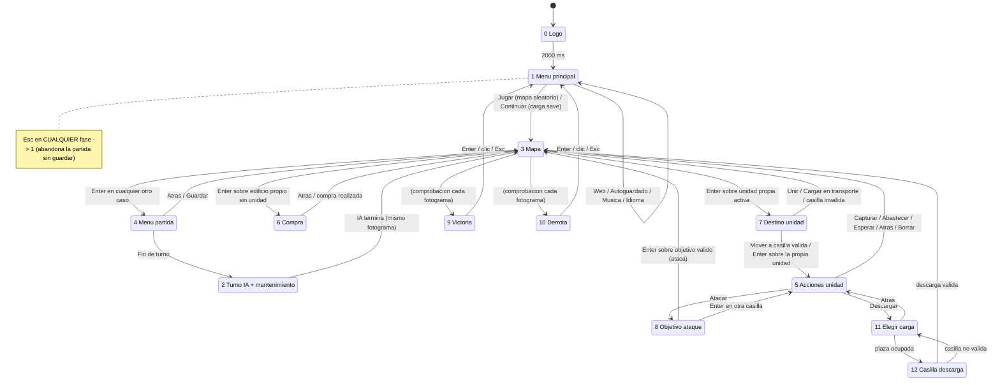

# Ilogic: especificación de interfaz, flujo y dibujado

Fuente única: `/home/claude/rename/final/*.java`, sobre todo `Ilogic.java` (incluye las clases `Cloud`) y `Boton.java`. Las reglas de combate, la IA y la generación de mapas se describen en otro documento. Aquí solo se citan cuando afectan a lo que se ve o a lo que se puede pulsar.

Notación: `Clase.metodo`. "Casilla" es una celda del mapa de 32×32 px. Las coordenadas en píxeles son relativas al área de dibujo (el `JComponent`) y no incluyen la barra de título. `focus` es la casilla del mapa que aparece en la esquina superior izquierda de la vista.

---

## 1. Ventana, layout y temporización

### 1.1 Constantes (valores exactos)

| Constante | Valor | Origen | Uso |
|---|---|---|---|
| `Terrain.TILESIZE` | 32 | Terrain | lado de una casilla en px |
| `MAPX`, `MAPY` | 32, 32 | Ilogic | tamaño del mapa en casillas (1024×1024 px en total) |
| `DISPLX`, `DISPLY` | 16, 16 | Ilogic | casillas visibles: vista de 512×512 px |
| `GAMEMENUX` | 160 | Ilogic | ancho del panel lateral derecho |
| `MENUX`, `MENUY` | 672, 512 | Ilogic | tamaño del menú principal |
| `WINMARGY` | 30 | Ilogic | margen vertical que se suma al alto de la ventana para la barra de título |
| `MAINMENUSTART` | 192 | Ilogic | y del primer botón del menú principal |
| `GAMEMENUSTART` | 192 | Ilogic | y del primer botón de los menús del panel |
| `HEALTHSTART`, `FUELSTART`, `AMMOSTART`, `CURRSTART` | 672 (los cuatro) | Ilogic | borde derecho de las filas de números del panel |
| `NUMX`, `NUMY` | 16, 32 | Ilogic | ancho de una cifra y alto de una cifra o icono del panel |
| `BUTCOLQUAN` | 4 | Ilogic | columnas de las cuadrículas de compra y descarga |
| `DISPLHEALTH`, `MAXHEALTH` | 10, 100 | Ilogic | la vida se muestra como `ceil(life*10/100)` |
| `LOGOX`, `LOGOY` | 320, 128 | Ilogic | no se usan; el código pone 320 y 128 a mano |
| `Boton.MAINBUTX`, `MAINBUTY` | 320, 40 | Boton | botón del menú principal |
| `Boton.GAMEBUTX`, `GAMEBUTY` | 160, 32 | Boton | botón de los menús del panel |
| `Boton.SQBUTSIZE`, `SQBUTMARG` | 40, 4 | Boton | celda cuadrada de compra o descarga y su margen interior |
| `logotime` | 2000 ms | Ilogic | duración del logo |
| `ticktime` | 0.1 s | Ilogic | duración de un fotograma del bucle de juego (10 FPS) |
| `ifunds` | 5000 | Ilogic | fondos iniciales de cada bando en una partida nueva |
| `maxfunds` | 999999 | Ilogic | tope de fondos (6 cifras como máximo) |
| `maxus` | 30 | Ilogic | máximo de unidades vivas por bando (afecta a la compra) |
| `butquan`, `gamebutquan`, `unitbutquan` | 6, 3, 7 | Ilogic | número de botones de cada menú |
| `Cloud.*` | ver §5.12 | Cloud | nubes |

### 1.2 Ventana (`Ilogic()` y `ciclomenu` / `ciclojuego`)

- Título "Ilogic". Icono de la ventana: `b_Soldier.png`. No se puede redimensionar. Posición inicial en pantalla (100, 50).
- Cursor del ratón propio: `mouse.png` (25×31, un soldado blanco), con el punto activo en (17, 0).
- Tamaños del *frame* (incluyen la barra de título, de ahí el `WINMARGY`):
  - Logo y menú: 672 × 542 (`setBounds(..., MENUX, MENUY+WINMARGY)`).
  - Partida: 673 × 542 (`TILESIZE*DISPLX + GAMEMENUX + 1`, `TILESIZE*DISPLY + WINMARGY`).
  - Victoria y derrota: 512 × 542 (`setSize` en `ciclojuego`). El panel lateral queda oculto.
- **Área útil real**: 672×512 en el menú y la partida, 512×512 en victoria y derrota. Las imágenes que se dibujan con alto 542 (`logoFP`, `fondoacciones`, `*_victmsg`, `*_deftmsg`) se escalan a 542 de alto y se recortan por abajo (sobran 30 px). En la captura `menu.png` (hecha sin gestor de ventanas) se ve una franja gris de 30 px bajo el menú: es el fondo del componente y no se ve en el juego real.
- **Para el remake**: lienzo lógico fijo de 672×512. En victoria y derrota, o bien se cambia a 512×512, o bien se mantiene 672×512 con las columnas 512..671 en negro (recomendado: no redimensionar y centrar o rellenar de negro). Para que el recorte sea idéntico, esas imágenes se escalan a su tamaño "de dibujo" (por ejemplo 672×542) y se recortan a 512 de alto. Todas las imágenes se dibujan **escaladas al tamaño de destino, no al nativo** (ver §5.13). El escalado de Java es por vecino más cercano: conviene `pixelArt: true` o filtro NEAREST.

### 1.3 Áreas de la pantalla de partida

```
x: 0 ............................ 511 512 ........... 671
   +-------------------------------+--------------------+ y=0
   |                               | fondos (y=8)       |
   |   VISTA DEL MAPA 16x16        | vida/coste (y=56)  |
   |   casillas de 32 px           | combustible (y=104)|
   |   (focus = casilla esq. sup.  | munición (y=152)   |
   |    izquierda)                 | menús (y>=192)     |
   |                               |  fondoacciones     |
   +-------------------------------+--------------------+ y=511
```

- Vista: casilla de pantalla (sx, sy) = (x − focus.x, y − focus.y), con 0 ≤ sx, sy < 16. Píxel = (32·sx, 32·sy).
- `focus` va de (0,0) a (16,16) (el mapa mide el doble que la vista). El desplazamiento es **por casillas enteras**, sin animación (ver §3.3).
- Panel: x de 512 a 671, fondo `fondoacciones.png` (360×670 nativo) escalado a 160×542 en (512, 0).

### 1.4 Hilos y bucles (`main`, `displGName`, `ciclomenu`, `ciclojuego`)

- El hilo principal hace: `displGName()` (logo) y después repite para siempre: [música del menú] → `ciclomenu()` → [para la música] → generar o cargar el mapa → reiniciar las nubes → [música de juego] → `ciclojuego()` → [para la música].
- La entrada (teclado y ratón) va en el hilo de eventos de Swing (EDT). Solo cambia campos (`phase`, `selbut`, `cursor`...) y a veces ejecuta acciones de juego (mover, atacar, comprar). El bucle del hilo principal lee esos campos. No hay sincronización: en el remake basta con un único hilo y procesar la entrada al llegar o en el `update`.
- **Logo**: dibuja una vez y espera 2000 ms con espera activa. Después `phase = 1`.
- **Menú** (`ciclomenu`): redibuja sin pausa, todo lo rápido que puede (100 % de CPU). Cada vuelta actualiza el estado de los botones (§4.1).
- **Partida** (`ciclojuego`): un fotograma cada 100 ms como mínimo (10 FPS) con espera activa. Pasos de cada fotograma, en orden:
  1. Si `phase == 2`: turno de la IA más mantenimiento (§8.2).
  2. Si `phase == 4`: marca como seleccionado el botón `selbut` del menú de partida.
  3. Si `phase == 5`: marca el seleccionado y recalcula qué botones de unidad están activos (§5.10.2).
  4. Comprueba victoria y derrota (§2, fases 9 y 10).
  5. Recorta a 0 el combustible y la munición negativos. Elimina (pone a null) las unidades con `life <= 0` y las transportadas cuyo transporte ha desaparecido.
  6. `doClouds()`.
  7. Repinta.
  8. Espera hasta completar los 100 ms. El contador `tick` sube cada ≥100 ms, pero no se usa en ningún otro sitio.
- El bucle sigue mientras `phase > 1`. Las fases 9 y 10 se quedan dentro del bucle hasta que el jugador vuelve al menú (`phase = 1`).

---

## 2. Fases (`Ilogic.phase`)

| Fase | Nombre | Qué se dibuja | Entrada |
|---|---|---|---|
| 0 | Logo | `logoFP.png` escalado a 672×542 en (0,0) | nada útil (ver rarezas) |
| 1 | Menú principal | `menubackground` 672×512, `logoilogic` 320×128 en (176,32), 6 botones 320×40 desde (176,192) | §3, §4 |
| 2 | Fin de turno / IA | escena de partida sin menús (casi nunca llega a verse, §8.2) | ninguna efectiva |
| 3 | Navegación por el mapa | escena de partida, cursor y fondos | mover cursor; Enter: seleccionar |
| 4 | Menú de partida | escena + 3 botones en el panel (Atrás, Guardar, Fin de turno) | arriba/abajo, Enter |
| 5 | Menú de acciones de unidad | escena + vida, combustible y munición de la unidad + botones de acción activos | arriba/abajo, Enter |
| 6 | Menú de compra (edificio) | escena + "Atrás" + cuadrícula de unidades fabricables + coste | flechas en cuadrícula, Enter |
| 7 | Unidad seleccionada: elegir destino | escena + casillas `seltile`, `mergetile`, `entertile` | mover cursor; Enter |
| 8 | Elegir objetivo de ataque | escena + `atktile` sobre los enemigos atacables | mover cursor; Enter |
| 9 | Victoria | `<idioma>victmsg.png` escalado a 512×542 | Enter, Espacio, clic o Esc: al menú |
| 10 | Derrota | `<idioma>deftmsg.png` escalado a 512×542 | igual |
| 11 | Elegir carga a descargar | escena + "Atrás" + cuadrícula de plazas del transporte | flechas en cuadrícula, Enter |
| 12 | Elegir casilla de descarga | escena + `seltile` en las adyacentes válidas | mover cursor; Enter |
| 13 | (sin usar) | solo `menubackground` | nunca se asigna |

"Escena de partida" se refiere al apilado de capas de §5.1, que se dibuja en todas las fases salvo 0, 1, 9, 10 y 13.

### 2.1 Diagrama de estados



Victoria y derrota se comprueban en **cada fotograma del bucle de juego, en cualquier fase > 1** (`ciclojuego`):
- Victoria (fase 9) si no queda un edificio de la IA (dueño 2) de tipo HQ (`Building.HQ` = 5, "Base"), o si la IA no tiene ni unidades ni edificios.
- Derrota (fase 10) con la misma condición para el jugador (dueño 1). Se evalúa después de la victoria, así que si se cumplen las dos gana la derrota.
- Al entrar en 9 o 10: si la partida se cargó desde fichero (`loadmap`), se borra `data/save`. La ventana se encoge a 512 de ancho.

---

## 3. Controles

### 3.1 Teclas (`mapeoTeclas`, InputMap WHEN_IN_FOCUSED_WINDOW)

| Acción | Teclas |
|---|---|
| ARRIBA | Flecha arriba, Arriba del teclado numérico (KP_UP), W |
| IZQUIERDA | Flecha izquierda, KP_LEFT, A |
| DERECHA | Flecha derecha, KP_RIGHT, D |
| ABAJO | Flecha abajo, KP_DOWN, S |
| ACEPTAR | Enter, Espacio |
| ESC | Escape |

La autorrepetición del sistema operativo está permitida (mantener una flecha mueve el cursor de forma continua). No hay otras teclas: ni zoom, ni atajos, ni retroceso.

### 3.2 Efecto de cada tecla por fase

**ARRIBA / ABAJO** (`Accion_UP` / `Accion_DOWN`):
- Fase 1: `selbut` −1 / +1 con vuelta circular entre 6. ARRIBA salta los botones inactivos (bucle do-while). ABAJO no los salta, pero `ciclomenu` avanza `selbut` hacia delante hasta el siguiente activo, con el mismo efecto.
- Fase 4: −1 / +1 circular entre 3.
- Fase 5: −1 / +1 circular entre 7, saltando los inactivos.
- Fases 6 y 11 (cuadrícula, ver §5.10.3): `selbut` va de 0 ("Atrás") a N, donde N es el número de tipos fabricables (fase 6) o `maxcarry` del transporte (fase 11).
  - ARRIBA: `selbut −= 4`. Si queda < 0: si se venía de 0, salta a N; si no, va a 0.
  - ABAJO: `selbut += 4`. Si queda > N, va a 0.
- Resto de fases (0, 2, 3, 7, 8, 9, 10, 12): mueve el cursor del mapa ±1 en y, dentro de 0..31, y ajusta `focus` (§3.3).

**IZQUIERDA / DERECHA** (`Accion_LEFT` / `Accion_RIGHT`):
- Fase 0: nada. Fases 1, 4 y 5: mueven el cursor del mapa, que no se ve; es inofensivo porque `ciclojuego` lo pone a (0,0) al empezar.
- Fases 6 y 11: `selbut` −1 / +1 con vuelta circular dentro de 0..N.
- Resto de fases: mueven el cursor ±1 en x (0..31) y ajustan `focus`.

**ACEPTAR** (`Accion_ENTER`):
- Fase 1: pulsa el botón `selbut` (§4.1).
- Fase 3: si hay una unidad propia **activa** bajo el cursor: `selent` = esa unidad, fase 7. Si no, si hay un edificio del jugador (dueño 1) **sin unidad encima**: `selent` = edificio, `selbut = 0`, fase 6. En cualquier otro caso (casilla vacía, unidad enemiga, unidad propia ya usada, edificio ajeno): fase 4 con `selbut = 0`.
- Fase 4: 0 Atrás → fase 3. 1 Guardar → guarda en `data/save` y pasa a fase 3. 2 Fin de turno → fase 2.
- Fase 5 (los índices son los del array completo, no la posición visual):
  - 0 Atacar (solo si `canfire`) → fase 8.
  - 1 Capturar → `Capture` del edificio bajo la unidad → fase 3.
  - 2 Descargar → fase 11, `selbut = 0`.
  - 3 Abastecer → `Heal` a las 4 unidades adyacentes; la unidad queda inactiva → fase 3.
  - 4 Esperar → unidad inactiva → fase 3.
  - 5 Atrás → fase 3 (la unidad sigue activa).
  - 6 Borrar → **elimina la unidad sin confirmar** → fase 3.
- Fase 6: con `selbut = 0` → fase 3. Si no, se traduce `selbut` al tipo de unidad: el k-ésimo tipo fabricable por ese edificio, en el orden del array `Unit.unames`. Si el coste es ≤ fondos y el jugador tiene menos de 30 unidades, se llama a `Spawn` (la unidad nace inactiva en la casilla del edificio) y se pasa a fase 3. Si no, no pasa nada y se sigue en la fase 6.
- Fase 7 (prioridad en este orden):
  1. Si la casilla del cursor está en el mapa de unión y hay una unidad: `Merge` (la seleccionada se funde en la de destino, que queda inactiva; la seleccionada desaparece al fotograma siguiente) → fase 3.
  2. Si no, si está en el mapa de carga y hay unidad: el transporte hace `Load` de la seleccionada (que se oculta) → fase 3.
  3. Si no, si la casilla es alcanzable (`1 ≤ moveMap ≤ mover`): `Move` (teletransporte instantáneo) → fase 5, `selbut = 0`.
  4. Si no: fase 3; pero si el cursor está sobre la propia unidad seleccionada → fase 5, `selbut = 0` (actuar sin moverse).
- Fase 8: si la casilla del cursor está en el mapa de ataque: `Attack` (instantáneo, sin animación), la unidad queda inactiva → fase 3. Si no → fase 5, `selbut = 0`.
- Fases 9 y 10 → fase 1.
- Fase 11: con `selbut = 0` → fase 5. Si la plaza `selbut−1` está ocupada → fase 12. Si está vacía, no pasa nada.
- Fase 12: si el cursor no está a distancia Manhattan 1 del transporte, o la casilla no es transitable para la unidad transportada (terreno o casilla ocupada) → fase 11. Si `Unload` tiene éxito: transporte inactivo → fase 3.
- Fases 0 y 2: nada.

**ESC** (`Accion_ESC`): `phase = 1` en **cualquier** fase. Desde una partida, la abandona sin guardar y vuelve al menú (el bucle de juego termina y la música cambia).

### 3.3 Cursor y desplazamiento de la vista

- `cursor` es una casilla del mapa (0..31, 0..31). `ciclojuego` la pone a (0,0), igual que `focus`, al empezar cada partida (nueva o cargada).
- **Teclado**: el cursor se mueve una casilla y `focus` se ajusta lo mínimo para que el cursor quede dentro de la vista. El desplazamiento solo ocurre cuando el cursor intentaría salir de ella.
- **Ratón** (fases 3, 7, 8 y 12, clic en x ≤ 512): la casilla pulsada es `(x div 32 + focus.x, y div 32 + focus.y)`.
  - Si es **distinta** del cursor: el cursor se mueve allí y, si queda en la columna o fila de pantalla del borde (15 o 0) y aún se puede desplazar, `focus` se mueve 1 en esa dirección. El cursor sigue en la misma casilla del mapa, que pasa a verse una fila o columna más adentro. Con eso termina el clic.
  - Si es **la misma**: equivale a ACEPTAR en esa fase.
  - En resumen: un clic coloca el cursor y un segundo clic en la misma casilla confirma. No importa el tiempo entre clics.
- No hay desplazamiento al acercar el ratón al borde, ni rueda, ni arrastre.

### 3.4 Ratón por fase (`mouseClicked`)

Solo se usa `mouseClicked` (pulsar y soltar), con **cualquier botón** del ratón (izquierdo, derecho o central, el código no los distingue). La regla general es "primer clic selecciona, segundo clic sobre lo mismo ejecuta".

| Fase | Zona válida | Comportamiento |
|---|---|---|
| 1 | x∈[176,496], y∈[192,432] | botón = (y−192) div 40. Si está inactivo, se ignora. Si ≠ `selbut`, se selecciona. Si ya estaba seleccionado, se ejecuta como ACEPTAR. |
| 3 | x ≤ 512 | §3.3. El segundo clic hace lo mismo que ACEPTAR en la fase 3. |
| 4 | x ≥ 512, y∈[192, 192+3·32] | fila = (y−192) div 32 entre los botones **activos**. Primer clic selecciona, segundo ejecuta. |
| 5 | x ≥ 512, y∈[192, 192+nActivos·32] | igual que la fase 4. La fila corresponde a la posición en la lista compactada de botones activos y se traduce a su índice real. |
| 6 | x ≥ 512, y ≥ 192 | si y ≤ 224: índice 0 (Atrás). Si no: índice = 1 + (x−512) div 40 + ((y−224) div 40)·4. Si índice > N, se ignora. Primer clic selecciona, segundo ejecuta (compra si se puede). |
| 7, 8, 12 | x ≤ 512 | §3.3. El segundo clic hace lo mismo que ACEPTAR en esa fase. |
| 9, 10 | cualquiera | → fase 1 |
| 11 | **sin comprobar x ni y** | igual que la fase 6 con N = `maxcarry` (ver bug B9) |
| 0, 2 | — | nada |

---

## 4. Menú principal y botones

### 4.1 Menú principal (fase 1)

Capas: `menubackground.png` (640×640 nativo) escalado a 672×512 en (0,0). Encima, `logoilogic.png` 320×128 en (176, 32). Después los 6 botones, cada uno de 320×40, en x=176 e y = 192 + 40·i.

| i | Imagen base | Texto (es) | Acción |
|---|---|---|---|
| 0 | `Botonjugar` | JUGAR | `loadmap=false`, fase 3. El hilo principal genera un mapa aleatorio (`RandomMap.generateMap`), fondos 5000 / 5000. |
| 1 | `Botoncargar` | CONTINUAR | Solo activo si existe `data/save` (se comprueba en cada vuelta de `ciclomenu`). `loadmap=true`, fase 3. El hilo principal hace `IlogicIO.loadMap`. |
| 2 | `Botonpw` | PÁGINA WEB | abre `http://www.fingerprintgames.es/` en el navegador. No cambia de fase. |
| 3 | `Botonasave` | AUTOGUARDADO ON/OFF | invierte `autosave`. Depende de `autosave` (imagen `d_` cuando está activado). |
| 4 | `Botonmusic` | MÚSICA ON/OFF | para y cierra el clip, invierte `music` y, si queda activada, reproduce `menu.wav` en bucle desde el principio. Depende de `music`. |
| 5 | `Botonlang` | bandera ES / EN | `lang = (lang+1) mod 2`. Cambia al instante todas las imágenes con prefijo de idioma. |

- Selección inicial: `selbut = 0` cada vez que se entra en `ciclomenu`. Si el botón seleccionado está inactivo (por ejemplo, Continuar sin partida guardada), avanza al siguiente activo.
- En cada vuelta: `buttons[i].selected = (i == selbut)`.
- Al cambiar de idioma no se reinicia nada más. La configuración solo se escribe en disco al **cerrar la ventana** (`windowClosing` → `IlogicIO.saveConfig`).

### 4.2 Cómo se elige la imagen de un botón (`Boton.getbuttonImage`)

Ruta = `Imagenes/Botones/` + prefijo de idioma + prefijo de estado + prefijo de dependencia + nombre:

- Prefijo de idioma: `langprefs[lang]`, es decir `es_` (lang 0, por defecto) o `en_` (lang 1).
- Prefijo de estado: si el botón está **inactivo**, `i_` (texto gris oscuro, visto en `es_i_Botoncargar`). Si está activo y **seleccionado**, `l_` (fondo rojo claro y una mano señalando a la izquierda del texto). Si está activo y no seleccionado, nada.
- Prefijo de dependencia: `d_` si el botón depende de una opción (solo autoguardado y música) y esa opción vale **true**. `d_` corresponde a "ON" (verde) y sin `d_` es "OFF" (rojo). Comprobado con `es_Botonasave` (OFF) frente a `es_d_Botonasave` (ON).
- Combinaciones reales: `es_Botonjugar`, `es_l_Botonjugar`, `es_i_Botoncargar`, `es_l_d_Botonmusic`, `en_d_Botonasave`, etc. Nunca aparece `i_` con `d_` porque autoguardado y música siempre están activos.
- Todas las imágenes de botón miden 320×40 de origen. En el menú principal se dibujan a 320×40 y en el panel lateral **se escalan a 160×32** (deformación ×0.5 en horizontal y ×0.8 en vertical; hay que reproducirla).
- `Botonlang`: la imagen es una barra estrecha con la bandera (ES amarilla y roja, EN de EE. UU.) abajo a la derecha. Gran parte es transparente.
- Existen `es_Botondonar` y `es_l_Botondonar` y la tabla `ldbuttonimgs` con `Botonempty`, pero **ninguno se usa**.

### 4.3 Botones del panel en partida

- Menú de partida (`inbuttonimgs`): 0 `Botonatras` (ATRÁS), 1 `Botonguardar` (GUARDAR), 2 `Botonfinturno` (FIN DEL TURNO). Siempre están activos los tres.
- Menú de unidad (`unitbuttonimgs`): 0 `Botonatacar`, 1 `Botoncapturar`, 2 `Botondescarga`, 3 `Botonsupply`, 4 `Botonesperar`, 5 `Botonatras`, 6 `Botonborrar`.
- Se dibujan con `drawMenu(getActiveMenu(...))`: **solo los activos, compactados** (sin huecos), en x=512, y = 192 + 32·fila, a 160×32. Los botones inactivos **no se dibujan** (no se usa la versión `i_` en el panel).
- En las fases 6 y 11, "Atrás" no es un `Boton`: se dibuja a mano `Botones/<idioma>[l_]Botonatras.png` en (512,192) a 160×32, con `l_` si `selbut == 0`.

### 4.4 Logo, victoria y derrota

- Fase 0: `logoFP.png` (logotipo dorado "FINGERPRINT" sobre negro, 670×670 de origen) escalado a 672×542, durante 2 s. Sin música.
- Fase 9: `es_victmsg.png` o `en_victmsg.png` según el idioma. Fase 10: `es_deftmsg` o `en_deftmsg`. Se dibujan en (0,0) a 512×542 y no se dibuja nada más (ni mapa ni nubes). Cualquier tecla de ACEPTAR, cualquier clic o Esc vuelve al menú.

---

## 5. Dibujado de la partida (`Ilogic.paint`, fases 2..8, 11, 12)

### 5.1 Orden de capas (de abajo arriba)

1. Rectángulo negro de 0,0 a 672×542.
2. Panel `fondoacciones.png` en (512,0), 160×542.
3. Terreno de la vista, con orillas, casilla a casilla (§5.2 y §5.3).
4. Edificios dentro de la vista, en el orden de `builds` (§5.4).
5. Unidades visibles dentro de la vista, en el orden de `units`, cada una seguida de su número de vida (§5.5).
6. Niebla (`fogtile`) en cada casilla no visible de la vista (§5.6).
7. Superposiciones de la fase 7 (movimiento, unión, carga) o de la fase 8 (ataque) (§5.7).
8. Contenido del panel según la fase: 4 menú de partida, 5 estadísticas y acciones, 6 compra, 11 descarga. En la fase 12, casillas de descarga sobre el mapa (§5.10).
9. Fondos del jugador (fila y=8 del panel) (§5.9).
10. Cursor (§5.8).
11. Nubes (§5.12).

Cualquier imagen que **no exista** no se dibuja, sin error: `ImageIcon` devuelve una imagen de tamaño −1. Por eso en `jugar1.png` hay casillas negras (falta, por ejemplo, `Flowers.png`). En el remake: si falta la textura, no se dibuja nada (y se avisa una vez por consola).

### 5.2 Terreno

- Recorrido: x desde `focus.x` hasta `min(32, focus.x+16)−1` (bucle exterior) e y igual (bucle interior). Es decir, **por columnas y de arriba abajo**.
- Imagen: `Terrain.imgs[map[x][y]]`. Índice: nombre (agua o no):
  0 `Grass` · 1 `Water` (agua) · 2 `Woods` · 3 `Sand` · 4 `Cactus` · 5 `SandCliff` · 6 `Flowers` · 7 `GrassCliff` · 8 `SWater` (agua) · 9 `DWater` (agua) · 10 `Snow` · 11 `Frosty` · 12 `SnowCliff` · 13 `SnowWood` · 14 `Ice` (**no** es agua).
- Las "decoraciones" (Flowers, Cactus, Frosty, Woods, SnowWood, los acantilados) **son tipos de terreno completos**, no capas aparte. Su imagen ya contiene el suelo.
- Posición: ancho 32, **alto nativo de la imagen**, alineada por abajo con la casilla: `y_px = 32·(sy+1) − altoImagen`. Una imagen de más de 32 px de alto sobresale hacia la casilla de arriba. Como el bucle va de arriba abajo, la parte que sobresale tapa la casilla superior, ya dibujada. Todas las imágenes de terreno disponibles miden 32×32, pero hay que respetar la regla.
- Justo después de cada casilla de agua se dibujan sus orillas (§5.3), antes de pasar a la casilla siguiente.

### 5.3 Orillas: imágenes `c_<tema>_<n>.png`

Solo para casillas de **agua** (`Terrain.iswater`: Water, SWater, DWater). "Tierra" es cualquier casilla dentro del mapa que no sea agua, Ice incluido. Fuera del mapa cuenta como agua, así que no hay orilla en los bordes.

Máscara de lados (`shoreMask`):
- +8 si la casilla de **abajo** (y+1) es tierra
- +4 si la de la **izquierda** (x−1) es tierra
- +2 si la de **arriba** (y−1) es tierra
- +1 si la de la **derecha** (x+1) es tierra

Si la máscara es distinta de 0, se dibuja `c_<theme>_<mascara>.png` (1..15) a 32×32 sobre la casilla. Comprobado con las imágenes: `c_1_1` es una franja de 7 px a la derecha, `c_1_2` arriba, `c_1_4` a la izquierda, `c_1_9` abajo y a la derecha.

Después, las esquinas diagonales. Pueden dibujarse varias, cada una encima de lo anterior:
- `c_<t>_16` (esquina **superior izquierda**, 7×7): si (x−1, y−1) es tierra y ni arriba ni izquierda lo son (`mask & 6 == 0`).
- `c_<t>_17` (**superior derecha**): (x+1, y−1) es tierra y `mask & 3 == 0` (ni arriba ni derecha).
- `c_<t>_18` (**inferior derecha**): (x+1, y+1) es tierra y `mask & 9 == 0` (ni abajo ni derecha).
- `c_<t>_19` (**inferior izquierda**): (x−1, y+1) es tierra y `mask & 12 == 0` (ni abajo ni izquierda).

`theme` (0..4) lo elige `RandomMap` y se guarda en la partida: 0 Plains (llanura), 1 Desert, 2 Forest, 3 Swamp (pantano), 4 Snowy. Según la lista de archivos, **los temas 0 y 2 solo tienen de `c_*_1` a `c_*_17`**: en llanura y bosque las esquinas inferiores (18 y 19) no se dibujan. Ver bug B14.

### 5.4 Edificios

- Se dibujan todos los que caen en la vista (`Building.isInDisplay`), **también bajo la niebla**.
- Ruta: `[b_ | r_ | nada]` + `Building.tprefs[tipo][terreno]` + `Building.imgs[tipo]` + `.png`.
  - Prefijo de dueño: `b_` (azul) si el dueño es el jugador (id/64 == 1) **y la casilla es visible**. `r_` (rojo) si es de la IA (id/64 == 2) y la casilla es visible. Sin prefijo si es neutral **o si la casilla está en niebla**: en la niebla se ven todos los edificios como neutrales, aunque sean del jugador. La visión propia de un edificio es solo su casilla (`Building.vision` = 0, rombo de radio 0), así que un edificio propio siempre se ve con su color. Los ajenos solo si alguna unidad propia los ve.
  - `tprefs`: `2_` si el terreno de la casilla es `Snow` (10); si no, nada. Variante nevada.
  - Tipos: 0 `City`, 1 `Oil`, 2 `Factory`, 3 `Stronghold`, 4 `Airport`, 5 `Base` (HQ).
  - Ejemplos: `City.png`, `2_City.png`, `b_Factory.png`, `r_2_Airport.png`.
  - No hay `Base.png` ni `2_Base.png` neutrales en la lista. No hace falta: la Base nunca es neutral salvo tras una captura, y en ese caso la partida termina.
- Tamaño y posición: ancho 32, alto nativo, alineado por abajo (igual que el terreno).

### 5.5 Unidades y su vida

- Se dibuja cada unidad que cumple: no es null, está en la vista, **su casilla es visible para el jugador** y no va transportada (`carrier == -1`).
- Ruta: prefijo de bando y estado + `Unit.tprefs[tipo][terreno]` + `Unit.unames[tipo]` + `.png`.
  - Prefijo: unidad del jugador **activa** `b_` (azul); unidad del jugador **ya usada** (inactiva) `i_` (gris o negro); unidad de la IA `r_` (rojo, siempre igual, no hay versión "usada").
  - `tprefs` según el terreno: `1_` "vadeando" para la infantería (Soldier, BSoldier, SSoldier, MSoldier) sobre `SWater` y para WTank sobre Water, SWater y DWater. `2_` "en nieve" para las unidades terrestres sobre Snow, Frosty, SnowCliff, SnowWood e Ice (WTank no la usa sobre Ice). Nada para las aéreas (LFighter, Fighter, Bomber, THelicopter).
  - Nombres: Soldier, Tank, Artillery, Car, LTank, Blocker, BSoldier, Transport, SSoldier, Missile_truck, LFighter, Fighter, Bomber, Supplier, Antiair, THelicopter, MSoldier, FSoldier, WTank (índices 0..18).
- Posición: ancho 32, alto nativo, alineada por abajo, más `offx`/`offy`. Esos desplazamientos **siempre valen 0**: nada los cambia y no hay animación de movimiento.
- Número de vida: si `0 < life < 100`, se dibuja `n_<ceil(life·10/100)>.png` a **14×14** en (32·sx + 17, 32·sy + 17), en la esquina inferior derecha de la casilla. Con vida 91..99 el resultado es `n_10.png`, que no existe, así que no se dibuja nada. **Efecto real: el número solo aparece con vida 1..90 y vale de 1 a 9.** Las imágenes `n_*` miden 32×48 de origen (cifra gris con borde oscuro).

### 5.6 Niebla de guerra

- Mapa de visión del jugador (`getVisMap(false)`): rombo (distancia Manhattan ≤ `Unit.vision[tipo]`) alrededor de cada unidad del jugador no transportada, más la casilla de cada edificio del jugador.
- `fogtile.png` (negro con alfa 127, es decir 50 %) a 32×32 en cada casilla de la vista que no es visible.
- La niebla se dibuja **encima** de terreno y edificios y **debajo** de las casillas resaltadas, el cursor y las nubes.

### 5.7 Casillas resaltadas

- **Fase 7** (unidad seleccionada): para cada casilla de la vista, la primera que se cumpla de:
  - `seltile.png` si `1 ≤ moveMap ≤ mover` (casilla alcanzable; la casilla de la propia unidad no se marca).
  - `mergetile.png` si está en el mapa de unión: casilla de **otra unidad del mismo tipo y bando** cuya casilla adyacente se puede alcanzar.
  - `entertile.png` si está en el mapa de carga: casilla de un **transporte aliado con plaza** que puede llevar a esta unidad y al que se puede llegar.
- **Fase 8**: `atktile.png` sobre cada casilla con una unidad enemiga visible a distancia mayor que `minalc` y como mucho `alcance`, y a la que esta unidad hace daño (`poder != 0`).
- **Fase 12**: `seltile.png` sobre las 4 adyacentes al transporte que sean transitables para la unidad elegida y estén libres.
- Las cuatro imágenes son de 32×32 y se dibujan encima de la niebla (se ven también en casillas no visibles).

### 5.8 Cursor

`cursor.png` (cuatro esquinas rojas en forma de corchete, fondo transparente) a 32×32 en la casilla del cursor. Se dibuja en todas las fases de partida, también cuando el foco está en un menú del panel (se queda donde estaba). No parpadea ni tiene animación.

### 5.9 Números y fondos del panel (`getNumImg`)

- `getNumImg(n)` devuelve las cifras de **menor a mayor peso**. Cada cifra i se dibuja en x = 672 − 32 − 16·(i+1), es decir, de derecha a izquierda empezando en x=624, con tamaño **16×32** (la imagen de 32×48 se deforma). El icono de la fila va a la derecha, en x=640, a 32×32. Así, un número de 4 cifras ocupa de x=560 a 623.
- Para n = 0 se dibuja una sola cifra `n_0`.
- Filas del panel (y): 8 fondos (`currency.png`, todas las fases de partida). 56 vida en la fase 5 (`health.png`) o coste en la fase 6 (`minus.png`). 104 combustible en la fase 5 (`fuel.png`). 152 munición en la fase 5 (`ammo.png`).
- **Fondos**: solo los del jugador (`funds`). Los de la IA no se muestran nunca.

### 5.10 Panel lateral por fase

#### 5.10.1 Fases 3, 7, 8, 12 y 2
Solo el fondo del panel y los fondos del jugador en y=8. No hay información del terreno ni de la unidad bajo el cursor.

#### 5.10.2 Fase 5: estadísticas y acciones de la unidad seleccionada
- y=56: `health.png` y la vida mostrada `ceil(life·10/100)`, por ejemplo "10", "7".
- y=104: `fuel.png` y el combustible actual, solo si el tipo usa combustible (`maxfuel != 0`).
- y=152: `ammo.png` y la munición actual, solo si el tipo usa munición (`maxammo != 0`).
- Desde y=192: los botones de acción **activos**, compactados, a 160×32, el seleccionado con `l_`.
- Cuándo está activo cada botón (lo recalcula cada fotograma `ciclojuego`):
  - 0 **Atacar**: `canfire`, el tipo puede luchar, hay al menos un objetivo en el mapa de ataque y (tiene munición o no la usa).
  - 1 **Capturar**: la unidad está sobre un edificio **que no es del jugador** (neutral o de la IA) y su tipo puede capturar.
  - 2 **Descargar**: es un transporte (`maxcarry > 0`) y lleva al menos una unidad.
  - 3 **Abastecer**: hay una unidad del mismo bando en una de las 4 adyacentes a la que puede curar, dar combustible o dar munición. En la práctica, solo el Supplier.
  - 4 **Esperar**: siempre.
  - 5 **Atrás**: solo si la unidad **todavía no se ha movido** (`canmove`). Tras moverse no se puede deshacer.
  - 6 **Borrar**: siempre. Disuelve la unidad.
- Si el botón seleccionado deja de estar activo, `selbut` avanza al siguiente activo (con vuelta circular).

#### 5.10.3 Fase 6: compra en edificio propio
- "Atrás" en (512,192) a 160×32 (con `l_` si `selbut == 0`).
- Cuadrícula: para cada tipo de unidad, en orden de índice, que el edificio pueda fabricar (`Unit.spawner`), en la posición slot = 0,1,2…:
  - Celda `Botonunit.png`, o `l_Botonunit.png` si `selbut == slot+1`, en (512 + (slot mod 4)·40, 224 + (slot div 4)·40), a 40×40. Estas imágenes están en `Imagenes/`, no en `Botones/`, y no llevan prefijo de idioma.
  - Icono de la unidad dentro, con un margen de 4: en (512+4+…, 228+…), a 32×32. `b_<Nombre>.png` si el jugador puede pagarla y tiene menos de 30 unidades; `i_<Nombre>.png` (gris) si no. No se aplica el prefijo de terreno.
  - Si es la celda seleccionada: en y=56, `minus.png` y el **coste** de la unidad.
- Tipos fabricables y su orden:
  - City: Soldier, BSoldier, SSoldier, MSoldier, FSoldier (5, dos filas).
  - Factory: Tank, Artillery, Car, LTank, Blocker, Transport, Missile_truck, Supplier, Antiair, WTank (10, tres filas).
  - Airport: LFighter, Fighter, Bomber, THelicopter (4, una fila).
  - Oil, Stronghold y Base no fabrican nada: el menú solo muestra "Atrás".
- No se muestran nombres ni estadísticas de las unidades, solo el icono y el coste.

#### 5.10.4 Fase 11: elegir carga
- "Atrás" igual que en la fase 6.
- Una celda por plaza del transporte (`maxcarry`, que es 1 para Transport y THelicopter) en la misma cuadrícula. Si la plaza está ocupada, el icono es `b_<Nombre>.png` de la unidad transportada (siempre en azul, sin variante `i_`).

#### 5.10.5 Fase 4: menú de partida
Los 3 botones en (512,192), (512,224) y (512,256) a 160×32.

### 5.11 Resumen de los prefijos de imagen

| Prefijo | Significado |
|---|---|
| `b_` | del jugador (azul): unidad activa, edificio visible, icono de compra disponible |
| `r_` | de la IA (rojo): unidad o edificio visible |
| `i_` | unidad del jugador ya usada en este turno, icono de compra no disponible o botón inactivo (este último en `Botones/`) |
| (nada) | edificio neutral o edificio en niebla |
| `1_` | variante de unidad en agua (vadeando o anfibia) |
| `2_` | variante en nieve (unidades y edificios) |
| `l_` | botón o celda seleccionado ("lit") |
| `d_` | botón con opción activada (ON) |
| `es_`/`en_` | idioma (botones y pantallas de victoria y derrota) |
| `c_<t>_<n>` | orilla: tema t, máscara n (§5.3) |
| `cl_<k>` | nube, k de 0 a 4 |
| `n_<d>` | cifra d |

### 5.12 Nubes (`Cloud`, `doClouds`)

- Constantes: `IMGS`=5 (`cl_0`..`cl_4`, imágenes de 64×128 con una estela blanca vertical), `CLOUDW`=64, `CLOUDH`=128, `MAXCLOUDS`=8, `NCLOUDPROB`=0.0005, `CLOUDV`=0.5 px por fotograma.
- Al empezar cada partida el array de 8 huecos se vacía (en `main`).
- `doClouds()` se ejecuta una vez por fotograma del bucle de juego (10 por segundo, en todas las fases > 1, también en victoria y derrota, aunque ahí no se dibujan). Para cada hueco i de 0 a 7:
  1. Si hay nube: `y += 0.5`. Si `y ≥ 512`, se elimina.
  2. Si el hueco está vacío, aún no ha nacido ninguna nube en este fotograma y `random() < 0.0005`: nace una nube con imagen aleatoria entre 0 y 4, x entera aleatoria en [0, 512−64) y y = −128.
- Como mucho nace una nube por fotograma. Con los 8 huecos libres sale una cada ~250 fotogramas, unos **25 s** de media. Cada nube **cae** de arriba abajo a 5 px/s y tarda ~128 s en cruzar la vista.
- Se dibujan a 64×128 en (x, floor(y)), encima de todo, cursor incluido. Están en coordenadas de **pantalla**, no del mapa: al desplazar la vista no se mueven.

### 5.13 Tamaños nativos frente a tamaños de dibujo (para no equivocarse al escalar)

| Imagen | Nativo | Dibujado |
|---|---|---|
| logoFP | 670×670 | 672×542 (se ve 672×512) |
| menubackground | 640×640 | 672×512 |
| logoilogic | 320×128 | 320×128 |
| botón del menú principal | 320×40 | 320×40 |
| botón del panel | 320×40 | 160×32 |
| fondoacciones | 360×670 | 160×542 (se ve 160×512) |
| victmsg / deftmsg | ? | 512×542 (se ve 512×512) |
| n_* en el panel | 32×48 | 16×32 |
| n_* sobre la unidad | 32×48 | 14×14 |
| iconos currency/health/fuel/ammo/minus | 32×32 | 32×32 |
| Botonunit / l_Botonunit | ? | 40×40 |
| icono de unidad en la cuadrícula | 32×32 | 32×32 |
| terreno, edificio, unidad | 32×alto | 32×alto nativo |
| seltile, atktile, mergetile, entertile, fogtile, cursor | 32×32 | 32×32 |
| cl_* | 64×128 | 64×128 |

---

## 6. Música (`main`, botón 4 del menú)

- Un único clip. `menu.wav` suena en bucle infinito en el menú principal. `game.wav` suena en bucle en la partida, incluidas las pantallas de victoria y derrota (siguen dentro de `ciclojuego`).
- El logo es silencioso: la música empieza al entrar en el menú.
- Al pasar del menú a la partida y de vuelta: se para y se cierra el clip, y el nuevo empieza desde el principio.
- Solo se activa o desactiva desde el menú principal (botón Música). Al activarla, `menu.wav` vuelve a empezar desde el principio. En partida no hay forma de cambiarla.
- No hay efectos de sonido.
- El estado ON/OFF se guarda en la configuración. Por defecto, sin fichero de configuración, está apagada.
- **Remake**: los navegadores exigen un gesto del usuario antes de reproducir audio. Si la configuración dice ON, hay que arrancar la música con la primera tecla o clic.

---

## 7. Guardado, autoguardado y configuración (vista del usuario)

- **Configuración** (`data/config`): identificador de instalación (`gameid`), idioma, autoguardado y música. Se lee al arrancar y se escribe **solo al cerrar la ventana**. La primera vez se genera un `gameid` aleatorio distinto de 0, con idioma ES y autoguardado y música apagados.
- **Partida** (`data/save`, un solo hueco): `gameid`, fondos de los dos bandos, tema, terreno completo, unidades (tipo y bando, posición, activa/puede moverse/puede disparar, vida, combustible, munición, transporte) y edificios (tipo y dueño, posición). No se guardan la posición del cursor, la vista, el turno ni las nubes. Al cargar, cursor y vista empiezan en (0,0).
- Se guarda:
  - manualmente con "Guardar" en el menú de partida (fase 4). No hay ningún mensaje de confirmación.
  - automáticamente, si Autoguardado está en ON, **al final del turno de la IA**, ya hecho el mantenimiento (justo antes de que el jugador recupere el control).
- "Continuar" solo está activo si existe `data/save`. Carga esa partida tal cual, con el estado de cada unidad (activa o no).
- Al ganar o perder se borra el guardado **solo si la partida en curso se había cargado** con Continuar (ver bug B5).
- Si el `gameid` del guardado no coincide con el de la instalación y no es 0, el juego **se cierra** tras escribir un mensaje en la consola, no en pantalla ("Error, la partida guardada no le pertenece." / "The saved game doesn't belong to you."). Es una protección contra copiar partidas.
- **Remake**: usar `localStorage` (claves de configuración y de partida) y guardar la configuración en el momento de cada cambio.

---

## 8. Flujo de un turno

### 8.1 Turno del jugador
1. Al empezar la partida, o tras el turno de la IA, todas las unidades del jugador están activas (`b_`), salvo las compradas en el turno anterior del jugador: también se reactivan, porque la reactivación es global (ver 8.2).
2. El jugador mueve el cursor (fase 3). Pulsa sobre una unidad propia activa (fase 7): ve las casillas azules (`seltile`) y las de unir y cargar.
3. Elige destino (la unidad aparece allí al instante) o pulsa sobre la propia unidad (actuar sin moverse) → menú de acciones (fase 5). Ve vida, combustible y munición en el panel.
4. Acción: atacar (fase 8, casillas `atktile`; el resultado se ve al instante porque baja el número de vida o la unidad desaparece en el fotograma siguiente), capturar, abastecer, esperar, descargar (fases 11 y 12) o borrar. La unidad pasa a `i_`. Excepciones: "Atrás" sin haberse movido, y Unir o Cargar, que la eliminan o la ocultan.
5. Puede comprar en ciudades, fábricas y aeropuertos propios libres (fase 6). La unidad aparece en `i_` sobre el edificio y los fondos bajan al momento.
6. No hay límite de tiempo. Se termina con Enter en cualquier casilla sin unidad propia activa ni edificio propio libre → menú de partida → "Fin del turno".
7. No se avisa de las unidades que quedan sin usar.

### 8.2 Turno de la IA y mantenimiento (fase 2, en `ciclojuego`)
- Ocurre todo **dentro de un solo fotograma** y de forma **síncrona** (`ia.run()` se llama directamente, no como hilo). Mientras dura no se repinta: el jugador ve congelada la última imagen, con el menú de partida aún dibujado, durante lo que tarde el cálculo (normalmente una fracción de segundo).
- No hay animaciones, ni retardos, ni cámara que siga a la IA. Al terminar aparece de golpe el nuevo estado: unidades rojas movidas, daños, capturas y unidades nuevas.
- Orden: la IA juega todas sus unidades y compra → todas las unidades (de ambos bandos) se reactivan y recuperan `canmove`/`canfire` → las aéreas gastan su combustible por turno (y desaparecen si llegan a 0) → ingresos de los edificios de cada bando → curación y reabastecimiento de las unidades sobre edificios propios → tope de fondos en 999999 → autoguardado si está activo → fase 3.
- Lo que ve el jugador: sus unidades vuelven a azul, los fondos suben y algunas unidades recuperan vida. No hay mensaje de "turno 2" ni de "turno del enemigo". El cursor y la vista no se mueven.
- Mientras la IA calcula, el hilo de Swing sigue procesando teclas: las flechas mueven el cursor, aunque no se vea hasta el final, y Esc se pierde (ver B8).

### 8.3 Recomendación para el remake
Para ser fiel, el turno de la IA debe ser instantáneo. Se puede añadir como opción (desactivada por defecto) un pequeño retardo o una animación por unidad de la IA. Si se hace, mantener el orden lógico de §8.2 y no aplicar el mantenimiento hasta que termine la última acción.

---

## 9. "Feel": detalles que hay que copiar

- 10 FPS en partida: el cursor, la selección y las nubes se actualizan cada 100 ms. La respuesta a teclas es inmediata en estado, pero el repintado sale como mucho cada 100 ms. Con Phaser a 60 FPS el estado se puede pintar cada fotograma; solo **la lógica de las nubes** debe avanzar al ritmo de 10 pasos por segundo (0.5 px por paso, probabilidad por paso).
- Sin animaciones: movimientos, ataques, compras y capturas son instantáneos. No hay números de daño, ni explosiones, ni parpadeos. Lo único que se mueve solo son las nubes. Tampoco hay animación de cursor ni de unidades: `Climate` (fotogramas de clima) existe pero no se usa.
- El desplazamiento de la vista es de casilla en casilla, sin suavizado.
- Doble clic "lento": primer clic coloca o selecciona, segundo clic confirma.
- Los botones del panel se ven deformados (320×40 → 160×32) y las cifras estrechas (32×48 → 16×32). Hay que respetar esos tamaños.
- La niebla oculta los colores de los edificios ajenos y todas las unidades enemigas.
- El cursor del ratón es el sprite del soldado.
- La ventana cambia de tamaño entre menú, partida y victoria. En el remake basta con lienzo fijo y negro donde sobre.

---

## 10. Bugs y rarezas de interfaz (con propuesta)

Marcados [F] los que conviene **conservar** por fidelidad y [C] los que se recomienda **corregir**.

| # | Rareza (origen) | Propuesta |
|---|---|---|
| B1 | Esc en cualquier fase vuelve al menú y abandona la partida sin guardar ni confirmar (`Accion_ESC`). | [C] Esc = "atrás" contextual: 4/5/6/7/8 → fase anterior (7→3, 8→5, 11→5, 12→11, 6/4→3). En la fase 3, Esc abre el menú de partida o pide confirmación para salir. En 9/10, al menú. |
| B2 | Bucles con espera activa (logo, menú y partida) que tienen la CPU al 100 % (`displGName`, `ciclomenu`, `ciclojuego`). | [C] Usar el bucle de Phaser. Las nubes avanzan con un acumulador de 100 ms. |
| B3 | Vida 91..99 → `n_10.png`, que no existe, así que no se ve número (`paint`). | [F] Mostrar el número solo si `ceil(life/10) ≤ 9`. Es el comportamiento efectivo y coincide con el estilo Advance Wars. |
| B4 | En la fase 5 la vida se muestra como `ceil(life/10)` (un 10 con 91 de vida). | [F] |
| B5 | El guardado solo se borra al ganar o perder si la partida se cargó; una partida nueva guardada a mano sobrevive a su final (`ciclojuego`). | [C] Borrar siempre el guardado al terminar una partida que se haya guardado, o al menos si su `gameid` y su contenido son de esta partida. |
| B6 | gameid distinto → `System.exit(-1)` con el mensaje solo en la consola (`IlogicIO.loadMap`). | [C] Mostrar un aviso y dejar "Continuar" desactivado (o ignorar el `gameid` en web). |
| B7 | La configuración solo se guarda al cerrar la ventana. | [C] Guardar en cada cambio (`localStorage`). |
| B8 | Durante la IA se procesan teclas: el cursor se mueve "a ciegas" y un Esc se pierde porque después se fuerza `phase=3`. | [C] Ignorar la entrada mientras dura el turno de la IA. |
| B9 | Fase 11 con ratón: no comprueba los límites, así que un clic en el mapa puede dar un índice negativo y provocar una excepción al confirmar (`mouseClicked`). | [C] Aplicar los mismos límites que en la fase 6 (x ≥ 512, y ≥ 192) y descartar índices < 0. |
| B10 | Límites inclusivos en los clics: y = 432 en el menú principal (índice 6, fuera del array), y = 192+3·32 en la fase 4, y = 192+n·32 en la fase 5, x = 512 en el mapa (columna 16, fuera de la vista), x ≥ 672 en la cuadrícula (pasa a la fila siguiente). | [C] Usar intervalos semiabiertos [inicio, fin). |
| B11 | Fase 6 en Oil, Stronghold y Base propios: menú vacío con solo "Atrás". | [F] o [C]: abrir el menú de partida si el edificio no fabrica nada. |
| B12 | En la fase 3, Enter sobre una unidad propia ya usada o enemiga abre el menú de partida. No hay forma de ver estadísticas de unidades enemigas o usadas. | [F] (como mejora opcional: panel de información al pasar el cursor). |
| B13 | Tras mover, "Atrás" desaparece: no se puede deshacer el movimiento. | [F] Es una regla de diseño. |
| B14 | Faltan `c_0_18`, `c_0_19`, `c_2_18` y `c_2_19`: en Plains y Forest no se dibujan las esquinas inferiores de las orillas. | [C] Usar las de un tema parecido (por ejemplo `c_3_18/19` para la llanura) o generarlas volteando `c_t_16/17`. Si falta una imagen, se omite en silencio. |
| B15 | Los edificios propios no se ven con su color si están en niebla. No ocurre en la práctica porque su propia casilla siempre es visible. | [F] |
| B16 | "Borrar" elimina la unidad sin confirmar (y con ella su carga). | [F] o [C]: pedir confirmación con un segundo Enter. |
| B17 | ABAJO en el menú principal no salta los botones inactivos, pero el bucle lo corrige. | [F] El resultado es el mismo que saltarlos. |
| B18 | ARRIBA y ABAJO en las fases 0, 2, 9 y 10 mueven el cursor, que no se ve. | inofensivo; ignorar la entrada en esas fases. |
| B19 | Esc durante el logo no lo acorta. | [F] |
| B20 | Clic con cualquier botón del ratón (derecho incluido) cuenta como clic. | [F] o [C]: botón derecho = Esc contextual (B1). |
| B21 | Victoria y derrota encogen la ventana a 512 de ancho. | [C] Lienzo fijo: dibujar la imagen en 0..511 y negro en el resto. |
| B22 | Clic en una casilla que es borde de la vista: la vista se desplaza 1 aunque el clic era para seleccionar. Un tercer clic en la misma casilla del mapa sigue funcionando porque el cursor no cambia de casilla. | [F] |
| B23 | Fase 13, `zoomstate`, `ldbuttons`/`Botonempty`, `Botondonar`, `Climate`, `tick`, `LOGOX`/`LOGOY` y `offx`/`offy`: no se usan. | no implementar (o dejar `offx`/`offy` para una posible animación). |
| B24 | El último fotograma antes de la IA muestra aún el menú de partida "Fin del turno" seleccionado. | [F] (opcional: pintar un fotograma sin menú antes de calcular). |
| B25 | `getNumImg` con números negativos generaría nombres como `n_-5`. No ocurre porque el combustible y la munición se recortan a 0 en el mismo fotograma. Ojo: el panel puede pintarse antes de ese recorte. | [C] Recortar a 0 antes de mostrar. |
| B26 | Recuento de la cuadrícula de compra repetido en cada tecla (código muerto en DERECHA y ABAJO). | sin efecto visible. |

---

## 11. Lista de recursos usados por la interfaz

- `Imagenes/`: `logoFP`, `menubackground`, `logoilogic`, `mouse`, `fondoacciones`, `Botonunit`, `l_Botonunit`, `cursor`, `seltile`, `atktile`, `mergetile`, `entertile`, `fogtile`, `currency`, `health`, `fuel`, `ammo`, `minus`, `n_0`..`n_9`, `cl_0`..`cl_4`, `es_victmsg`, `en_victmsg`, `es_deftmsg`, `en_deftmsg`, los terrenos (15), `c_<t>_<1..19>`, los edificios (`[b_|r_][2_]<Tipo>`) y las unidades (`<b_|i_|r_>[1_|2_]<Nombre>`).
- `Imagenes/Botones/`: `<es_|en_>[l_|i_][d_]Boton<jugar|cargar|pw|asave|music|lang|atras|guardar|finturno|atacar|capturar|descarga|supply|esperar|borrar>`.
- `music/`: `menu.wav`, `game.wav`.
